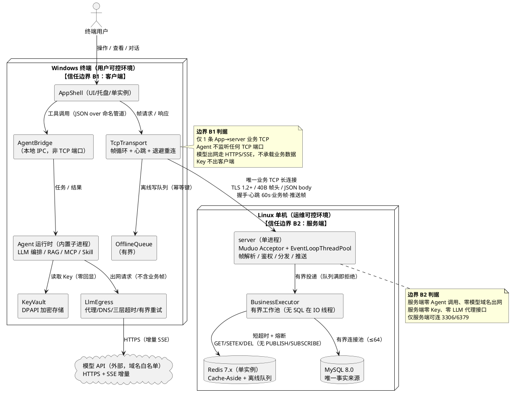
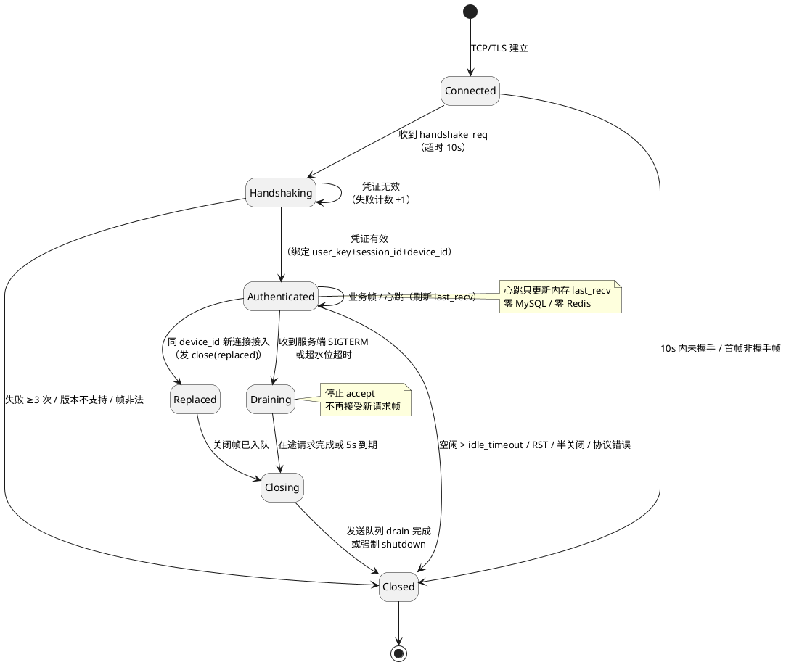
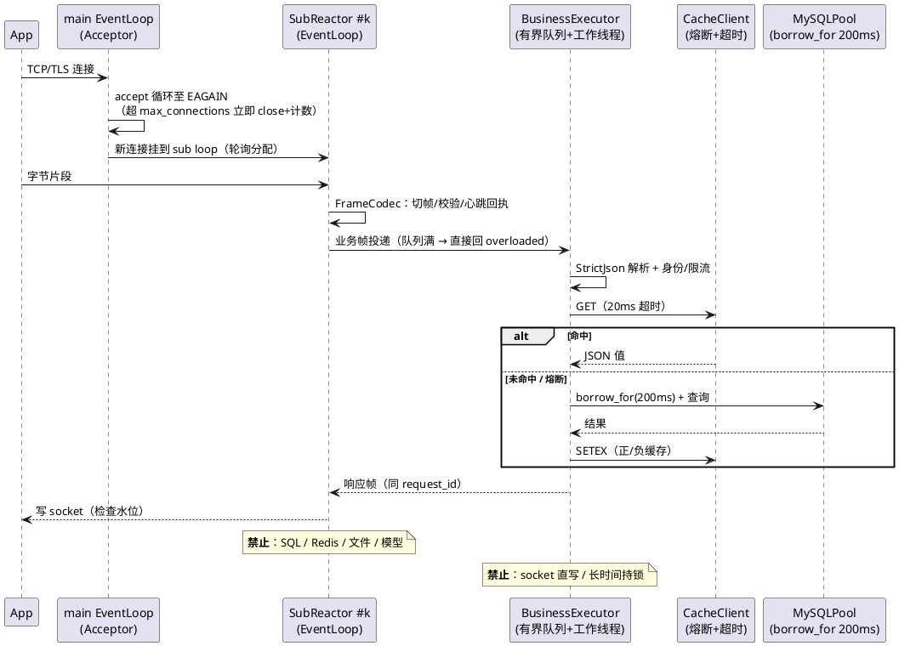
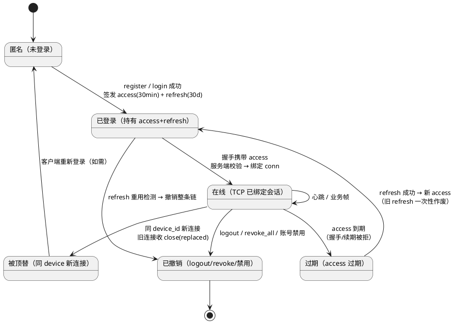
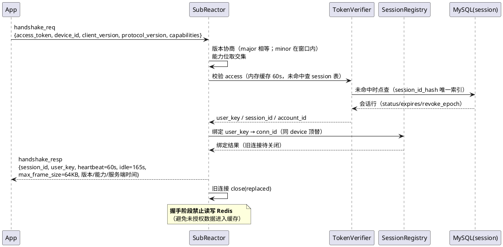
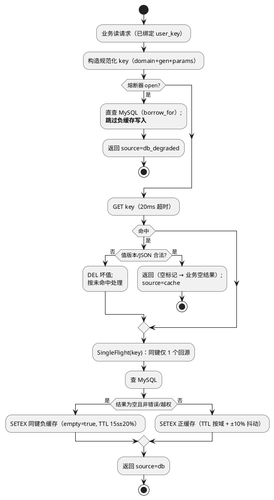
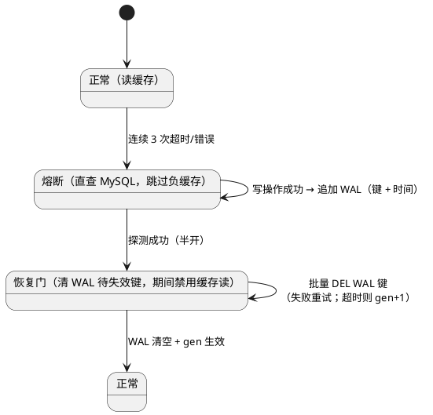
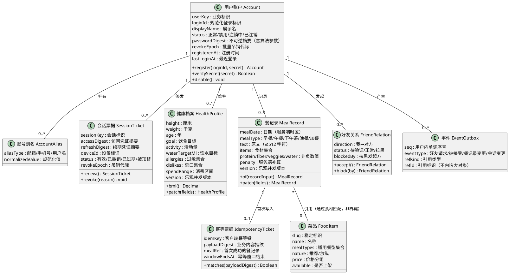
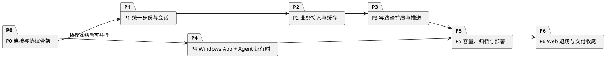

# Windows App · 自研 TCP / C++(Muduo) Linux 单机服务端 · 实现方案（design.md）

> **上游输入**：`.codeartsdoer/specs/app_transport_scale/spec.md`（R6，3157 行，本阶段已完整读取）
> **前序审查**：`.codeartsdoer/specs/p8_backend_check/spec.md`（864 行，已完整读取）
> **代码基线**：`origin/main`（`fc34b0f`）+ PR #2 `origin/feat/backend-p8`（`ab248f3`，base `b5887a2`）+ 只读工作树 `D:\gitclone\p8-verify`
> **本阶段边界**：只产出实现方案（HOW）。不写业务代码、不做任务拆分、不合并 PR、不修改 `p8-verify`。
> **评测标注纪律**：全文任何容量/性能/可靠性结论必须带四选一标注——**【已验证事实】【理论推导】【未验证】【阻断】**。未实测一律不得写成已达标。
> **口径来源**：所有硬约束来自 R6 第 5 章与附录 C/D；本方案只做"如何落地"的裁决，不改变 R6 的任何 WHAT 口径。凡本方案给出更具体数值者，均标注为【设计裁决】并注明后续需实测替换。

---

# 一、需求与存量功能关系分析

## 1.1 需求功能与存量功能对比

### 1.1.1 已实现功能

> 匹配度口径：100%＝语义完整且可直接复用（仅需适配调用方式）；75%＝主体语义具备、缺少目标必需能力；50%＝骨架具备、语义需重写；25%＝仅有可借鉴的形态。

| 需求功能 | 存量功能 | 代码位置 | 匹配度 |
|---|---|---|---|
| 餐记录幂等裁决（同键同内容返回首次结果、同键异内容冲突） | `MealService::recordMeal` + `IdempotencyDao` 的"餐记录与幂等账本同事务" | `server/http/service/MealService.cc`、`server/http/dao/IdempotencyDao.cc`、`server/http/dao/MealDao.cc` | 100% |
| 健康档案读取（默认档案 + BMI 现算 + 来源标记） | `ProfileService::getProfile` | `server/http/service/ProfileService.cc`、`server/http/dao/ProfileDao.cc` | 100% |
| 健康档案部分更新（未提交字段不变、BMI 随身高体重重算） | `ProfileService::patchProfile` | 同上 | 100% |
| 当日营养缺口（`gap = max(0, target - intake)`） | `StatsService::nutritionGap` | `server/http/service/StatsService.cc` | 100% |
| 周统计（平均健康分、记录天数、三餐齐全天数、积分、连续天数） | `StatsService::weeklyStats` + `HealthScore.h` | `server/http/service/StatsService.cc`、`server/http/service/HealthScore.h` | 100% |
| 菜单（按餐型过滤）与菜品搜索（过敏/忌口过滤 + 命中排序） | `FoodService::menu` / `FoodService::search` | `server/http/service/FoodService.cc`、`server/http/dao/FoodDao.cc` | 100% |
| 菜品目录只读（16 道种子 + 定价分组） | `foods` 表 + `foods_seed.sql` | `server/http/migrations/foods_seed.sql`、`server/http/migrations/001_p8_business.sql` | 100% |
| 好友列表（仅 status=2，正反双向合并去重） | `FriendService::friends` | `server/http/service/FriendService.cc` | 100% |
| 好友排行（含本人、仅好友、名次连续、周/当日两种 scope） | `RankingService::friendRanking` | `server/http/service/RankingService.cc`、`server/http/dao/RankingDao.cc` | 100% |
| 统一结果语义（`status` 枚举 + JSON data + message） | `ServiceResult` | `server/http/service/ServiceResult.h` | 100% |
| JSON 编解码基础设施（C++ `nlohmann::json`、Python `json`、`{ok,error,message}` 信封） | 全链路既有编码方式 | `server/http/HttpUtil.h:11-44`、`server/http/JsonUtil.h`、`agent/`（Python `json`） | 75% |
| MySQL 连接池（限时借用 + 容量自愈，断连丢弃重建） | `MySQLPool::borrow_for` / `returnConn`，容量上限不可越界 | `server/database/MySQLPool.h:16-40`、`server/database/MySQLPool.cc` | 75% |
| Redis 连接池骨架（多连接复用、无 pub/sub） | `Redis` 的 `borrow/returnConn`，仅 `lpush/rpop/getLen` | `server/database/Redis.h:9-30` | 25% |
| 业务字段与错误码契约（档案/餐记录/统计/菜单/排行/好友字段语义） | P8 响应体与前端消费字段 | `server/http/controller/*`、`server/http/HttpUtil.h`、`agent-adapter.js`、`app.js` | 75% |
| Agent 能力本体（LLM 编排、RAG、MCP、Skill 市场、工具链、本地 SQLite） | `agent/` 全部能力模块 | `agent/llm/`、`agent/rag/`、`agent/mcp/`、`agent/skills/market.py`、`agent/tools/` | 100% |
| 客户端模型出网骨架（直连 `base_url + /chat/completions`、代理三档、SSE `data:` 解析、`rule-fallback`） | `OpenAICompatibleProvider` | `agent/llm/gateway.py:44-56, 418-450, 481-545` | 75% |
| Agent 工具到业务数据的语义映射（10 个业务方法 + `source` 标记） | `ServiceClient`（HTTP 形态需替换，语义可继承） | `agent/data/service_client.py:103-311` | 50%（仅语义） |
| P7 socket 生命周期骨架（`TCP_NODELAY`、非阻塞 fd、读写/关闭） | `TcpServer`/`Connection` 的 fd 设置与关闭路径 | `server/net/TcpServer.h`、`server/net/Connection.h:10-30`、`server/net/Connection.cc` | 25%（约 45–70 行可搬移，见 1.2.3） |

### 1.1.2 需要扩展的功能

| 需求功能 | 存量功能 | 差异说明 | 扩展方向 |
|---|---|---|---|
| 统一身份（注册/登录/短期访问凭证/续期/撤销/多设备） | P7 `user` 表（无盐 `sha256` 摘要）+ 登录仅返回整型 `id`；P8 静态 Bearer + `u_demo` 白名单 | ①输入输出：无票据、无会话对象、无吊销入口；②业务逻辑：身份来源是"客户端可自填 uid / 环境变量 Token"；③边界：无失败锁定、无设备维度、无密码重置 | 新建 `account`/`session` 表与 `IdentityService`；密码哈希改为 `scrypt`（OpenSSL 3.0）并支持登录时惰性重哈希；业务主键改为 `user_key`（ULID 字符串），P8 `Service/DAO` 的 `agentUid` 形参语义原位替换 |
| 餐记录编辑 / 删除（main 侧仅改浏览器 `localStorage`） | P8 只有 `POST/GET /meals` | ①输入输出：无 `PATCH`/`DELETE`、无版本/乐观并发字段；②业务逻辑：删改必须联动统计与幂等；③边界：历史记录可变后周统计口径需重算 | `MealService` 增加 `patchMeal`/`deleteMeal`（复用 `MealDao`）；写后 DEL 扩展失效清单（见 2.3.4）；`meal_records` 增 `updated_at`/`version` |
| 好友双向关系与反查 | `friend` 表仅单向 `uk_user_friend(user_id, friend_id)`，`status` 0–3 | ①输入输出：无"谁加了我"方向；②业务逻辑：拉黑需双端可见；③边界：P7 冻结不得改其表 | 新表 `friend_relation`（双行边 + `blocked_by`），P7→新表一次性迁移任务（显式登记），P7 只读不改 |
| 在线状态与跨连接通知 | P7 `user.state` 行标记 + `UPDATE user SET state = 0;` 全表更新 + 进程内 `m_user_conn` | ①输入输出：在线状态落 MySQL 高频行；②业务逻辑：无事件序号、无离线补拉；③边界：禁 pub/sub、禁 Redis TTL 判活 | 内存 `SessionRegistry`（`user_key → {conn_id}`）+ 推送帧 + 事件序号 + 拉取补齐；`user.state` 降级为不影响在线判定的展示位或直接废弃 |
| 心跳 | P7 客户端 20s `{"type":0}`、服务端 20s 扫描 + 60s `isIdle` 回收、客户端 60s 无数据即退出且无重连 | ①输入输出：无握手下发参数、无回执序号；②业务逻辑：扫描式回收，超时值等于心跳周期存在误杀；③边界：心跳路径未验证零落库 | IO 线程内纯内存回执（`last_recv` 单调时钟）；周期默认 60s（握手下发）；空闲超时默认 165s；每 sub Reactor 1s 粒度巡检 |
| 传输分帧 | P7 `find('\n')` 分帧 + 64KB 整体读缓冲，超限即断连 | ①输入输出：无长度字段、无魔数、无校验；②业务逻辑：一次 read 当一条消息；③边界：无最大帧长、无发送水位 | 新建长度前缀帧编解码库（定长 40B 头 + body + CRC32C），见 2.2.2；读缓冲按 `header+body` 精确消费 |
| 传输加密与身份校验 | P7/P8 均为明文；P8 未启用 OpenSSL | ①输入输出：无 TLS 握手、无证书校验；②业务逻辑：无 SPKI 固定；③边界：无"跳过校验"开关的构建隔离 | Muduo SSL 模式（OpenSSL 1.1.1+/3.0，TLS 1.2 最低、优先 1.3）+ 服务端证书 + 客户端 SPKI 指纹固定，见 2.1.4 |
| Redis 缓存能力 | `Redis` 仅 3 个数据命令，无 `GET/SET/SETEX/DEL/EXISTS/MGET` | ①输入输出：无法读写 KV；②业务逻辑：无 TTL、无负缓存、无单飞、无失效；③边界：无熔断与降级 | 扩命令层（`GET/SETEX/DEL/MGET/EXISTS/EVAL` 不启用脚本）、`CacheClient` 封装超时/错误分类/熔断、`TtlPolicy`、`SingleFlight`、`InvalidationSet` |
| 业务 QPS 与连接解耦 | P8 固定线程池 W + 无界队列 + backlog=5 | ①输入输出：并发上限=W、排队无界；②业务逻辑：工作线程内同步查库；③边界：backlog 远小于 `somaxconn` | Muduo 主从 Reactor + 有界业务池 + 有界 DB 池 + 显式 backlog，见 2.1.4 |
| Agent 数据访问通道 | `ServiceClient` 用 `urllib` 反向调 `:8080`，10 个业务方法，未配置地址回退 mock | ①输入输出：HTTP 端点 → 帧方法；②业务逻辑：mock 冒充真实数据；③边界：无跳数上限、无请求 ID 贯通 | 新建 Agent 数据代理（IPC → 帧），移除 `:8080` 直连；`source` 语义保留但删除 mock 冒充路径 |
| 客户端形态 | 静态 `index.html`/`app.js`/`agent-adapter.js` 由 `http.server :4173` 托管 | ①输入输出：浏览器 DOM + `localStorage`；②业务逻辑：会话状态前端自持；③边界：无离线队列、无单实例、无托盘 | Windows App 新建（UI + TCP 帧循环 + Agent 运行时 + 本地加密存储 + 离线队列） |
| 部署与可观测 | 无 systemd/内核参数/指标/压测脚本 | ①输入输出：无 healthz、无 metrics；②业务逻辑：日志为自由文本；③边界：无 fd/backlog 联动依据 | systemd 单元 + `sysctl` 检查单 + 内置 `/metrics`（文本）+ 采集脚本 + 自研协议压测客户端 |
| 菜单/排行/好友缓存语义 | 无任何缓存动作 | ①输入输出：无缓存键；②业务逻辑：写路径只提交 MySQL；③边界：无失效清单 | 见 2.3.4（键模板、TTL、失效清单、降级与整代作废） |

### 1.1.3 需要新增的功能或接口

**A. 传输与协议层（新建）**

1. `FrameCodec`：定长头编解码 + 长度校验 + CRC32C 校验 + 粘包循环切分；输入字节流片段，输出完整帧序列或"需更多字节/非法帧"判定；核心逻辑为"先读满头 → 校验魔数/版本/类型/标志/头长/body_len → 超限拒绝 → 读满 body → 校验 CRC"。
2. `FrameDispatcher`：按 `frame_type` 与 JSON body 的 `method` 分发到握手/心跳/业务/推送确认路径；依赖 `SessionRegistry`、`RateLimiter`、`BusinessExecutor`。
3. `StrictJson`：UTF-8 合法性、重复键、深度上限、数值有限性、尾随内容、`>2^53-1` 转字符串；错误产出 `invalid_json` + `reason` 六分类。
4. `ConnectionState`：连接状态机（见 2.1.4.1）、关闭原因码、每连接读/写水位与帧计数。

**B. 身份与会话层（新建）**

5. `IdentityService`：注册、登录、刷新、登出、全量撤销、改密、禁用；输出访问凭证与续期凭证。
6. `TokenVerifier`：访问凭证 → 会话（内存优先，未命中查 MySQL 会话表）；输出 `account_id/user_key/session_id/scope`。
7. `SessionRegistry`：`user_key → 活跃连接集合`，支持顶替、多设备上限、事件序号分配；纯内存。

**C. 缓存层（新建）**

8. `CacheClient`：Redis KV 命令封装（超时、错误分类、熔断、pipeline 多键 DEL）。
9. `CacheKeyBuilder`：键规范化（排序/去空白/统一大小写/日期标准化/分页夹取/集合排序/自由文本哈希）。
10. `SingleFlight`：进程内同键回源合并 + 有界等待。
11. `InvalidationSet`：写操作的键集合显式枚举（禁 `KEYS/SCAN`）；`PendingInvalidationWal`：Redis 不可用时的本地待失效日志 + 恢复门。

**D. 客户端（新建）**

12. `AppShell`：Windows 原生壳 + 托盘常驻 + 单实例锁 + 开机自启可选 + 页面资源本地化。
13. `TcpTransport`：帧循环、心跳、退避重连、离线队列、写入幂等键。
14. `AgentBridge`：Agent 工具调用 → 帧请求 → 响应回注（JSON over 命名管道）。
15. `KeyVault`：DPAPI 加密存储、来源标记、指纹审计、撤销/轮换。
16. `LlmEgress`：模型出网（代理/DNS/证书分类、三层超时、有界重试、取消、有界增量缓冲）。
17. `OfflineQueue`：有界队列（幂等键 + 载荷 + 重试次数 + 最后错误）。

**E. 服务端业务扩展（在复用模块上新增）**

18. 餐记录 `patch/delete`（新方法，复用 `MealDao`）。
19. 好友 `request/accept/remove/block`（新表 + 新 DAO）。
20. 推送帧与拉取：`sync.pull`（按事件序号增量返回）、`push.ack`。
21. 健康检查 `healthz` 与指标 `/metrics`（回环端口，不经 TCP 帧）。

**F. 运维与验证（新建）**

22. systemd 单元、`sysctl` 检查单、配置模板、迁移与回滚脚本（在 P8 `run_migration.sh` 基础上扩展）。
23. 自研协议压测客户端 + 数据集生成器 + 压测报告模板。
24. 归档任务（分区切换 + 冷表迁移 + 幂等账本清理）。

## 1.2 存量功能详细分析

### 1.2.1 P8 业务层（`service/` + `dao/`）——保留主体

| 模块 | 接口契约（现有） | 业务规则要点 | 扩展点 | 约束 | 结论 |
|---|---|---|---|---|---|
| `MealService` | `recordMeal(uid, body)`、`recentMeals(uid, days)` | 幂等键必填；餐记录与幂等账本同事务；`payload_hash = SHA256(canonical{date,type,text})`；同键异内容 → `Conflict`；空日期补本地当天；文本为空时由 `items` 拼接 | 新增 `patchMeal`/`deleteMeal`；写后 DEL 钩子 | 内部直接使用 `MySQLPool`，**无连接超时参数**（依赖 `borrow()` 无限等待），在业务池内必须改用 `borrow_for` | 保留，新增两个方法与失效钩子 |
| `ProfileService` | `getProfile(uid)`、`patchProfile(uid, body)` | 无档案返回默认对象而非错误；部分更新；BMI 服务端现算；字段截断与枚举校验 | 无（仅接入缓存） | 读路径无缓存；返回体已含 `source` | 保留，外包缓存 |
| `StatsService` | `nutritionGap(uid, date)`、`weeklyStats(uid)` | 缺口恒等式；健康分严格复刻前端算法；日期按服务端本地时区 | 无（接入缓存 + 写后失效） | 周统计需对 `meal_records` 做范围聚合，依赖 `idx_uid_date` | 保留 |
| `FoodService` | `menu(uid, mealType)`、`search(uid, q, tags, mealType, limit, nature)` | 过敏/忌口过滤；命中数排序；`defaultUserId` 兜底（契约缺口） | 帧方法不再接受"无 uid"调用（身份来自握手） | 构造函数持有 `defaultUserId`，在新链路上必须改为"当前会话 user_key" | 保留，构造参数改为显式传 uid |
| `FriendService` | `friends(uid)` | 仅 `status=2`；正反合并去重；展示名回退 `health_profile.name → user.name` | 好友增删改（新 DAO） | 无写入方法 | 保留 + 新增写方法 |
| `RankingService` | `friendRanking(uid, scope)` | 含本人；仅好友；名次连续；复用 `HealthScore` | 无 | `scoreFor` 逐用户取分（好友数上限需约束） | 保留，加缓存与好友数上限 |

**关键边界（已验证事实）**：`service/` 与 `dao/` 内 `grep -l httplib` 零命中，业务逻辑不依赖传输层，因此可在"有界业务工作池"线程中直接调用，**不需要**为引入 Muduo 做业务层重写。

**必须在接入时统一修正的三处**（否则违反 R6）：

1. `MySQLPool::borrow()`（无限等待）不得在新业务池使用，统一改 `borrow_for(200ms)`，超时返回 `service_unavailable`。
2. `ServiceResult::Status` 需扩展 `RateLimited`/`Overloaded`/`NotFound`，映射到新错误码（不得改写既有 5 个状态的语义）。
3. `FoodService` 的 `defaultUserId` 机制必须下线：身份只来自握手绑定（否则等于保留"客户端指定用户"）。

### 1.2.2 P8 HTTP 语义层——重写

| 文件 | 现有职责 | 重写原因 | 新归属 |
|---|---|---|---|
| `server/http/main_http.cc`（10,122B） | 端口/线程池/DB 池/路由注册/信号处理/健康检查 | `httplib` 固定线程池、无界队列、backlog 未显式设置、明文 HTTP/1.1，与 Muduo 主从 Reactor 是两种骨架 | 拆为 `server/tcp/main.cc`（Muduo 启动）+ `server/app/HttpAdmin.cc`（回环 healthz/metrics） |
| `server/http/Router.cc/.h` | 正则路由 + Handler 绑定 | 依赖 `httplib::Request/Response`，帧模型无 HTTP 语义 | 替换为 `FrameDispatcher` 的 `method → Handler` 表 |
| `server/http/Auth.cc/.h` | 静态 Token 常量时间比较 + `u_demo` 白名单 | 身份必须由新统一身份体系签发；白名单不可承载百万注册 | 替换为 `TokenVerifier` + `SessionRegistry` |
| `server/http/controller/*`（6 组） | HTTP 参数解析、UID 形状校验、状态码映射、JSON 渲染 | 全部与 `httplib` 强耦合 | 替换为帧 Handler（薄适配层：JSON → Service 调用 → JSON） |
| `server/http/HttpUtil.h`、`DbConn.h`、`DateUtil.h`、`Utf8Util.h`、`JsonUtil.h` | 响应信封、池借用 RAII、日期、UTF-8 截断、JSON 输出 | `DbConn` 依赖 `httplib` 响应语义；其余可保留 | `DateUtil`/`Utf8Util`/`JsonUtil` 保留复用；`DbConn` 重写为 `PooledConn`（帧无关） |
| `web/httplib.h` | HTTP 库单体头 | 新链路不再需要 | 保留在仓库供 P8 冻结/对照，不进新构建目标 |

### 1.2.3 P7 网络层——约 10–15% 代码级复用

| 文件 | 现状 | 可复用内容 | 不可复用内容 | 结论 |
|---|---|---|---|---|
| `server/net/TcpServer.h/.cc` | socket 创建、`SO_REUSEADDR`、`TCP_NODELAY`、`bind/listen(1024)`、非阻塞 | socket 选项设置与错误处理骨架（约 20–30 行） | 自管 listen fd 与 accept 循环（Muduo `Acceptor` 接管） | 参考搬移 |
| `server/net/Connection.h/.cc` | fd 生命周期、`recvData` 循环读到 `EAGAIN`、`sendData`/`flush`、`closeFd`、64KB 缓冲上限 | fd 生命周期与关闭路径（约 25–40 行） | `find('\n')` 分帧、整段读缓冲、无发送水位 | 参考搬移 + 全面重写缓冲与分帧 |
| `server/reactor/Reactor.*` | 自管 `epoll_wait`、eventfd、按最少连接派发、20s 扫描 + 60s 回收 | 架构思路（主从分层、ET、eventfd 唤醒、按连接数派发） | `epoll_wait` 主循环、`MAX_EVENTS=1024`、扫描式心跳、reactor 内同步 SQL | **不复用**，Muduo 承载 |
| `server/service/ChatService.cc` | 13 条 `type:0–12` 路由、登录返回整型 id、`user.state` 在线位、reactor 线程内 SQL | 无（协议/身份/在线判定全部冲突） | 全量 | 不复用 |
| `server/model/UserModel.cc` | `user` 表读写、`UPDATE user SET state = 0` 全表更新 | 可作为迁移期数据读取参考 | 在线状态语义 | 不复用 |

**量化结论**：P7 是**架构参照物**，不是可移植底座（与 R6 §7.4.2 一致）。搬移比例按静态行数估算为【理论推导】约 10–15%，需在实现阶段按实际 diff 复核。

### 1.2.4 Agent 能力本体——保留，形态与出网需改造

| 模块 | 现状 | 目标差异 | 结论 |
|---|---|---|---|
| `agent/llm/gateway.py` | `urllib` 直连 `base_url + /chat/completions`，`Authorization: Bearer <env var>`；代理三档；单值超时（chat 60s / stream 90s）；SSE `data:` 行解析 + `[DONE]`；`_describe_error` 直接写 stderr | Key 改为本地加密存储读取；增加连接/首帧/空闲三层超时、有界重试、取消、失败分类、日志脱敏、域名白名单、证书校验开关禁止 | 保留并改造 |
| `agent/data/service_client.py` | 10 个业务 HTTP 方法 + 未配置即 mock | 移除 HTTP 直连，改为 IPC → 帧；`source` 语义保留；删除 mock 冒充 | 重写数据通道 |
| `agent/server.py` | `ThreadingHTTPServer:8787` + SSE、宽松 CORS、无鉴权 | 不再对外监听；开发者模式仅回环且默认关闭 | 重写入口 |
| `agent/rag/`、`mcp/`、`skills/`、`tools/`、`core/` | 能力本体 | 无删除、无降级 | 保留 |
| Agent 本地 SQLite（`agent/data/db.py`、`schema.sql`） | 会话/记忆/RAG 索引 | 明确"本地可丢失、非业务真相"；不得落盘 Key/Authorization | 保留 + 边界声明 |

### 1.2.5 存量必须继承的约束（不得在设计中被放宽）

1. **业务语义不变**：档案字段、餐次枚举、营养缺口恒等式、健康分算法、菜单 16 道种子/展示 14 道/70–30 随机/消费水平 20–35、排行规则、好友 status 语义。
2. **错误码信封兼容**：外部错误必须仍可被客户端映射为 `{ok:false, error, message}` 语义（帧 `error_code` + JSON body 同时携带可读码）。
3. **幂等语义**：同键同内容重放返回首次结果（含首次营养值权威）；同键异内容拒绝；不同键同内容记为两条。
4. **P7 冻结**：`server/reactor`、`server/net`、`server/service`、`user`/`friend` 表在 P7 进程内零行为变更；P7 回归必须保持全绿。
5. **禁 pub/sub、单 Redis 实例、仅服务端可连**：新缓存层的失效只能由服务端写路径 DEL（见 2.3.4）。
6. **JSON 唯一**：仓库不得出现 `.proto`、protobuf/MessagePack/CBOR 依赖、编码开关或帧头"编码类型"位。
7. **服务端零 LLM**：服务端不得出现模型域名出网、模型 SDK、Key 读取路径、`llm_proxy` 类接口。

## 1.3 改造类型与工作量边界（模块数，非工期）

> 口径：沿用 R6 §7.3 的 61 个模块划分与主改造类型；本表只做"设计阶段承接方式"归类，**不是人天估算**。

| 改造类型 | 模块数 | 设计承接方式 | 对应本文章节 |
|---|---|---|---|
| 新建 | 35 | 新建独立模块/目标；不复用既有语义 | 2.1.3、2.2、2.3 |
| 重构 | 10 | 保留业务语义，替换传输/身份/数据通道/表键 | 1.2.1–1.2.4、2.1.3 |
| 配置 | 7 | 构建依赖（Muduo/OpenSSL）、内核参数、部署单元、日志与扫描门禁 | 2.4 |
| 验证 | 9 | 压测/故障注入/协议评审/复用边界复核 | 2.5 |

**复用边界结论（设计裁决）**：

- **保留主体**：P8 `service/`（6 个 Service）+ `dao/`（7 个 DAO）+ `MySQLPool`（改造为限时借用）+ 迁移脚本 + `foods` 种子；Agent 全部能力本体；P7 `Redis` 连接池骨架与 `Connection` fd 生命周期骨架。
- **重写**：P8 HTTP 语义层（`main_http`/`Router`/`Auth`/6 个 Controller/`DbConn`）；P7 自研 Reactor 与 `\n` 分帧；测试与压测产物。
- **丢弃**：Web 渲染层（`index.html`/`app.js`/`agent-adapter.js`）、`transit`（WebSocket 桥）、`client/`（控制台客户端）；其**契约字段与错误码**作为新客户端的需求输入保留。
- **新增最大缺口**：帧协议与连接层、统一身份、Cache-Aside 缓存层、推送/拉取与在线路由、Windows App 与 Agent 运行时、客户端 Key 保管与出网前置、部署与压测。

## 1.4 需求到技术组件的映射（可追溯）

| R6 需求域 | 主要需求编号 | 承接技术组件 | 章节 |
|---|---|---|---|
| Windows App 完全替代 Web | §5.1.1 | `AppShell`、`TcpTransport`、`OfflineQueue` | 2.1.3、2.2.5 |
| 自研 TCP 完整帧协议 | §5.2.1 规则 1–22、REQ-REL-08、REQ-PERF-10/12 | `FrameCodec`、`StrictJson`、`FrameDispatcher` | 2.2.2、2.1.4.2 |
| C++/Muduo 主从 Reactor + Linux 单机 | §5.3.1、REQ-PERF-06 | `TcpServerApp`（Acceptor + EventLoopThreadPool）、`BusinessExecutor` | 2.1.4.3 |
| 三档容量口径 | §5.4、REQ-PERF-01/02/03/04/05/08 | 容量模型 + 压测客户端 + 指标 | 2.5 |
| 在线状态与推送（禁 WebSocket/pub-sub） | §5.5、REQ-STATE-01/02 | `SessionRegistry`、推送帧、`sync.pull` | 2.1.4.5 |
| 统一身份 | §5.6、REQ-SEC-02/03/04 | `IdentityService`、`TokenVerifier`、`session` 表 | 2.1.4.4、2.2.3 |
| Agent 链路重排 + 客户端 Key | §5.7、§5.13、REQ-SEC-07/09/10、REQ-REL-09 | `AgentBridge`、`KeyVault`、`LlmEgress` | 2.1.4.6 |
| MySQL + Redis 边界与 Cache-Aside | §5.9、§5.12、REQ-REL-07/10、REQ-COMP-05 | `CacheClient`、`CacheKeyBuilder`、`InvalidationSet`、表设计 | 2.3 |
| 百万注册数据规模 | §5.10、REQ-PERF-05 | 分区/归档/索引/写入预算 | 2.3.3 |
| 压测与宣称纪律 | §5.11 | 场景矩阵 + 报告模板 + 三态判定 | 2.5 |
| 部署与运维 | §5.5.3、REQ-REL-05/06、REQ-MNT-01/03 | systemd + sysctl + 日志 + healthz/metrics | 2.4 |
---

# 二、增量设计方案

## 2.1 实现模型

### 2.1.1 上下文视图

**部署与信任边界（PlantUML）**



**通信协议与频率**

| 链路 | 协议 | 方向 | 频率/规模 | 信任假设 |
|---|---|---|---|---|
| App → server | 自研 TCP over TLS，40B 定长头 + JSON body | 双向长连接 | 1 条/设备；心跳 60s；业务按需 | 客户端不可信：所有身份以握手绑定为准 |
| App ↔ Agent 运行时 | Windows 命名管道（DACL 限定当前用户 SID）+ JSON | 双向 IPC | 每工具调用 1 次往返 | 同机同用户进程，需 ACL + 版本自检 |
| Agent → 模型 API | HTTPS（TLS 1.2+，证书校验开启），增量 SSE | 出站 | 受本地并发上限约束 | 模型侧不可信：错误报文禁止透传 |
| server → MySQL | MySQL 协议（TCP 3306 或 unix socket） | 双向 | 有界池 ≤64 连接 | 仅服务端可达 |
| server → Redis | RESP（TCP 6379） | 双向 | 短超时 20ms、熔断 | 仅服务端可达，无 pub/sub |
| 运维 → server | 回环 `127.0.0.1:9080` `/healthz`、`/metrics` | 单向读 | 10s 一次 | 仅回环，不进业务链 |

> **禁止项（设计期固化）**：服务端不得出现任何指向客户端/Agent 的出站连接或地址配置；客户端不得出现 `:8000`/`:8080`/`:8787` 直连配置；569 端口的 Redis 与 3306 的 MySQL 只允许服务端网段/本机访问（`bind` + 防火墙双保险）。

### 2.1.2 进程与线程拓扑

**进程拓扑（单机 Linux）**

```
┌──────────────────────────── Linux 主机（32C/64G/NVMe，示例规格）────────────────────────────┐
│                                                                                          │
│  eat-server.service (systemd, 1 进程)                                                    │
│    ├─ main EventLoop 线程（Acceptor：accept + 分配）                                      │
│    ├─ N_sub 个 SubReactor 线程（EventLoop：读/写/帧解析/心跳回执/关闭）                    │
│    ├─ BusinessExecutor 工作线程池（业务分发 → Service → Cache/MySQL）                     │
│    ├─ DB 池（≤64 连接，业务线程内限时借用）                                               │
│    ├─ Redis 客户端（短超时 + 熔断，业务线程内调用）                                       │
│    ├─ 定时器线程（Muduo 各 loop 的 runEvery：空闲巡检、水位巡检、指标聚合）                │
│    └─ Admin 回环 HTTP（healthz/metrics，1 线程）                                         │
│                                                                                          │
│  mysqld（单实例）         redis-server（单实例，bind 127.0.0.1，禁 pub/sub 使用）          │
│  eat-archive.timer/cron（低峰归档，独立事务、分批限速）                                    │
└──────────────────────────────────────────────────────────────────────────────────────────┘
```

**线程与职责表**

| 线程/池 | 数量（默认） | 职责 | 明确禁止 |
|---|---|---|---|
| main EventLoop | 1 | `Acceptor` 监听/accept、把新连接挂到 sub loop、拒绝超限连接 | 解析业务 JSON、查库、调 Redis、写日志阻塞 |
| SubReactor（`EventLoopThreadPool`） | `min(16, max(4, 物理核/2))`，可配 | 读写、帧边界校验（头/长度/CRC）、心跳回执、关闭、发送队列水位 | 同步 SQL/Redis、长耗时 JSON 解析、文件 IO |
| 业务工作池（`BusinessExecutor`） | 16（可配 8–64） | JSON 严格解析、鉴权校验（内存优先）、Service 调用、缓存读写、组装响应帧 | 直接操作 socket、阻塞等待模型（不存在此路径） |
| Admin 线程 | 1 | `/healthz`、`/metrics`（只读快照，不查业务表） | 承担业务请求 |
| 归档任务 | 独立进程/定时器 | 分区切换、冷表迁移、幂等清理（分批 + `LIMIT` + sleep） | 高峰执行、长事务 |

**数据流（一次读请求）**

```
App → TLS → SubReactor：读字节 → FrameCodec 切出完整帧
  → 帧边界校验（魔数/版本/类型/标志/头长/body_len≤max/CRC）
  → 心跳？是→就地回执（纯内存，零 DB/Redis）
  → 否→投递 BusinessExecutor（有界队列；满则回 overloaded）
BusinessExecutor：
  → StrictJson 解析（UTF-8/重复键/深度/数值/尾随）
  → 身份取 ConnContext（禁用 body 内 uid）
  → 限流（连接/用户/全局）
  → Service（Profile/Meal/Stats/Food/Friend/Ranking）
      → CacheClient.GET（20ms 超时；熔断时直查 DB）
      → 命中：返回（source=cache）
      → 未命中：SingleFlight 回源 → MySQL（borrow_for 200ms）→ SETEX（正/负缓存）
  → 结果 → 响应帧（同 request_id）→ SubReactor 发送队列
SubReactor：水位检查 → 写 socket → 水位回落
```

**内存预算（100 万连接，压测上限档）**

| 项 | 单连接估算 | 100 万连接 | 标注 |
|---|---|---|---|
| `ConnContext`（状态/会话/计数器/时间戳） | ≈ 256–384 B | 0.26–0.38 GB | 【理论推导】 |
| 读缓冲（初始 4KB，按帧增长，上限 `max_frame_size+40`） | 常态 ≈ 4KB，空载合计 | 4 GB | 【理论推导】，须以阶梯压测实测替换 |
| 发送队列（常态空，高水位 256KB 仅慢客户端） | 空载 ≈ 0 | ≈ 0（慢客户端另计） | 【理论推导】 |
| TLS 会话状态（OpenSSL per-conn） | ≈ 2–4 KB | 2–4 GB | 【理论推导】 |
| 内核 socket 缓冲 | ≈ 1.5–3 KB | 1.5–3 GB | 【理论推导】（`tcp_rmem/wmem` 需调小） |
| 合计（应用 + 内核） | — | **≈ 8–12 GB**（不含业务堆与页缓存） | 【理论推导】，必须实测 |

> 降缓冲策略：读缓冲上限与发送水位均按百分位自适应（80% 连接使用 4KB 档，仅活跃连接升至 64KB）；TLS 使用 session ticket 减少全握手比例。

### 2.1.3 目录与模块划分（新建 / 重构 / 复用）

**服务端目录（目标态）**

```
server/
  tcp/                      # 【新建】Muduo 接入层
    main.cc                 #   进程入口：配置加载、TLS、启动/信号
    TcpServerApp.{h,cc}     #   Acceptor + EventLoopThreadPool + 连接回调
    FrameCodec.{h,cc}       #   40B 定长头编解码 + 粘包/半包状态机 + CRC32C
    StrictJson.{h,cc}       #   严格 JSON 校验（六类 reason）
    FrameDispatcher.{h,cc}  #   frame_type/method → handler 表
    ConnContext.{h,cc}      #   连接态、会话绑定、水位、计数
    HeartbeatMonitor.{h,cc} #   60s 心跳回执 + 165s 空闲回收（纯内存）
    Backpressure.{h,cc}     #   每连接/全局发送水位与读暂停
    RateLimiter.{h,cc}      #   连接/用户/全局令牌桶 + 握手限速
  identity/                 # 【新建】统一身份
    IdentityService.{h,cc}  #   注册/登录/刷新/登出/撤销/改密
    TokenVerifier.{h,cc}    #   凭证 → 会话（内存优先）
    SessionRegistry.{h,cc}  #   user_key → 连接集合；事件序号；顶替
    PasswordHasher.{h,cc}   #   scrypt（OpenSSL EVP_PBE_scrypt）
  cache/                    # 【新建】Cache-Aside
    CacheClient.{h,cc}      #   GET/SETEX/DEL/MGET + 超时/分类/熔断
    CacheKeyBuilder.{h,cc}  #   键规范化 + 自由文本哈希
    SingleFlight.{h,cc}     #   进程内同键回源合并
    InvalidationSet.{h,cc}  #   写操作 → 键集合（显式枚举）
    PendingInvalidationWal.{h,cc}
    TtlPolicy.h             #   各域 TTL/抖动/负缓存参数
  app/                      # 【新建】业务适配层
    handlers/               #   每个业务域一个薄 Handler（JSON → Service）
    BusinessExecutor.{h,cc} #   有界队列 + 工作线程 + 超时/拒绝
    ServiceRegistry.{h,cc}  #   组装 Service（持有 MySQLPool/CacheClient）
    HttpAdmin.{h,cc}        #   回环 healthz / metrics
    Metrics.{h,cc}          #   计数器/直方图（原子，无锁读快照）
  http/                     # 【重构边界】service/、dao/ 保留；其余冻结不参与新构建
  database/                 # 【重构】MySQLPool 增限时借用默认；Redis 扩命令层
  net/ reactor/ service/ model/  # 【复用参照】P7 冻结，保留源码，不链接进新目标
shared/protocol/            # 【新建】帧/错误码/方法常量（server、client、loadtest 共用）
third_party/muduo/          # 【新建】vendored 源码 + patches/
migrations/                 # 【新建+复用】
  add/002_identity.sql 003_session.sql 004_friend_relation.sql 005_meal_partition.sql
  keep/001_p8_business.sql foods_seed.sql
deploy/                     # 【新建】systemd/sysctl/配置模板/日志轮转
tests/protocol|load|cache/  # 【新建】帧模糊测试、压测客户端、缓存一致性用例
```

**客户端目录（目标态）**

```
client/
  app/            # 【新建】Windows UI（本地资源）、托盘、单实例、设置页
  transport/      # 【新建】复用 shared/protocol；帧循环/心跳/退避/离线队列
  agentbridge/    # 【新建】命名管道服务端 + 工具调用 → 帧转换 + 跳数上限
  keyvault/       # 【新建】DPAPI 加密存储、来源标记、指纹审计
  llm/            # 【新建】出网封装（代理/DNS/证书/三层超时/重试/取消/有界缓冲）
  ipc/            # 【新建】命名管道协议 + ACL + 版本自检
  agent-runtime/  # 【重构】随包分发 Agent（能力本体不变；入口改为命名管道）
```

**新建 / 重构 / 复用清单（与 R6 模块编号对齐）**

| 处置 | 模块 | 依据 |
|---|---|---|
| **复用（主体不变）** | P8 6 个 Service + 7 个 DAO、`ServiceResult`、`HealthScore`、`foods` 种子、迁移 `001_p8_business.sql`、`MySQLPool`（限时借用改造）、Agent `llm/rag/mcp/skills/tools` 能力本体 | `service/`+`dao/` 零 `httplib` 依赖【已验证事实】 |
| **复用（骨架改造）** | P7 `Redis` 连接池、P7 `Connection` fd 生命周期、`DateUtil/Utf8Util/JsonUtil`、`agent/llm/gateway.py` 出网骨架、`ServiceClient` 的业务字段语义 | 见 1.2.3 / 1.2.4 |
| **重构** | `main_http.cc`、`Router`、`Auth`、6 个 Controller、`DbConn`、`MealService`（增删改）、`FoodService`（去 `defaultUserId`）、`UserModel`（在线位废弃）、`Gateway`（超时/重试/取消）、`server.py`（入口改 IPC） | 传输/身份/形态不兼容 |
| **新建** | `server/tcp/*`、`server/identity/*`、`server/cache/*`、`server/app/*`、`server/HttpAdmin`、`shared/protocol`、`client/*`（全部）、`deploy/*`、`tests/load/*`、`migrations/add/*` | 存量为零（G-41/42/43/45–52/55/56/58/63） |
| **丢弃** | `index.html`/`app.js`/`agent-adapter.js`/`transit/*`/`client/*`（控制台） | Web 退场；WebSocket 桥禁用；控制台非 GUI |
| **冻结（不链接、不修改）** | `server/reactor/*`、`server/net/*`、`server/service/ChatService*`、`server/model/*`、P7 `init.sql` 的 `user`/`friend` | P7 回归必须零行为变更 |

**P8 service+dao 的保留边界（精确到文件级）**

| 保留 | 改造点 | 不得跨界的部分 |
|---|---|---|
| `MealService/ProfileService/StatsService/FoodService/FriendService/RankingService` | 构造参数改为"显式 user_key + CacheClient + MySQLPool"；新增 `patchMeal/deleteMeal/friendWrite` | 不得让 Service 直接依赖 `ConnContext`、帧类型或 JSON 严格校验器 |
| `MealDao/ProfileDao/FoodDao/IdempotencyDao/RankingDao/UserDao` | 表名/列名改为 `user_key`；新增 `version`/`updated_at` 条件更新 | 不得在 DAO 内做缓存（缓存只在 Service 边界） |
| `MySQLPool` | 默认 `borrow_for(200ms)`；新增 `PoolStats`（借出/等待/超时计数） | 不得让连接数随客户端连接数增长 |
| `HttpUtil/ResultRenderer` | 只保留 JSON 信封构造语义 | 不参与帧编解码 |

**P8 HTTP 语义层重写范围**：`main_http.cc`（11KB）、`Router.*`、`Auth.*`、6 个 `*Controller.*`、`DbConn.h`、`ResultRenderer.h` —— 全部由 `tcp/` + `app/handlers/` 替代，**逐行移植业务参数映射规则**（字段名、校验、截断、默认值），不移植 HTTP 形态。

**P7 Reactor 复用（约 10–15%【理论推导】）**：

| 可搬移 | 不可搬移 | 搬移方式 |
|---|---|---|
| `TcpServer` 的 `SO_REUSEADDR`/`TCP_NODELAY`/非阻塞设置（≈20–30 行） | 自建 listen fd + accept 循环（Muduo `Acceptor`） | 复制常量与选项设置到 `TcpServerApp::onConnection` 前置配置 |
| `Connection::closeFd` 与 fd 状态机（≈25–40 行） | `find('\n')` 分帧、整段 64KB 缓冲、无水位写缓冲 | 重写为 `ConnContext::close(reason)` + 发送队列 drain |
| 思路：按连接数派发、ET + eventfd 唤醒 | `epoll_wait` 主循环、`MAX_EVENTS=1024`、20s 扫描心跳 | Muduo 的 `EventLoopThreadPool` + `runEvery` 实现 |

### 2.1.4 实现设计文档

#### 2.1.4.1 连接状态机



状态字段（`ConnContext`）：`state`、`conn_id`（单调递增 uint64）、`reactor_index`、`peer_addr_hash`（脱敏）、`session_id_hash`、`user_key`、`device_id`、`last_recv_mono`、`read_buf_used`、`send_queued_bytes`、`auth_fail_count`、`inflight_business`、`recv_frame_count`、`bad_frame_count`。

#### 2.1.4.2 帧循环：粘包 / 半包 / 拆包 / 超长 / 非法

```plantuml
@startuml
start
:收到字节片段，追加到读缓冲（上限 max_frame_size+40）;
while (读缓冲 ≥ 40B ?) is (是)
  :读取 40B 定长头;
  if (magic != 'EAT1') then (否)
    :计数 + 发送 error(invalid_magic) + close;\nstop
  endif
  if (version 不在支持窗口) then (否)
    :计数 + error(unsupported_version) + close;\nstop
  endif
  if (header_len != 40) then (否)
    :计数 + error(bad_header) + close;\nstop
  endif
  if (frame_type 未知) then (否)
    :计数 + error(unknown_frame_type) + close;\nstop
  endif
  if (flags 非法组合) then (否)
    :计数 + error(bad_flags) + close;\nstop
  endif
  if (body_len > max_frame_size) then (否)
    :**在读 body 前**计数 + error(frame_too_large) + close;\nstop
  endif
  if (读缓冲 < 40 + body_len) then (否)
    :**半包**：保留残余，设置等待超时（5s）;\nbreak
  endif
  :取 body（精确消费 40+body_len）;
  if (CRC32C 校验失败) then (否)
    :计数 + error(checksum_failed) + close;\nstop
  endif
  :分发完整帧（心跳就地回执 / 其余投递业务池）;
  :**粘包**：继续循环处理剩余字节;
endwhile (否)
if (半包等待 > 5s 或缓冲触顶) then (是)
  :计数 + close(frame_wait_timeout / buffer_overflow)
endif
stop
@enduml
```

**规则固化**：

1. 读缓冲按"已消费偏移"滑动，不使用"整段字符串重新 find"；每次 `retrieve` 后压缩到 ≤ 4KB 空闲尾部时再搬移，避免 O(n²) 拷贝。
2. 半包等待超时 5s（可配）；同一连接短时反复半包不重置为有效请求（防慢速攻击）。
3. 拆包错位（`body_len` 与实际 JSON 结构不符，如 JSON 尾随内容）→ 按 `invalid_json:trailing_data` 处理：**帧边界可信时返回错误帧不断连**（连续 3 次断连）。
4. 一次读取最多处理 `MAX_FRAMES_PER_READ = 64` 帧，超出则让出并重新触发（防单连接饿死其它连接）；原始字节全量保留在缓冲，不丢弃（满足"粘包逐帧分发"）。
5. 零长度 body 仅允许 `heartbeat/heartbeat_ack/close/error` 且 `frame_type` 校验先行；请求/响应帧 `body_len=0` → `invalid_json:syntax`。
6. 校验失败与非法帧日志**不输出 body 原文**，只输出 `reason`、偏移、长度、`conn_id`。

#### 2.1.4.3 主从 Reactor 与业务线程边界



**参数与策略（【设计裁决】，需压测复核）**

| 参数 | 默认值 | 依据 | 调整方式 |
|---|---|---|---|
| `sub_reactors` | `min(16, max(4, 物理核/2))` | 每 loop 12.5 万连接（1M/8）时心跳 ≈2,083 帧/s；16 亚 Reactor 在 32 核机上留足业务池核 | 配置 + SIGHUP |
| `business_threads` | 16 | 业务 QPS 峰值假设 1,736/s（人均 30 请求/日 ×10 峰值）÷ 平均 10ms ≈ 174 并发；16 线程留 10× 余量 | 配置 + SIGHUP |
| `business_queue_capacity` | 8192 | 队列 × 平均任务内存 ≈ 数十 MB；满即拒绝（禁止无界） | 配置 + SIGHUP |
| 单任务超时 | 3s | 超过即返回 `request_timeout` 并放弃结果（写操作不取消事务，靠幂等键兜底） | 配置 |
| 全局在途上限 | `business_threads × 64` | 过载保护硬门 | 配置 |
| `epoll` 批次容量 | 2048（`EPollPoller` 构造参数） | 需要 Muduo 最小 patch（见 2.7 风险 R-13） | 编译期默认 + 配置 |
| 连接分配 | 轮询（round-robin） | 避免"最少连接"统计开销；倾斜由监控发现 | 不热更 |

**连接生命周期与优雅关闭**

1. `SIGTERM`：① 停 accept（`Acceptor` 关闭 listen fd）；② 向全部已认证连接下发 `close(server_shutdown, retry_after_ms)`；③ 停止接收新业务帧，等待在途业务 ≤5s；④ drain 发送队列 ≤5s；⑤ `shutdown(SHUT_WR)` → 1s 后强制 close；⑥ 进程退出（总预算 10s，systemd `TimeoutStopSec=20`）。
2. 半关闭（`read` 返回 0）：标记 `peer_half_closed`，只允许发完已入队响应后关闭。
3. RST/写错误：立即进入 `Closing`，清理 `SessionRegistry` 映射（按 `conn_id` 精确删除，避免误删新连接）。
4. 连接关闭统一入口 `ConnContext::close(reason)`：幂等、先摘除注册表再释放缓冲、所有计数在此处归零。

#### 2.1.4.4 统一身份、令牌与 TCP 会话绑定



**令牌设计（裁决）**

| 项 | 裁决 | 理由 |
|---|---|---|
| 凭证形态 | **不透明随机令牌**（32B CSPRNG → base64url 43 字符），**不用 JWT** | 需要"立即吊销"；JWT 需黑名单反而更复杂；单机内存查表 O(1) |
| 存储 | 服务端只存 `SHA-256(token)` 摘要（`session.access_hash`/`refresh_hash`） | 库泄露不等于令牌泄露 |
| access TTL | 30 min（可配 10–60） | 缩短泄露窗口；握手/业务帧都用它 |
| refresh TTL | 30 d（可配），**一次性使用 + 轮换** | 重用检测 → 撤销整条会话链 |
| 密码哈希 | **scrypt**（OpenSSL `EVP_PBE_scrypt`，`N=2^15, r=8, p=1`，16B salt，64B 输出），编码串包含参数 | 不新增第三方依赖（服务端已依赖 OpenSSL）；禁用无盐 SHA256 |
| 登录标识规范化 | `NFKC` → 去首尾空白 → 全角转半角 → 小写 → 折叠连续空白 | 满足"同一自然人不得多账号" |
| 多设备策略 | **同账号最多 3 台活跃设备并存；同 `device_id` 重连顶替旧连接** | 策略对用户可见（被顶替端收到 `close(replaced)` 并可读提示） |
| 吊销 | 单会话吊销（`session.status=revoked`）+ 按账号批量吊销（`account.revoke_epoch` 递增，内存校验 epoch） | 批量吊销不必逐行扫描 |

**握手时序（关键约束）**



**无法绕过的身份规则**：业务帧 body 内的 `user_id`/`user_key` 一律忽略并计 `identity_spoof_attempt`；Handler 只接受 `ConnContext.user_key`。

#### 2.1.4.5 在线状态、推送与拉取（禁 pub/sub）

| 能力 | 实现 | 约束 |
|---|---|---|
| 在线判定 | `SessionRegistry`：`user_key → {conn_id, device_id, since}` 纯内存哈希（分片锁，64 桶） | Redis 清空不影响；禁 `user.state`；禁 TTL 判活 |
| 事件序号 | 每 `user_key` 一个单调 `event_seq`（内存 `uint64`），事件落库为 `outbox` 行（见 2.3.3） | 断线后按 `since_seq` 拉取 |
| 推送 | 目标在线 → 向对应 sub loop 投递 `push` 帧（body ≤1KB，仅事件类型 + 序号 + 引用 ID） | 大对象只给引用，客户端 `sync.pull` 取全量 |
| 离线 | 目标离线 → Redis 列表 `off_queue:{user_key}`（可丢失辅助，无 TTL，不淘汰）+ `outbox` 落库 | 重连后按序号补齐；超窗口 → `resync_required` |
| 跨连接通知 | 单进程内存路由（`EventLoop::runInLoop` 跨线程投递） | 禁 Redis pub/sub、禁轮询数据库 |
| 通知延迟目标 | ≤2s（同机内存投递，实测替换） | 【未验证】 |

#### 2.1.4.6 Agent 链路与模型出网隔离

```plantuml
@startuml
participant "Agent 运行时\n(内置子进程)" as AG
participant "AgentBridge\n(App 内)" as BR
participant "TcpTransport" as T
participant "server\n(分发/取数)" as S
participant "KeyVault(DPAPI)" as KV
participant "LlmEgress" as EG
cloud "模型 API" as LLM

AG -> AG : 意图识别 / 工具选择
AG -> BR : tool_call(JSON) over 命名管道\n（本地令牌 + 版本自检）
BR -> BR : 跳数 +1（上限 3）；幂等键生成
BR -> T : 帧请求（method/params/idem_key）
T -> S : 业务帧（TLS）
S -> S : 鉴权 → 缓存/MySQL 取数
S --> T : 响应帧（同 request_id）
T --> BR : 结构化 JSON
BR --> AG : tool_result
AG -> KV : 读 Key（仅使用期解密，零回显）
AG -> EG : 模型请求（HTTPS，域名白名单）
EG -> LLM : POST /chat/completions（stream=true）
loop SSE 增量
  LLM --> EG : data: 分块
  EG -> EG : UTF-8 流式解码 + 有界缓冲（上限 256KB）
  EG --> AG : chunk（带 seq）
end
LLM --> EG : [DONE] / finish_reason
EG --> AG : 完整结束（或 timeout/canceled/interrupted）
note over T : **与模型出网完全独立线程/socket**\n模型故障不得触发 TCP 重连
note over S : 零 Agent 调用 / 零模型域名 / 零 Key
@enduml
```

**两类不可达的降级（必须可区分）**

| 场景 | 业务能力 | 对话能力 | 标记 | 禁止 |
|---|---|---|---|---|
| 服务端不可达（TCP 断/握手失败） | 本地缓存可读；写操作入离线队列 | 仅本地知识/规则，标注"数据不可用/可能过期" | `data_unavailable` | 伪造业务数据；把模型可用当作业务可用 |
| 模型不可达（TCP 正常） | **100% 可用** | `rule-fallback`，标注"AI 受限" | `ai_degraded` | 触发 TCP 重连；把未完成增量渲染为完整回答 |

**跳数与上限**：单次用户请求内工具数据往返 ≤3；LLM 调用不计跳数；超限返回 `hops_exceeded` 并记录跳数链（`request_id` 贯通）。

#### 2.1.4.7 缓存读 / 写 / 降级（Cache-Aside + 写后删除）



**写路径（唯一动作 DEL）**

```
BEGIN → 写业务表 + 幂等账本（同事务）→ COMMIT
  → 若 COMMIT 成功：按 InvalidationSet 枚举键 → 多键 DEL（pipeline，一次往返）
      → 失败：有界重试 3 次（10/50/200ms）+ 计数 + 告警；仍失败 → 写 PendingInvalidationWal
  → 若 COMMIT 失败/回滚：不执行任何失效（避免无谓删除）
```

**Redis 故障与恢复（必须满足"故障中写入 → 恢复 → 立即读 = 新值"）**



- 熔断参数：连续 3 次失败或 1s 内失败率 >50% → open 5s；半开单请求探测。
- WAL：`%StateDirectory%/pending_invalidate.log`（append-only，行=键，fsync 策略 `everysec`），恢复后按行 DEL 并 `ftruncate`。
- 整代作废：`cache_gen`（Redis 内单键计数器）；键内含 gen 段；`gen+1` 使旧键全部失联并由 TTL 自然清理（不使用 `SCAN`）。
- 恢复门期间（WAL 未清空）**禁用缓存读**，直查 MySQL，确保恢复后立即读为新值。

#### 2.1.4.8 心跳、空闲回收与重连

| 项 | 客户端 | 服务端 |
|---|---|---|
| 周期 | 默认 60s（握手下发，前台/后台均 60s；受限场景 60–120s 需登记） | 下发值 + 校验范围 60–120s |
| 发送 | 定时器（单调时钟）发 `heartbeat`，`request_id` 唯一 | 收到即回 `heartbeat_ack`（纯内存，无 JSON 解析，body 可为空） |
| 失败判定 | 连续 2 次未收到 ack → 主动重连（不等 TCP 超时） | 空闲超时 **165s**（≥2.5×60s，可配 150–180s）→ close(idle_timeout) |
| 回收粒度 | — | 每 sub loop `runEvery(1s)` 扫描本 loop 连接（用最小堆按 `last_recv` 排序，只查堆顶，避免全量扫描） |
| 重连 | 指数退避 1s→2s→4s→…→上限 30s，±20% 抖动；心跳失败立即进入退避 | `max_connections` 满 → 立即拒绝 + `ListenOverflows` 计数 + 告警 |
| 单实例 | 互斥命名对象（`Local\EatApp.Instance`），重复启动激活已有窗口 | 同 `device_id` 顶替，旧连接 close(replaced) |

#### 2.1.4.9 关键设计裁决汇总

| 编号 | 决策点 | 裁决 | 备选与否决理由 | 状态 |
|---|---|---|---|---|
| D-01 | 网络库 | vendored Muduo v2.0.x（`third_party/muduo` + 最小 patch 集） | 系统包版本不可控；自研 Reactor 被禁 | 【设计裁决】 |
| D-02 | TLS | Muduo SSL 模式 + OpenSSL 3.0；TLS1.2 最低、优先 1.3；客户端 SPKI 指纹固定 | 明文被 REQ-SEC-01 否决；自研加密不可评审 | 【设计裁决】，握手成本未验证 |
| D-03 | 凭证形态 | 不透明随机令牌 + 哈希存储（非 JWT） | JWT 吊销需黑名单，复杂度更高 | 【已验证事实（可实现性）】 |
| D-04 | 密码哈希 | scrypt（OpenSSL）| 无盐 SHA256 被禁；Argon2id 需新依赖（可后置） | 【理论推导】CPU 成本待实测 |
| D-05 | 客户端 Agent 形态 | 内置子进程 + **命名管道 IPC**（不监听 TCP） | 备选"同级进程 + 回环端口"存在端口暴露与 ACL 复杂 | 【设计裁决】 |
| D-06 | Key 保管 | DPAPI（CurrentUser）加密 blob + 内存清零 + 不可逆指纹 | 凭据管理器可作等价替代 | 【设计裁决】 |
| D-07 | JSON 解析位置 | 头/长度/CRC 在 IO 线程；JSON 严格解析在业务池 | 全在 IO 线程会把 CPU 抖動传给心跳；全在业务池则非法 JSON 需额外跨线程 | 【理论推导】 |
| D-08 | 缓存命令 | 只用 `GET/SETEX/DEL/MGET`（禁 Lua/SCAN/KEYS） | Lua 需要脚本管理且难审计；SCAN 被明令禁止 | 【已验证事实】 |
| D-09 | 正负缓存 | **同键** + 值内 `empty` 标记 | 分键必然漏删（R6 原理 9） | 【设计裁决】 |
| D-10 | 整代作废 | 键含 `gen` 段 + `cache_gen` 计数器 | `SCAN` 逐键清理被禁 | 【设计裁决】 |
| D-11 | 分区键 | `meal_records` 按 `RANGE(TO_DAYS(date))` 月分区；`idempotency_records` 按 `RANGE(TO_DAYS(created_at))` 月分区 | `HASH(user_key)` 无法按时间归档；按日分区过多 | 【理论推导】需运维实测 |
| D-12 | 业务主键 | 新增 `user_key`（26 字符 ULID）作为全部业务表的字符串键 | 复用 P7 整型 id 被禁；直接用 `account_id` 会让 P8 Service 签名大改 | 【设计裁决】 |
| D-13 | 服务端多进程 | **单进程**（不启用多进程） | 跨进程路由与禁 pub/sub 结构性冲突（R6 §5.5.1 规则 6） | 【设计裁决】，1M fd 需实测 |
## 2.2 接口设计

### 2.2.1 总体设计

**接口分层与稳定性等级**

| 层 | 接口族 | 稳定性 | 变更策略 |
|---|---|---|---|
| 传输层 | 帧结构、帧类型、错误码、握手/心跳/关闭 | **稳定（冻结）** | 字段增删必须升主版本；枚举扩展走次版本 |
| 业务层 | `method` 命名空间（`auth.*`/`profile.*`/`meal.*`/`stats.*`/`food.*`/`friend.*`/`ranking.*`/`sync.*`） | **稳定** | 新增 method 向后兼容；参数新增字段可忽略；禁止改义 |
| 服务内部 | `Service`/`DAO`/`CacheClient`/`SessionRegistry` 契约 | 实验（可重构） | 不对外，仅服务端内部 |
| 客户端本地 | Agent IPC（命名管道 JSON）、KeyVault API | 实验（与 App 版本同步） | 版本自检，不匹配拒绝进入可用态 |
| 运维 | `healthz`、`metrics`、配置键 | 稳定 | 仅追加字段 |

**接口清单总览**

| 帧类型 | 值 | 方向 | 用途 | 稳定性 |
|---|---|---|---|---|
| `handshake_req` | 0x01 | C→S | 版本协商 + 凭证校验 + 参数下发 | 稳定 |
| `handshake_resp` | 0x02 | S→C | 会话绑定结果 + 心跳/帧长参数 | 稳定 |
| `request` | 0x03 | C→S | 业务请求（`method` + `params`） | 稳定 |
| `response` | 0x04 | S→C | 业务响应/错误（回带 `request_id`） | 稳定 |
| `heartbeat` | 0x05 | C→S | 60s 心跳 | 稳定 |
| `heartbeat_ack` | 0x06 | S→C | 纯内存回执 | 稳定 |
| `push` | 0x07 | S→C | 轻量事件通知（≤1KB） | 稳定 |
| `close` | 0x08 | S→C | 关闭原因（含重试建议） | 稳定 |
| `error` | 0x09 | S→C | 连接级协议错误（随后关闭或计数） | 稳定 |

> **R6 不适用声明**：本协议**不存在** `llm_proxy` 请求帧与 `llm_stream_start|delta|end|error|cancel` 五类流式帧；LLM 增量只在客户端本地以 HTTPS/SSE 消费，不进入帧协议（见 2.2.6）。

### 2.2.2 TCP 协议设计

#### 2.2.2.1 帧头字段表（定长 40 字节，大端序）

| 偏移 | 宽度 | 字段 | 取值/约束 | 非法处理 |
|---|---|---|---|---|
| 0 | 4 | `magic` | 固定 `0x45 0x41 0x54 0x31`（"EAT1"） | `1001 invalid_magic` + 计数 + 断连 |
| 4 | 1 | `ver_major` | 当前 1；必须等于服务端主版本 | `1002 unsupported_version` + 断连 |
| 5 | 1 | `ver_minor` | 当前 0；必须 ∈ [`min_supported_minor`, 服务端 minor] | `1002 unsupported_version`（附可读"需升级"） |
| 6 | 1 | `frame_type` | 0x01–0x09 | `1003 unknown_frame_type` + 断连 |
| 7 | 1 | `flags` | bit0 压缩（**必须 0**）、bit1 分片（**必须 0**）、bit2 加密（TLS 承载时 0）、bit3 urgent（仅 close 允许）、bit4–7 必须 0 | `1004 bad_flags` + 断连 |
| 8 | 1 | `header_len` | **固定 40** | `1005 bad_header` + 断连 |
| 9 | 1 | `reserved0` | 必须 0 | `1005 bad_header` |
| 10 | 4 | `body_len` | `≤ max_frame_size`（默认 65536，硬顶 262144）；`heartbeat/heartbeat_ack/close/error` 允许 0 | `1006 frame_too_large`（**读 body 前**判定）+ 断连 |
| 14 | 8 | `request_id` | 客户端单调递增 uint64；单连接唯一；**响应原样回带** | 重复 → `1005 bad_header`（计数） |
| 22 | 8 | `seq` | 推送/拉取事件序号；请求/响应/心跳填 0 | `1005 bad_header` |
| 30 | 4 | `error_code` | 见 2.2.2.4；成功为 0 | 未知码按 `5003 internal_error` |
| 34 | 2 | `reserved1` | 必须 0 | `1005 bad_header` |
| 36 | 4 | `checksum` | `CRC32C(header[0..35] \|\| body)`；不含自身字段 | `1007 checksum_failed` + 断连 |

**设计说明**：

1. **请求 ID 必须在头内**：body 完全不可解析时仍能回带 `request_id`（R6 §5.2.1 规则 2 硬约束）。
2. 头内**不设"编码类型"位**：JSON 是唯一编码（R6 §5.2.1 规则 18）。
3. `max_frame_size` 默认 64KB（建议区间 64–256KB 的下沿）：常态业务 body 1–8KB；整月统计/全量好友等大对象必须分页（`stats.weekly` 只回聚合值，`friends.list` 限量 + 分页游标）。
4. TLS 记录层已带完整性；CRC32C 仍保留，用于**应用层帧边界错位检测**与调试回放，不与 TLS 重复加密。
5. 帧头常量进入 `shared/protocol/protocol.h`，三端（server/client/loadtest）同源编译，禁止各自复制魔数。

#### 2.2.2.2 JSON body 约定

| 帧类型 | body 形态 | 必填字段 | 约束 |
|---|---|---|---|
| `handshake_req` | 对象 | `access_token`、`device_id`、`client_version`、`protocol_version{major,minor}`、`capabilities[]`、`max_frame_accept` | `access_token` ≤512B；`device_id` ≤64B；能力位数组 ≤32 项 |
| `handshake_resp` | 对象 | `ok`、`session_id`、`user_key`、`heartbeat_interval_s`、`idle_timeout_s`、`max_frame_size`、`protocol_version`、`min_supported`、`capabilities`、`server_time_ms` | `heartbeat_interval_s` 必须 60（偏离需服务端配置登记）；`server_time_ms` 以字符串承载（>2^53 风险） |
| `request` | 对象 | `method`、`params` | `method` 白名单（见 2.2.3）；写操作 `params` 内必填 `idem_key` |
| `response` | 对象 | `ok`、`data` 或 `error{code,message,retryable}` | `ok=false` 时 `error.code` 与帧头 `error_code` 一致；`message` 为固定文案（不含内部细节） |
| `heartbeat` | 空或 `{}` | — | `body_len` 0 或 2 |
| `heartbeat_ack` | `{}` | — | 不得携带业务数据；不写缓存 |
| `push` | 对象 | `event`、`seq`、`ref{}` | 序列化后 ≤1024B；大对象只给 `ref.id` + `ref.kind` |
| `close` | 对象 | `reason`、`retry_after_ms` | `reason` 见 2.2.2.4 关闭原因；服务端主动关闭必须发 |
| `error` | 对象 | `code`、`message`、`reason`（`invalid_json` 时必填） | 不含 body 原文、不含用户敏感字段 |

**JSON 严格校验（`StrictJson`）**

| 检查 | 规则 | 失败 `reason` |
|---|---|---|
| UTF-8 | 必须无 BOM、合法 UTF-8；拒绝 `\uFFFE/\uFFFF` 等非法码点 | `encoding` |
| 语法 | 标准 JSON；禁止 `NaN/Infinity`；禁止尾随内容 | `syntax` / `number_range` / `trailing_data` |
| 重复键 | 同一对象内键名重复 → 拒绝（不允许"后者覆盖"） | `duplicate_key` |
| 嵌套深度 | ≤16 层 | `depth` |
| 数值 | 只允许有限数；`|x| > 2^53-1` 的整数必须为字符串（接收侧同时容忍合法数字并提示升级） | `number_range` |
| 体积 | body ≤ `max_frame_size`；单字段字符串 ≤ 512KB | `frame_too_large`（帧层） |
| 原子性 | 解析失败不得执行任何部分逻辑、不得写缓存/DB | — |

`invalid_json` **不断连**（帧边界可信），连续 3 次 → `close(invalid_json_flood)`；日志只记 `reason`+偏移+长度。

#### 2.2.2.3 握手、鉴权与版本协商

**帧序规则**：连接建立后首个有效帧**必须**是 `handshake_req`；握手完成前收到其它类型 → `error(2001 handshake_required)` + `close`。握手阶段**禁止** Redis 读写（防未授权数据入缓存）。

**版本协商算法**

```
if client.major != server.major            → 1002 + close（附 min_supported + "需升级"）
if client.minor < server.min_supported_minor → 1002 + close（附"需升级"）
accepted.major = server.major
accepted.minor = min(client.minor, server.minor)
capabilities  = client.capabilities ∩ server.capabilities
```

**能力位（首版）**：`push`、`pull_sync`、`meal_edit`、`friend_write`、`idem_v1`、`tls_resume`。未协商的能力对应 method 返回 `1003 unknown_frame_type`/`3001 invalid_params`（视层而定），禁止"静默忽略后继续用未知语义"。

**鉴权前置条件**：`access_token` 未过期、会话 `status=active`、`account.status=正常`、`session.revoke_epoch == account.revoke_epoch`。任一不满足 → `2002/2003/2005/2007`。

#### 2.2.2.4 错误码表（含可重试属性）

| 码 | 名称 | 层 | 可重试 | 用户动作 | 说明 |
|---|---|---|---|---|---|
| 0 | `ok` | — | — | — | 成功 |
| 1001 | `invalid_magic` | 帧 | 否 | 升级/修复客户端 | 断连 |
| 1002 | `unsupported_version` | 帧 | 否 | **升级客户端** | 附 `min_supported` |
| 1003 | `unknown_frame_type` | 帧 | 否 | 升级客户端 | 断连 |
| 1004 | `bad_flags` | 帧 | 否 | 升级客户端 | 断连 |
| 1005 | `bad_header` | 帧 | 否 | 升级客户端 | 头自洽失败/请求 ID 重复 |
| 1006 | `frame_too_large` | 帧 | 否 | 改用分页/减小载荷 | 读 body 前拒绝 |
| 1007 | `checksum_failed` | 帧 | 是（重连后重发） | — | 断连 + 计数 |
| 1008 | `invalid_json` | body | 否 | 升级/修复客户端 | 附 `reason`；连续 3 次断连 |
| 1009 | `frame_wait_timeout` | 帧 | 是（重连） | — | 半包超 5s |
| 2001 | `handshake_required` | 鉴权 | 否 | — | 未握手发业务帧 |
| 2002 | `unauthorized` | 鉴权 | 否 | **重新登录** | 凭证缺失/错误 |
| 2003 | `token_expired` | 鉴权 | 是（refresh 后重试） | 自动续期 | |
| 2004 | `forbidden` | 鉴权 | 否 | — | 越权访问他人资源 |
| 2005 | `account_disabled` | 鉴权 | 否 | 联系客服 | 在线连接立即关闭 |
| 2006 | `session_replaced` | 会话 | 否 | 提示"已在其它设备登录" | 旧连接被顶替 |
| 2007 | `too_many_auth_failures` | 鉴权 | 否（冷却 60s） | 稍后重试 | 握手失败 ≥3 |
| 2008 | `refresh_reused` | 会话 | 否 | **重新登录** | refresh 重用 → 撤销整链 |
| 3001 | `invalid_params` | 业务 | 否 | 修正输入 | 字段/范围/枚举非法 |
| 3002 | `user_not_found` | 业务 | 否 | — | 未知用户（不得回显存在性差异给越权者） |
| 3003 | `idempotency_conflict` | 业务 | 否 | 提示"操作已存在且内容不一致" | 同键异内容 |
| 3004 | `not_found` | 业务 | 否 | — | 资源不存在（与越权统一为 3002/3004 之一，防存在性泄露） |
| 3005 | `version_conflict` | 业务 | 是（刷新后重试） | 刷新列表 | 餐记录/档案乐观并发 |
| 4001 | `rate_limited` | 资源 | 是（退避） | 稍后重试 | 附 `retry_after_ms` |
| 4002 | `overloaded` | 资源 | 是（退避） | 稍后重试 | 业务队列满/在途超限 |
| 4003 | `max_connections` | 资源 | 是（退避） | 稍后重试 | 服务端连接达上限 |
| 4004 | `slow_consumer` | 资源 | 是（重连） | — | 发送队列超水位超时 |
| 4005 | `request_timeout` | 资源 | 是 | 稍后重试 | 业务超 3s |
| 5001 | `service_unavailable` | 依赖 | 是（退避） | 稍后重试 | DB 池超时/不可用 |
| 5002 | `cache_unavailable` | 依赖 | — | — | **内部标记**（不单独失败；`source=db_degraded`） |
| 5003 | `internal_error` | 内部 | 是（有限） | 联系支持（带请求 ID） | 未分类异常 |
| 5004 | `hops_exceeded` | 客户端侧 | 否 | 重试/简化问题 | 仅 Agent 内使用 |
| 9001 | `server_shutdown` | 关闭 | 是（退避重连） | — | SIGTERM 主动关闭 |
| 9002 | `replaced` | 关闭 | 否（提示） | 单设备登录 | 被新连接顶替 |
| 9003 | `idle_timeout` | 关闭 | 是（重连） | — | 空闲 165s |
| 9004 | `protocol_error` | 关闭 | 是（重连） | — | 非法帧/JSON 泛滥 |

> `error_code` 与 `error.code` 双写：帧头保证可机器判定，body 保证可读文案；**不得**把 5001 与 4002 混用（DB 慢 ≠ 过载）。

#### 2.2.2.5 心跳、超时、重连、关闭

| 项 | 取值 | 约束 |
|---|---|---|
| 心跳周期 | 60s（默认=验收基线） | 服务端可下发 60–120s；偏离 60s 必须登记理由 |
| 心跳帧大小 | `body_len=0` 或 `{}`（≤2B） | 上行 + 下行 ≈ 80–120B（含 TLS/头）；月流量按 43,200 次 × 2 方向估算（【理论推导】） |
| 心跳路径 | SubReactor 内直接回执 + 更新 `last_recv_mono` | **零 MySQL / 零 Redis / 不进业务队列** |
| 空闲超时 | 165s（可配 150–180） | 必须 ≥2.5×60s |
| 半包等待 | 5s | 超时 → 1009 + 断连 |
| 业务请求超时 | 3s | 超时 → 4005；写操作靠幂等键可安全重试 |
| 重连 | 1s 起，指数翻倍，上限 30s，±20% 抖动 | 心跳连续失败 2 次立即重连；记录退避曲线 |
| 关闭 | 服务端先发 `close`（含 `reason`、`retry_after_ms`）→ drain ≤5s → close | 禁止直接 RST（除异常）；禁止在已关闭连接追加发送 |

#### 2.2.2.6 背压与限流

**背压（三级水位）**

| 层级 | 阈值（默认） | 超限动作 | 恢复 |
|---|---|---|---|
| 每连接发送队列 | 高水位 256KB / 低水位 64KB | 标记 `slow`，`disableRead`（暂停读该连接），继续写 | 回落到低水位 → 恢复读 |
| 每连接读缓冲 | `max_frame_size + 40`（64KB+40） | 立即 `close(buffer_overflow)` | — |
| 全局发送队列 | 512MB | 新业务任务直接 `overloaded`，不再入队 | 回落到 256MB |
| 全局在途业务 | `business_threads × 64` | 拒绝（4002） | 回落即恢复 |
| 业务队列 | 8192 | 拒绝（4002） | 队列 <75% 恢复 |
| 慢客户端 | 超水位持续 30s | `close(slow_consumer)` | — |

**限流（令牌桶）**

| 维度 | 默认速率 | 突发 | 超限响应 |
|---|---|---|---|
| 每连接 | 60 req/s | 120 | 4001（附 `retry_after_ms`） |
| 每用户（跨设备） | 120 req/s | 240 | 4001 |
| 全局业务 | 由压测实测能力设定（初始 5,000/s） | — | 4002 |
| 握手（每 IP） | 5/s | 10 | 2007（冷却 60s） |
| 握手（全局） | 3,000/s | 5,000 | 直接 close（不计入业务指标） |
| 登录（每账号） | 5/min | 10 | 2007 + 锁定 5min |

#### 2.2.2.7 最大帧长与最大连接数

| 参数 | 默认 | 上限/依据 | 热更 |
|---|---|---|---|
| `max_frame_size` | 65536 | 硬顶 262144；提高硬顶需需求变更 + 每连接内存重算 | 否（握手时下发新值，旧连接不变） |
| `max_connections` | 1,000,000（压测上限档） | 必须 ≤ `nofile/1.2` | SIGHUP |
| `listen_backlog` | 65535 | 必须 ≥ `net.core.somaxconn` | 否（重启生效） |
| 每连接读缓冲上限 | `max_frame_size+40` | — | 否 |
| 每连接发送高水位 | 262144 | — | SIGHUP |
| 全局发送高水位 | 536870912 | — | SIGHUP |

> 达 `max_connections` 时：`Acceptor` 仍 accept（避免 SYN 队列积压语义错乱）→ **立即 close 并计数/告警**，禁止"接受后静默丢弃"。

### 2.2.3 业务接口清单（帧 `method`）

> 命名空间与 P8 端点语义一一对应；**不以 HTTP 路径暴露**。全部 `method` 在握手绑定身份后执行，`params` 内不得含 `user_id`。

#### 2.2.3.1 `auth.*`（新建）

| method | 请求参数 | 响应 data | 前置/后置 | 异常 |
|---|---|---|---|---|
| `auth.register` | `login_id`、`password`、`display_name`、`idem_key` | `user_key`、`account_id`、`access_token`、`refresh_token`、`expires_at` | 注册前：未认证连接亦可调用（握手帧携带空凭证时允许 `auth.*`） | 3001（弱密码/非法标识）、3003（重复注册） |
| `auth.login` | `login_id`、`password`、`device_id`、`device_name`、`client_version` | 同注册 | 登录成功后由客户端发起**新握手**绑定会话 | 2002、2005、2007、4001 |
| `auth.refresh` | `refresh_token`、`device_id` | 新 `access_token`、新 `refresh_token`、`expires_at` | 旧 refresh 立即作废（一次性） | 2003、2008 |
| `auth.logout` | `session_id`（缺省=当前） | `{}` | 当前连接收到 `close(9001/9002)` 或正常关闭 | 2002 |
| `auth.revoke_all` | `password` 二次确认 | `{revoked: n}` | 该账号全部会话失效，在线连接关闭 | 2002、2007 |
| `auth.change_password` | `old_password`、`new_password`、`revoke_others` | `{}` | 强制 `revoke_others=true` 时撤销其它设备 | 2002、3001 |

**契约要点**：`access_token`/`refresh_token` 只在响应体出现一次，客户端写入 KeyVault/安全存储；服务端日志**零令牌明文**（只记录 `session_id` 摘要前 8 位）。

#### 2.2.3.2 `profile.*` / `meal.*` / `stats.*`

| method | 请求参数 | 响应 data | 复用存量 | 新增点 |
|---|---|---|---|---|
| `profile.get` | 无 | P8 档案对象（含 `bmi`、`source`） | `ProfileService::getProfile` | 缓存 key `prof:{user_key}` |
| `profile.patch` | P8 字段子集 + `version`（可选） | 更新后档案 + `updated[]` | `ProfileService::patchProfile` | 乐观并发 `version`；写后 DEL |
| `meal.create` | P8 body + `idem_key` | `receipt_id`、`meal`、`idempotent` | `MealService::recordMeal` | 幂等键进 `params`；写后 DEL |
| `meal.recent` | `days`（1–31，默认 7）、`cursor`、`limit`（≤50） | `meals[]`、`count`、`next_cursor` | `MealService::recentMeals` | **分页**（禁止整月整年入单帧） |
| `meal.patch` | `meal_id`、字段子集、`idem_key`、`version` | `meal`、`updated[]` | 新增（复用 `MealDao`） | 事务 + 版本；写后 DEL 扩展 |
| `meal.delete` | `meal_id`、`idem_key`、`version` | `{deleted: true}` | 新增 | 软删/硬删裁决见 2.3.3；写后 DEL |
| `stats.nutrition_gap` | `date`（YYYY-MM-DD，缺省服务端本地当天） | `targets`/`intake`/`gap` | `StatsService::nutritionGap` | 缓存 + 写后 DEL |
| `stats.weekly` | `week_start`（缺省本周） | P8 周统计对象 | `StatsService::weeklyStats` | 缓存 + 写后 DEL |

#### 2.2.3.3 `food.*` / `friend.*` / `ranking.*`

| method | 请求参数 | 响应 data | 复用存量 | 新增点 |
|---|---|---|---|---|
| `food.menu` | `meal_type`、`price_group`、`page`/`limit` | `foods[]`、`count`、`next_cursor` | `FoodService::menu` | 去 `defaultUserId`；缓存较长 TTL |
| `food.search` | `q`、`tags[]`、`meal_type`、`nature`、`limit≤20` | `foods[]`、`count` | `FoodService::search` | `q` 必须哈希进 key；过敏/忌口来自会话 user_key |
| `friend.list` | `cursor`、`limit≤200` | `friends[]`（含 `user_key`、`display_name`、`status`）、`next_cursor` | `FriendService::friends` | 分页 + 缓存 |
| `friend.request` | `target_user_key`、`message`、`idem_key` | `{relation_status}` | 新增 | 事务 + 推送；写后 DEL 双方 |
| `friend.accept` | `requester_user_key`、`idem_key` | `{relation_status}` | 新增 | 同上 |
| `friend.remove` | `target_user_key`、`idem_key` | `{removed:true}` | 新增 | 同上 |
| `friend.block` | `target_user_key`、`idem_key` | `{blocked:true}` | 新增 | 同上 + 拉黑过滤 |
| `ranking.friends` | `scope`（`week`/`today`） | `ranking[]`（含本人、名次连续） | `RankingService::friendRanking` | 好友数上限 500（超出分页）；缓存 |
| `sync.pull` | `since_seq`、`limit≤100` | `events[]`、`next_seq`、`resync_required` | 新增 | 序号补齐；超窗口 → 全量同步 |

#### 2.2.3.4 内部服务接口（不对外）

| 接口 | 签名（语义） | 前置 | 后置 | 异常映射 |
|---|---|---|---|---|
| `IdentityService::register/login/refresh/revoke` | `(normalized_id, secret_hash, device) → SessionGrant` | 限流通过 | 会话落库 + 内存登记 | `IdentityError` → 2002/2005/2007/2008 |
| `TokenVerifier::verify(token)` | `(opaque_token) → VerifiedSession{user_key, session_id, account_id, epoch}` | — | 更新 LRU（60s） | 2002/2003 |
| `SessionRegistry::bind/unbind/replace` | `(user_key, conn_id, device_id)` | 握手成功 | 旧连接标记 `replaced` | 2006 |
| `CacheClient::get/setex/delMany` | `(key, ttl, value) → CacheOutcome{hit, miss, degraded}` | 熔断器关闭 | 计数器更新 | `cache_unavailable`（内部标记） |
| `SingleFlight::do(key, fn)` | 同键合并；等待上限 200ms | — | 仅 1 次回源 | 超时 → 直查 |
| `BusinessExecutor::submit(task, deadline)` | 有界队列 + 3s 超时 | 队列未满 | 任务执行或拒绝 | 4002/4005 |
| `MySQLPool::borrow_for(200ms)` | 限时借连接 | 池可用 | 用完归还 | 5001 |
| `InvalidationSet::keysFor(op, args)` | 显式枚举键集合 | 写操作参数完整 | 返回可确定性枚举的键 | 缺键 → 设计缺陷（拒绝上线） |
| `PasswordHasher::hash/verify/needsRehash` | scrypt 参数编码 | — | 登录成功可惰性重哈希 | 3001 |

### 2.2.4 客户端本地接口

#### 2.2.4.1 Agent IPC（命名管道，非 TCP）

**通道**：`\\.\pipe\EatAppAgent-{userSidHash}-{appInstance}`；DACL 仅当前用户 SID；消息 = 4B 长度（LE）+ JSON body（≤1MB）；超时 15s（工具调用）。

| 消息 | 方向 | 字段 | 语义 |
|---|---|---|---|
| `hello` | AG→App | `agent_version`、`protocol_minor`、`capabilities` | 版本自检；不匹配 → 拒绝进入可用态 |
| `tool_call` | AG→App | `call_id`、`tool`、`args{}`、`deadline_ms` | 转帧请求；`hops` 随消息传递（≤3） |
| `tool_result` | App→AG | `call_id`、`ok`、`data{}`/`error{}`、`source`、`hops` | 帧响应回注 |
| `llm_state` | AG→App | `state`（`idle`/`streaming`/`degraded`/`error`）、`reason` | UI 展示"AI 受限"依据 |
| `cancel` | App→AG | `call_id`/`turn_id` | 取消生成（有界生效） |
| `ping/pong` | 双向 | `ts` | 存活检测（5s） |

**工具白名单**（Agent→App 可调用的业务工具）：`get_profile`、`update_profile`、`get_recent_meals`、`record_meal`、`get_nutrition_gap`、`get_weekly_stats`、`search_foods`、`get_menu`、`get_friends`、`get_friend_ranking`、`pull_events`。**禁止**：文件读写、环境变量读取、系统命令、任意 URL 请求、凭据库读取。

#### 2.2.4.2 KeyVault 接口

| 操作 | 输入 | 输出 | 约束 |
|---|---|---|---|
| `store(key, source)` | 明文 Key（仅来自用户输入/激活流程，不进日志）、来源（`platform`/`self`） | `fingerprint`（SHA-256 前 8B hex） | DPAPI `CryptProtectData(CurrentUser)` 写入 `%LOCALAPPDATA%\EatApp\secrets.dat`；明文用后 `memset_s` 清零 |
| `load()` | — | 明文（仅使用期持有） | 解密失败 → `llm_unavailable`（子原因 `vault`）；不重试 |
| `revoke()` | — | `{revoked:true}` | 立即删除 blob + 清内存；下一次请求必须失败 |
| `rotate(new_key, source)` | 新明文 | `fingerprint_before/after`、`effective_at` | 覆盖写 + 重新读取事件；旧 Key 不留存 |
| `describe()` | — | `{configured, source, fingerprint}` | **不返回明文**；UI 只显示"已配置/来源/指纹前 8 位" |

#### 2.2.4.3 LlmEgress 接口（HTTPS/SSE）

| 项 | 默认值 | 行为 |
|---|---|---|
| 域名白名单 | 配置项（域名级，如 `api.deepseek.com`） | 非白名单 → 拒绝出网（`llm_unavailable:whitelist`） |
| 连接超时 | 5s | `llm_timeout:connect` + 释放槽位 |
| 首帧超时（TTFT） | 20s | `llm_timeout:first_byte` |
| 流空闲超时 | 30s | `llm_timeout:idle`；**判定"未完成"**，不得当作正常结束 |
| 重试 | ≤2 次，退避 500ms/2s + 抖动 | 仅连接失败/首字节前超时/5xx；**流开始后不重试** |
| 并发上限 | 4（可配 1–8） | 超限本地快速拒绝 `llm_quota_local` |
| 增量缓冲 | 256KB | 超限 → 暂停读取或终止（提示"回答被截断"） |
| 取消 | 用户停止/切会话 | ≤500ms 内关闭 HTTP 连接、释放槽位、记录原因 |
| 证书 | **必须校验**；允许用户导入企业根证书 | 无"跳过校验"开关（构建期断言不存在该配置项） |
| 错误映射 | 401/403 → `llm_unavailable:auth`（**不重试**，引导换 Key）；429 → `llm_quota_exceeded`；5xx → `llm_upstream_error`（固定文案，禁透传原文） | |

**与 TCP 的隔离证明方式（设计约束）**：`LlmEgress` 使用独立线程 + 独立 socket 池 + 独立事件队列；TCP 帧循环不等待任何 LLM 结果；压测时注入 LLM 故障并对照心跳间隔与业务 P99（见 2.5）。

### 2.2.5 错误码与业务错误映射一致性

| 业务异常（`ServiceResult::Status`） | 帧错误码 | 说明 |
|---|---|---|
| `Ok` | 0 | 成功 |
| `UserNotFound` | 3002 | 越权访问他人资源也返回 3002/3004（不泄露存在性） |
| `InvalidParams` | 3001 | 含字段级原因（不暴露内部表结构） |
| `Conflict`（幂等） | 3003 | 同键异内容 |
| `Conflict`（版本） | 3005 | 乐观并发失败 |
| `Unavailable` | 5001 | DB 池超时/DB 不可用 |
| `RateLimited`（新增） | 4001 | 令牌桶拒绝 |
| `Overloaded`（新增） | 4002 | 队列/在途超限 |
| `NotFound`（新增） | 3004 | 资源不存在 |

> 新增三个枚举不得改变既有 5 个的语义（R6 "业务语义不变"）。所有响应必须带 `request_id`，日志以它串联"帧解析 → 业务 → 缓存 → DB"。
## 2.3 数据模型

### 2.3.1 设计目标

| 目标 | 约束 | 验证方式 |
|---|---|---|
| 100 万注册用户的存储可承载 | 身份/档案/餐记录/幂等/会话/好友/事件七类对象；单表（单分区）≤1 亿行 | 数据量推导 + 归档演练 |
| 写入可预测 | 平均写 ≈35 TPS（3 餐/人/日），峰值 ×10 ≈350 TPS；含幂等/会话/事件后峰值 ≤1,000 TPS | `sysbench` + 业务压测（【未验证】） |
| 7 类查询全部命中索引 | 见 2.3.3.2 索引表 | `EXPLAIN` 逐条证据（百万级数据集） |
| 与存量兼容 | 保留 P8 字段语义与幂等口径；P7 `user`/`friend` 冻结不改，另建新表 | 双端对照用例 |
| 缓存可失效 | 每个键可归属到至少一个写业务的失效清单（或显式声明"版本段/TTL-only"） | 键-清单一致性核对脚本 |
| 可回滚 | 迁移脚本成对提供 rollback，只删本次新增对象 | 迁移演练 |

### 2.3.2 模型实现（领域类图）



> 类图为**领域模型**，不含存储技术字段；表结构见 2.3.3。`Account.userKey` 是跨表业务主键（26 字符 ULID），`Meal`/`Profile`/`Relation` 均以其归属。

### 2.3.3 MySQL 模型

#### 2.3.3.1 表清单与关键字段

> 存量为 P8 的 `health_profile`/`meal_records`/`idempotency_records`/`foods`（见 `server/http/migrations/001_p8_business.sql`）。下表"处置"列说明保留/改造/新建。完整 DDL 由实现阶段按本设计生成，迁移脚本编号 `002`–`006`。

| 表 | 处置 | 关键字段（含约束） | 主键/唯一键 |
|---|---|---|---|
| `account` | **新建** | `user_key CHAR(26)`、`login_id VARCHAR(128)`、`display_name VARCHAR(50)`、`status TINYINT`、`password_digest VARCHAR(255)`（含 `scrypt$N$r$p$salt$digest`）、`revoke_epoch INT UNSIGNED`、`registered_at`、`last_login_at`、`failed_attempts TINYINT`、`locked_until` | PK `account_id BIGINT UNSIGNED`；UK `uk_user_key(user_key)`；UK `uk_login_id(login_id)` |
| `account_alias` | **新建** | `account_id`、`alias_type VARCHAR(16)`、`normalized_value VARCHAR(128)` | UK `uk_alias(alias_type, normalized_value)`；KEY `idx_account(account_id)` |
| `session` | **新建** | `account_id`、`session_hash CHAR(64)`（access 摘要）、`refresh_hash CHAR(64)`、`access_expires_at`、`refresh_expires_at`、`device_id VARCHAR(64)`、`device_name VARCHAR(64)`、`status TINYINT`、`replaced_by CHAR(64)`、`client_version VARCHAR(32)`、`created_at`、`last_seen_at`、`revoked_at`、`revoke_reason VARCHAR(32)` | PK `session_id BIGINT UNSIGNED`；UK `uk_session_hash(session_hash)`；UK `uk_refresh_hash(refresh_hash)`；KEY `idx_account_status(account_id, status)` |
| `health_profile` | **改造**（P8 表沿用字段） | `user_key CHAR(26)`、`name`、`gender`、`age`、`height`、`weight`、`goal`、`activity`、`diet_style`、`water_target`、`sleep_hours`、`allergies VARCHAR(1024)`（JSON 数组）、`dislikes`、`spend_min`、`spend_max`、`note`、`version INT UNSIGNED`、`updated_at` | PK `user_key` |
| `meal_records` | **改造 + 分区** | `user_key`、`date DATE`、`type VARCHAR(8)`、`time CHAR(5)`、`text VARCHAR(512)`、`items VARCHAR(1024)`、`protein/fiber/veggies/water DOUBLE`、`penalty INT`、`version INT UNSIGNED`、`created_at`、`updated_at`、`deleted_at DATETIME NULL`（软删） | PK `(id, date)`（分区表 PK 必须含分区键）；KEY `idx_uid_date_id(user_key, date, id)` |
| `idempotency_records` | **改造 + 分区** | `user_key`、`idem_key VARCHAR(64)`、`payload_hash CHAR(64)`、`meal_id BIGINT UNSIGNED`、`created_at` | PK `(id, created_at)`；UK `uk_uid_key(user_key, idem_key)` |
| `friend_relation` | **新建**（替代 P7 `friend` 在新体系的使用） | `owner_key CHAR(26)`、`peer_key CHAR(26)`、`status TINYINT`（0 待验证/2 正常/3 拉黑）、`blocked_by CHAR(26) NULL`、`requested_at`、`updated_at` | PK `relation_id BIGINT UNSIGNED`；UK `uk_owner_peer(owner_key, peer_key)`；KEY `idx_peer_status(peer_key, status)`；KEY `idx_owner_status(owner_key, status)` |
| `foods` | **保留** | 同 P8（`id`/`name`/`nutrition`/`nature`/`meal_types`/`price`/`available`） | PK `id`；UK `uk_name(name)`；KEY `idx_available(available)` |
| `event_outbox` | **新建** | `user_key`、`seq BIGINT UNSIGNED`、`event_type VARCHAR(32)`、`ref_kind VARCHAR(16)`、`ref_id VARCHAR(64)`、`created_at` | PK `(user_key, seq)`；KEY `idx_created(created_at)` |
| `meal_records_archive_YYYYMM` | **新建（归档）** | 与 `meal_records` 同构（去掉在线索引） | 按月建表，`ROW_FORMAT=COMPRESSED` |
| `schema_migration` | **新建** | `migration_id VARCHAR(64)`、`applied_at`、`checksum CHAR(64)` | PK `migration_id` |

**软删 vs 硬删（裁决）**：`meal_records` 采用**软删**（`deleted_at`）：①保留统计追溯；②幂等账本指向的 `meal_id` 不会悬空；③"删除"后周统计需重算（查询条件 `deleted_at IS NULL`）。归档任务可将 `deleted_at` 超过 90 天的行物理清除（分批）。

**`event_outbox` 的必要性**：禁 pub/sub 且需"按序号补拉"，事件必须可持久化（内存 + Redis 离线队列之外的最后兜底）。保留 7 天，超出由清理任务删除；客户端 `since_seq` 早于最小可用序号 → `resync_required`。

#### 2.3.3.2 索引与查询路径（对应 R6 §5.10.1 规则 4 的 7 类）

| # | 查询模式 | 使用的索引 | 执行计划预期 |
|---|---|---|---|
| 1 | 登录：`WHERE login_id = ?` | `uk_login_id` | `eq_ref`，rows=1 |
| 2 | 档案：`WHERE user_key = ?` | PK | `const`，rows=1 |
| 3 | 餐记录：`WHERE user_key=? AND date BETWEEN ? AND ? AND deleted_at IS NULL ORDER BY date DESC, id DESC` | `idx_uid_date_id(user_key, date, id)` | `range`，覆盖排序，无 filesort |
| 4 | 幂等：`WHERE user_key=? AND idem_key=?` | `uk_uid_key` | `eq_ref`，rows=1 |
| 5 | 会话：`WHERE session_hash=?`；批量吊销 `WHERE account_id=? AND status=1` | `uk_session_hash`、`idx_account_status` | `const` / `range` |
| 6 | 好友：`WHERE owner_key=? AND status=2`；反查 `WHERE peer_key=? AND status IN (0,2)` | `idx_owner_status`、`idx_peer_status` | `range`，rows ≤ 好友数上限 |
| 7 | 排行：`JOIN friend_relation r ON r.peer_key=m.user_key WHERE r.owner_key=? AND r.status=2 AND m.date>=?` 聚合 | `idx_owner_status` + `idx_uid_date_id` | 每好友一次 `range`（≤500 行）；**禁止**对 `meal_records` 全表扫 |

**查询上限约束（设计新增）**：好友数 ≤500（超出则排行只取前 500 名并提示）；`meal.recent` 单次 ≤31 天且 `limit ≤50`；`friend.list` `limit ≤200`；`sync.pull` `limit ≤100`。所有分页使用游标（`(date, id)` / `(seq)`），禁止深 offset。

#### 2.3.3.3 分区与归档

| 对象 | 分区策略 | 在线保留 | 归档动作 | 影响 |
|---|---|---|---|---|
| `meal_records` | `PARTITION BY RANGE (TO_DAYS(date))`，按月一分区（每月 1 个 `pYYYYMM` + 1 个 `pmax`） | **6 个月**（≈ 5.5 亿行总，单分区 ≈9,125 万行） | 每月 `ALTER TABLE ... EXCHANGE PARTITION` 到 `meal_records_archive_YYYYMM`（元数据操作，秒级），归档表压缩 | 热表体积稳定；冷查需显式入口 |
| `idempotency_records` | `PARTITION BY RANGE (TO_DAYS(created_at))`，按月 | **30 天**（≥ 幂等窗口，且 ≥ 客户端离线队列保留 30 天） | `DROP PARTITION`（超出窗口后不再需要裁决） | 重放裁决只对窗口内有效（超窗重试可能重复，必须声明） |
| `event_outbox` | 不分区 | 7 天 | 定期 `DELETE ... LIMIT 5000` + sleep | 离线补拉窗口 7 天 |
| `session` | 不分区 | 有效 + 30 天 | 定期清理过期/撤销 30 天以上 | 会话审计保留 |

**归档任务约束**：每日 02:00–05:00 执行；单事务 ≤5,000 行；单次 sleep 50ms；失败重试 3 次并告警；归档前校验目标表结构与行数；归档后校验抽样哈希。归档不得与高峰压测并发。

**数据量与写入预算（【理论推导】，必须实测替换）**

| 对象 | 推导 | 年增量 | 存储/年 |
|---|---|---|---|
| 注册账户 | 100 万（存量） | 0 | 0.3–0.5 GB |
| 健康档案 | 100 万（一行/人） | 0（就地更新） | 0.5–1 GB |
| 餐记录 | 100 万 × 3 条/日 | ≈10.95 亿行/年 | 330–550 GB/年 |
| 幂等账本 | 与餐记录同量级（30 天窗口后删除） | 稳态 ≈0.9 亿行 | 15–25 GB（滚动） |
| 会话 | 1 次/人/日 + 刷新 | 数亿/年 | 数十 GB/年 |
| 好友关系 | 100 万 × 20 好友 × 2 方向 | 4,000 万行（存量） | ≈4 GB |
| 事件 | 每人每日 ≤5 条（7 天保留） | 稳态 ≈3,500 万行 | 滚动 ≈5 GB |

| 写路径 | 平均 TPS | 峰值（×10） | 说明 |
|---|---|---|---|
| 餐记录 + 幂等（同事务） | 34.7 | 347 | 单事务 2 表写 |
| 档案更新 | ≈2 | 20 | 低频 |
| 会话/刷新 | ≈12 | 120 | 登录/续期 |
| 好友/事件 | ≈5 | 50 | 低频 |
| **合计** | **≈54** | **≈540** | 业务 QPS 目标 ≤ 单机 MySQL 实测 TPS × 0.7（需实测） |

> 结论：**写入量级在单机 MySQL 可达范围**（【理论推导】）；但"每秒 16,667 次状态刷新若落库"仍为**阻断**（R6 §5.4.2），因此在线状态/未读数一律不落 MySQL（内存 + Redis 辅助计数，且不设 TTL 刷活）。

#### 2.3.3.4 迁移脚本策略

| 项 | 规则 |
|---|---|
| 编号 | `002_identity.sql`、`003_session.sql`、`004_friend_relation.sql`、`005_meal_partition.sql`、`006_event_outbox.sql`，每个配 `_rollback.sql` |
| 幂等 | `CREATE TABLE IF NOT EXISTS`；加列用 `information_schema` 条件判断（沿用 P8 的 `@col/@sql` 模式） |
| 标记 | 表注释前缀 `eat:migration=<id>;schema=v1`，用于识别"来源不明的同名表"并 **fail-closed 中止**（禁 DROP 重建） |
| 前置 | 全库备份 + 校验；单会话执行；`SELECT DATABASE()` 断言；禁止在业务库与测试库混用 |
| 守卫 | 启动时校验 `schema_migration` 记录与关键表/列存在；缺失 → **拒绝启动**（P8 已验证的 schema guard 语义保留） |
| 回滚 | 只删本次新增对象/列；不得改动 P7 `user`/`friend` 与既有业务数据 |
| P7 数据迁移 | `friend` 关系与 `user` 账号 → 新表：**独立一次性迁移任务**（显式登记、可重跑、双向校验），不在 schema 迁移内混做；P7 表保持只读 |

### 2.3.4 Redis Cache-Aside 设计

#### 2.3.4.1 键规范

**格式**：`eat:{env}:{gen}:{domain}:{normalized_params}`

| 段 | 规则 |
|---|---|
| `env` | `prod`/`stg`/`dev`（单实例内逻辑隔离） |
| `gen` | 缓存代际，整数（`cache_gen` 单键计数器）；整代作废 = `INCR cache_gen` |
| `domain` | 固定枚举：`prof`/`meal`/`gap`/`week`/`menu`/`search`/`friend`/`idem`/`offq`/`rate`/`outbox` |
| `normalized_params` | 参数排序、去首尾空白、统一小写、日期 `YYYY-MM-DD`、分页夹取到上限、集合排序、空值统一 `-` |
| 自由文本 | **禁止直拼**；`sha256(text)[:16]` 作为段（如搜索词） |
| 长度 | 整键 ≤200B；超长 → 设计缺陷（拒绝上线） |

**键模板（逐域）**

| 域 | 模板 | 说明 |
|---|---|---|
| 档案 | `eat:prod:{gen}:prof:{user_key}` | 一用户一键 |
| 餐记录 | `eat:prod:{gen}:meal:{user_key}:{date_from}:{date_to}:{cursor}` | 游标为 `date_id` 组合的哈希 |
| 营养缺口 | `eat:prod:{gen}:gap:{user_key}:{date}:{prof_ver}` | `prof_ver` = 档案 `updated_at` epoch 秒 |
| 周统计 | `eat:prod:{gen}:week:{user_key}:{iso_week}:{prof_ver}` | 依赖档案目标值 |
| 菜单 | `eat:prod:{gen}:menu:{meal_type}:{price_group}:{page}:{limit}` | 参数枚举有限，可整组 DEL |
| 菜品搜索 | `eat:prod:{gen}:search:{meal_type}:{nature}:{tags_hash}:{limit}:{prof_ver}` | 自由文本哈希；`prof_ver` 使过敏/忌口变更自然失联 |
| 好友列表 | `eat:prod:{gen}:friend:{user_key}` | 关系变更可枚举双方 |
| 幂等查询 | `eat:prod:{gen}:idem:{user_key}:{idem_key}` | TTL ≤ 幂等窗口 |
| 离线队列 | `eat:prod:{gen}:offq:{user_key}` | 列表，**无 TTL、不可淘汰** |
| 限流计数 | `eat:prod:{gen}:rate:{dimension}:{id}:{window}` | 窗口级 TTL |
| 事件指针 | `eat:prod:{gen}:outbox:min_seq` | 全局最小可用序号 |

> **正负缓存同键**：负缓存不另设前缀，值内 `empty=true` 区分（R6 §5.12.0 原理 9）。
> **禁止**：`KEYS`/`SCAN` 模式删除；无 TTL 的业务缓存；键内直拼用户自由文本。

#### 2.3.4.2 值结构与序列化

```json
{"v":1,"gen":7,"empty":false,"ts":1730000000123,"data":{...}}
```

| 字段 | 语义 | 约束 |
|---|---|---|
| `v` | 缓存值 schema 版本 | 不匹配 → 按未命中处理并 DEL 坏值 |
| `gen` | 写入时代际 | 与服务端当前 `gen` 不一致 → 视为未命中（整代作废生效） |
| `empty` | 负缓存标记 | `true` 时 `data` 必须为 `null`；`false` 时 `data` 不得为 `null` |
| `ts` | 写入毫秒时间戳 | 用于不一致窗口统计 |
| `data` | 业务对象（与帧 body 同字段名/语义） | 禁止凭证/密码摘要/完整自由文本病史 |

- 缓存值编码 = 帧 body 编码（同一 JSON），字段名与语义一致（R6 §5.9.1 规则 6 / §6.10）。
- 禁止 Protobuf/MessagePack/CBOR/二进制。

#### 2.3.4.3 TTL、抖动与负缓存

| 域 | 正缓存 TTL | 抖动 | 负缓存 TTL | 抖动 | 依据 |
|---|---|---|---|---|---|
| `prof` | 60s | ±10% | 15s | ±20% | 档案变更低频；负缓存短以避免"新增档案后假空" |
| `meal` | 30s | ±10% | 15s | ±20% | 写入即 DEL，TTL 仅兜底 |
| `gap` | 30s | ±10% | 15s | ±20% | 依赖餐记录 + 档案 |
| `week` | 60s | ±10% | 15s | ±20% | 聚合成本较高 |
| `menu` | 300s | ±10% | 60s | ±20% | 只读目录，变更极少 |
| `search` | 120s | ±10% | 30s | ±20% | 依赖档案过敏/忌口 |
| `friend` | 60s | ±10% | 15s | ±20% | 关系变更低频 |
| `idem` | 60s | ±10% | —（不写负缓存） | — | 幂等裁决必须以账本为准 |
| **不缓存** | `ranking`（见下）、心率/在线态/连接路由/会话/验证码/鉴权失败/越权结果 | — | — | — | |

**`ranking` 不缓存的裁决理由**：排行结果依赖"好友集合内每个人的餐记录"。A 的写入会影响 B 的排行缓存，而 A **无法确定性枚举**"谁会看我的排行"（那是反向好友关系集合，虽然可查，但每次写餐记录都查一次好友反查表会把写放大到 500×）。R6 要求"每个缓存键必须能归属到至少一个写业务的失效清单"，因此 v1 **不缓存排行**，改为每次实时聚合（好友 ≤500、索引覆盖、实测 P95 必须在目标内）。若后续要缓存，必须显式设计"好友写扩散"或"版本段"，并重新评审失效归属。

#### 2.3.4.4 单飞（SingleFlight）

- 结构：`unordered_map<key, shared_ptr<InFlight>>` + 分片锁（64 桶）；`InFlight` 含 1 个 leader 与 N 个 follower。
- follower 等待上限 200ms（可配）；超时 → 自行直查 MySQL（**不排队等 leader**），并计 `singleflight_timeout`。
- leader 回源失败 → 唤醒 follower 走降级直查（失败不写负缓存）。
- **禁止**分布式锁、第二 Redis 实例、pub/sub。

#### 2.3.4.5 失效清单（写后 DEL）

| 写操作 | 必须 DEL 的键（语义 → 模板） | 失效方式 | 不一致窗口上界 |
|---|---|---|---|
| `profile.patch` | `prof:{uk}`；`gap:{uk}:*`（由 `prof_ver` 段自然失联）；`search:*`（由 `prof_ver` 段自然失联）；`week:{uk}:*`（由 `prof_ver` 段自然失联） | DEL（1 键）+ 版本段 | ≤ 60s（TTL），工程目标 ≤ 500ms |
| `meal.create` / `meal.patch` / `meal.delete` | `meal:{uk}:{覆盖到的日期区间}`（按受影响日期逐键，≤31 键）；`gap:{uk}:{受影响日期}`；`week:{uk}:{受影响周}` | DEL（多键 pipeline） | ≤ 30s，工程目标 ≤ 500ms |
| `friend.request` / `friend.accept` / `friend.remove` / `friend.block` | `friend:{owner}`、`friend:{peer}`（各 1 键） | DEL（2 键） | ≤ 60s，工程目标 ≤ 500ms |
| `food` 目录运维写（仅迁移/运维脚本） | `menu:*` 的有限枚举集合（meal_type × price_group × page × limit） | DEL（预生成集合） | ≤ 300s |
| `auth.*`（登录/撤销/改密） | 不涉及业务缓存；仅使会话内存表与 `session` 表变化 | — | 即时（内存） |

**每个键的归属约束**：上线前必须有脚本枚举所有键模板，逐一映射到上表某一行；无归属的键 = **孤儿键，禁止上线**（R6 §6.10 第 7 条）。

**写后 DEL 执行细节**

1. 顺序：`COMMIT` 成功后 DEL（禁"先删缓存再写库"；禁 SET 新值）。
2. 多键：一次 pipeline（`DEL k1 k2 ...`），不逐键往返。
3. 失败：有界重试 3 次（10/50/200ms）→ 计数 `del_fail_total` + 告警 + 写 WAL。
4. 回滚：事务未提交成功不 DEL（避免无谓失效）。
5. TTL 兜底：任何情况下 ≤ 对应 TTL 自动恢复一致。

#### 2.3.4.6 并发回填竞态（已知风险，显式登记）

场景：读未命中 → 查库读到旧值 → 在 DEL 之后写回缓存 → 旧值滞留至 TTL。

缓解（**降低而非根除**）：

1. 回填前二次校验 `cache_gen` 与 `ts`（若期间发生过 DEL，则放弃本次回填）。
2. 写路径 DEL 与单飞 leader 协调：同一 key 的 leader 若在写事务窗口内启动，回填前必须检查"该 key 是否在最近 1s 内被 DEL"（内存 bloom/短 TTL 标记 `dirty:{key}`）。
3. 缩短 TTL（`prof`/`meal` 30–60s）。

**登记**：该竞态**不得标记为已解决**；必须用"并发回填注入"用例实测陈旧时长 ≤ 声明窗口（2.5 场景 S-09）。

#### 2.3.4.7 Redis 故障降级与恢复

| 阶段 | 行为 |
|---|---|
| 熔断 open | 直查 MySQL；**跳过负缓存写入**；不写正缓存（避免故障期结果被长期固化） |
| 降级期写操作 | MySQL 提交成功后：DEL 失败 → 追加 `pending_invalidate.log`（键 + 时间戳，`fsync=everysec`） |
| 半开探测 | 单请求 `PING`；成功 → 进入恢复门 |
| 恢复门 | ① 批量 DEL WAL 全部键（分批 1,000/次，失败重试）；② 若 WAL 超阈值或 DEL 持续失败 → `INCR cache_gen` 整代作废；③ 完成前**禁用缓存读**（直查 MySQL） |
| 恢复完成 | 允许缓存读；计数器 `cache_recovery_gate_ms` 记录恢复门时长 |
| 连接与心跳 | **完全不受影响**（在线状态在内存，心跳纯内存） |
| 离线队列 | 故障期写入失败 → 事件落 `event_outbox`（MySQL），恢复后补写 Redis 列表（不丢关键事件） |

#### 2.3.4.8 缓存可观测指标

| 指标 | 维度 | 用途 |
|---|---|---|
| `cache_hit_total` / `cache_miss_total` | 按域（prof/meal/gap/week/menu/search/friend） | 分域命中率（禁只给全局平均） |
| `cache_negative_hit_total` | 按域 | 防穿透效果 |
| `cache_db_fallback_total` | 按域/原因 | 回源率 |
| `cache_singleflight_wait_total` / `_timeout_total` | 按域 | 击穿防护有效性 |
| `cache_del_total` / `cache_del_fail_total` / `cache_del_retry_total` | 按键前缀 | 写后失效健康度 |
| `cache_unavailable_total` / `cache_recovery_gate_ms` | — | 降级与恢复 |
| `cache_stale_read_total` | 按域 | 不一致窗口实测（回填竞态） |
| `cache_value_version_mismatch_total` | — | 坏值/版本淘汰 |

> 所有指标与帧协议指标、MySQL 指标必须在同一时间窗口可对齐（R6 REQ-MNT-05）。
## 2.4 部署与运维

### 2.4.1 进程拓扑与启动顺序

```
[1] MySQL（mysqld，系统服务）        —— 业务唯一事实来源，先启动
[2] Redis（redis-server，单实例）    —— 缓存与离线队列；允许后启动（服务端可降级）
[3] eat-server.service               —— 唯一业务入口；启动时执行 schema guard（fail-closed）
[4] eat-archive.timer                —— 定时归档（低峰）
```

| 顺序 | 服务 | 启动失败处理 | 依赖关系 |
|---|---|---|---|
| 1 | `mysqld` | 启动失败 → 服务端拒绝启动（schema guard / DB ping 失败） | — |
| 2 | `redis-server` | 启动失败 → 服务端**仍启动**，缓存熔断直查 MySQL；healthz 报 `redis=unavailable` | 服务端通过 `After=` 但非 `Requires=` |
| 3 | `eat-server` | 端口占用/配置非法/迁移缺失 → **退出码非 0**，systemd 不无限重启（`StartLimitBurst`） | `After=network-online.target mysql.service redis-server.service` |
| 4 | `eat-archive` | 失败 → 告警，不影响在线业务 | 依赖 MySQL |

### 2.4.2 systemd 单元（关键字段）

| 字段 | 值 | 说明 |
|---|---|---|
| `Type` | `simple` | 前台进程 |
| `ExecStart` | `/opt/eat/bin/eat-server --config /etc/eat/server.toml` | 配置外置 |
| `LimitNOFILE` | `1500000` | ≥ 目标连接数 × 1.2（1M → 1.2M），留运维余量 |
| `LimitNPROC` | `65535` | 线程数上限（亚 Reactor + 业务池 + 辅助） |
| `Restart` / `RestartSec` | `on-failure` / `2s` | 崩溃自愈 |
| `StartLimitBurst` / `StartLimitIntervalSec` | `5` / `60s` | 防崩溃循环把 MySQL 打满 |
| `KillSignal` / `TimeoutStopSec` | `SIGTERM` / `20s` | 优雅关闭预算 10s，留 2× 余量 |
| `RuntimeDirectory` / `StateDirectory` | `eat` / `eat` | WAL、pid、socket 落点 |
| `NoNewPrivileges` / `ProtectSystem` / `ProtectHome` | `true` / `strict` / `true` | 最小权限 |
| `ReadWritePaths` | `/var/lib/eat`、`/var/log/eat` | 仅必要路径可写 |
| `Environment` | `EAT_ENV=prod`、`OPENSSL_CONF=/etc/eat/openssl.cnf` | 不走明文密钥环境变量 |

**绑定与监听**：业务端口 `0.0.0.0:9443`（TLS）；Admin `127.0.0.1:9080`（仅回环，`ProtectSystem` 下由 systemd socket 激活或普通 listen）。
**TLS 证书**：`/etc/eat/tls/server.crt` + `server.key`（私钥权限 `0400`，属主 `eat:eat`）；证书轮换通过 `SIGHUP` 重新加载（连接不中断，新连接用新证书）。

### 2.4.3 配置项（`server.toml`）

| 段 | 键 | 默认 | 热更 | 说明 |
|---|---|---|---|---|
| `network` | `listen_addr` / `listen_port` | `0.0.0.0` / `9443` | 否 | — |
| | `tls_min_version` | `1.2` | 否 | 1.3 优先 |
| | `tls_cert` / `tls_key` / `tls_spki_pin_sha256` | — | SIGHUP | SPKI 指纹下发给客户端用于固定 |
| | `sub_reactors` | `min(16, max(4, 核/2))` | 否 | 子 Reactor 数 |
| | `epoll_batch` | `2048` | 否 | Muduo 最小 patch 参数 |
| | `listen_backlog` | `65535` | 否 | 必须 ≥ `somaxconn` |
| | `max_connections` | `1000000` | SIGHUP | 压测上限档 |
| | `max_frame_size` | `65536` | 否（握手生效） | 硬顶 262144 |
| | `handshake_timeout_ms` | `10000` | SIGHUP | 未握手超时 |
| | `idle_timeout_s` | `165` | SIGHUP | ≥2.5×心跳 |
| | `heartbeat_interval_s` | `60` | SIGHUP | 验收基线 60 |
| `business` | `threads` | `16` | SIGHUP | 工作线程 |
| | `queue_capacity` | `8192` | SIGHUP | 有界队列 |
| | `task_timeout_ms` | `3000` | SIGHUP | 业务超时 |
| | `inflight_limit` | `threads × 64` | SIGHUP | 过载硬门 |
| `limits` | `per_conn_rps` / `burst` | `60` / `120` | SIGHUP | 令牌桶 |
| | `per_user_rps` / `burst` | `120` / `240` | SIGHUP | 跨设备合计 |
| | `global_rps` | `5000` | SIGHUP | 由压测能力修订 |
| | `handshake_per_ip_rps` | `5` | SIGHUP | 防爆破 |
| | `handshake_global_rps` | `3000` | SIGHUP | 防连接风暴 |
| | `send_high_watermark_b` / `send_low_watermark_b` | `262144` / `65536` | SIGHUP | 每连接水位 |
| | `global_send_watermark_b` | `536870912` | SIGHUP | 全局水位 |
| `mysql` | `host` / `port` / `db` | `127.0.0.1` / `3306` / `eat` | 否 | 仅本机 |
| | `pool_size` | `32` | SIGHUP | ≤64 预算上限 |
| | `borrow_timeout_ms` | `200` | SIGHUP | 限时借用 |
| | `statement_timeout_ms` | `2500` | 否 | 慢查询保护 |
| `redis` | `host` / `port` / `db` | `127.0.0.1` / `6379` / `0` | 否 | 单实例 |
| | `connect_timeout_ms` / `cmd_timeout_ms` | `50` / `20` | SIGHUP | 短超时 |
| | `circuit_fail_threshold` / `circuit_open_ms` | `3` / `5000` | SIGHUP | 熔断 |
| | `cache_gen` | `1` | 内部 | 整代作废计数（存 Redis，配置仅初值） |
| `ttl` | 各域 TTL/抖动 | 见 2.3.4.3 | SIGHUP | 业务陈旧窗口由产品确认后固化 |
| `archive` | `online_months` / `batch_rows` / `sleep_ms` | `6` / `5000` / `50` | 否 | 归档限速 |
| `log` | `level` / `json` / `dir` / `max_size_mb` / `keep_days` | `info` / `true` / `/var/log/eat` / `512` / `14` | SIGHUP | — |
| `security` | `login_max_attempts` / `lock_minutes` / `scrypt_n` | `5` / `5` / `32768` | 否 | 密码哈希参数 |

**热更机制**：`SIGHUP` 重读配置，只允许上表标记 `SIGHUP` 的键生效；其余键变更 → 日志告警"需重启"，**不静默忽略**。运行时校验：`max_connections ≤ nofile/1.2`、`listen_backlog ≥ somaxconn`、`idle_timeout_s ≥ 2.5 × heartbeat`、`heartbeat == 60 or 已登记偏离理由`，任一不满足 → **启动失败**。

### 2.4.4 内核参数与 fd 预算

| 参数 | 目标值 | 依据 | 校验命令 |
|---|---|---|---|
| `fs.file-max` | 4194304 | ≥ 连接数 × 3（socket + 日志 + DB 连接 + 余量） | `sysctl fs.file-max` |
| `fs.nr_open` | 2097152 | ≥ 1.2 × 1M；Linux 默认 1,048,576 **不足** | `sysctl fs.nr_open` |
| 进程 `nofile` | 1500000 | systemd `LimitNOFILE` | `prlimit --pid <pid>` |
| `net.core.somaxconn` | 65535 | listen backlog 上限 | `sysctl net.core.somaxconn` |
| `net.ipv4.tcp_max_syn_backlog` | 262144 | 握手风暴 | `sysctl` |
| `net.core.netdev_max_backlog` | 262144 | 网卡队列 | `sysctl` |
| `net.ipv4.tcp_rmem` | `4096 16384 1048576` | 每连接内核读缓冲压到 ~1MB 上限（1M 连接需小缓冲） | `sysctl` |
| `net.ipv4.tcp_wmem` | `4096 16384 1048576` | 同上 | `sysctl` |
| `net.ipv4.tcp_mem` | 按内存上调（如 `786432 1048576 1572864` 页） | 1M 连接内核态 1.5–3GB【理论推导】 | `sysctl` + 实测 |
| `net.ipv4.tcp_syncookies` | `1` | SYN 洪泛兜底 | `sysctl` |
| `net.ipv4.tcp_max_tw_buckets` | 262144 | TIME_WAIT 上限 | `sysctl` |
| `vm.overcommit_memory` | `1` | Redis fork/内存分配建议 | `sysctl` |
| `net.ipv4.ip_local_port_range` | 压测端 `10240 65535` | 压测客户端专用（被测端不需要） | 压测机 |

**fd 预算表（1M 连接档）**

| 环节 | 数量 | 说明 |
|---|---|---|
| 客户端连接 socket | 1,000,000 | 目标 |
| 监听 socket | 1–2 | — |
| MySQL 连接 | ≤64 | 预算上限（含运维预留 8） |
| Redis 连接 | ≤16 | 客户端连接池（短超时） |
| 日志/临时文件/事件 | ≤1,000 | 游标余量 |
| **合计** | **≈1,001,100** | `nofile 1,500,000` 留 50% 余量 |

> 若 `nofile` 无法调至目标值 → **登记为阻断（R-05）**，不得以"多进程"绕过（跨进程路由与禁 pub/sub 冲突）。

### 2.4.5 日志与可观测

| 项 | 方案 |
|---|---|
| 日志格式 | JSON 行（`json=true`）或 glog 兼容文本；字段：`ts`、`level`、`module`、`request_id`、`conn_id`、`user_key_hash`（前 8 位不可逆）、`frame_type`、`method`、`err_code`、`reason`、`latency_us`、`source`（`cache`/`db`/`db_degraded`）、`reactor_index` |
| 脱敏 | **禁止**记录 `access_token`/`refresh_token`/密码/模型 Key/`Authorization` 头/body 原文/完整健康档案明文；`user_key` 只记哈希前 8 位；IP 只记哈希 |
| 轮转 | 单文件 512MB、保留 14 天、`copytruncate=false`（`SIGHUP` 重开）；同时写 journald（便于 `journalctl -u eat-server`） |
| 采样 | 错误日志 100% 记录；正常业务日志按 1% 采样（可配），但**慢请求（>500ms）与过载/限流 100%** |
| 指标 | 内置 `/metrics`（文本，Prometheus 兼容格式）：连接数、握手成功/失败、帧类型计数、坏帧/超长/JSON 失败（按 reason）、心跳 QPS、业务 QPS、P50/95/99（按 method）、队列深度、在途数、慢客户端数、DB 池借出/等待/超时、Redis 命中/未命中/降级/DEL 失败、fd 使用率、RSS、各 Reactor 连接数与 CPU |
| 追踪 | `request_id` 贯穿"客户端生成 → 帧头 → 服务端日志 → 响应"；客户端日志同 ID，便于端到端对账 |
| 告警（脚本） | fd >80%；DB 池等待 >50ms 持续 1min；Redis 熔断开启；业务队列 >75%；`ListenOverflows` >0；归档失败；`del_fail_total` 增速 >阈值 |

### 2.4.6 健康检查

`GET http://127.0.0.1:9080/healthz`（无需 Token，仅回环）：

```json
{"status":"ok","service":"eat-server","version":"1.0.0","database":"ok",
 "redis":"ok","connections":123456,"queue_depth":3,"inflight":42,
 "fd_usage":0.12,"cache_gen":7,"uptime_s":3600}
```

| 状态 | 语义 | systemd/脚本动作 |
|---|---|---|
| `database=unavailable` | DB 不可用（ping 失败/池空） | **不重启**（重启无益），告警；连接与心跳继续 |
| `redis=unavailable` | 缓存降级 | 不重启，告警 |
| `status=degraded` | 队列 >90% 或 fd >90% | 告警 + 可选自动限流 |
| `status=fail` | 未握手连接 >阈值或发生内部致命错误 | 重启（`Restart=on-failure` 由进程退出触发） |

> `healthz` **不查业务表**（避免健康检查变成 DB 压力）；DB 状态用池内 `mysql_ping` + 最近一次业务失败率判定。

### 2.4.7 单点故障语义（显式声明，禁止暗示高可用）

| 故障 | 丢失范围 | 恢复行为 | 目标恢复时间 | 标注 |
|---|---|---|---|---|
| 服务端进程崩溃 | 全部内存态：连接、在线路由、会话 LRU、推送队列、事件指针缓存、单飞状态 | systemd 重启 → 全部连接断开 → 客户端退避重连 → 会话按 MySQL 重建 | 进程启动 + 连接恢复；**重启期间全部在线用户不可用** | 【设计声明】，恢复时间【未验证】 |
| 主机宕机 | 同上 + 直至主机恢复 | 同上 | 受主机启动影响 | 【未验证】 |
| MySQL 不可用 | 业务读写失败；在线状态与心跳不受影响 | 返回 5001；恢复后连接无需重建即可继续 | 依赖 DB 恢复 | 【设计声明】，演练【未验证】 |
| Redis 不可用 | 缓存/离线队列受影响；在线与心跳不受影响 | 熔断直查 → 恢复门 → 整代作废 | 恢复门 ≤ WAL 清理时间 | 【设计声明】，演练【未验证】 |
| 归档任务失败 | 无在线影响 | 重试 + 告警 + 次日补跑 | 24h | 【设计声明】 |
| 客户端 Agent 崩溃 | 对话能力缺失 | App 检测 → 重启子进程（≤3 次）；业务数据仍由 App 直连 TCP | ≤10s | 【未验证】 |
| 模型 API 不可达 | 无业务数据丢失 | 本地 `rule-fallback` + `ai_degraded`；TCP 不受影响 | 即时 | 【未验证】 |

**SLA 口径（必须写入交付材料）**：单机部署可用性不高于单进程可用性；计划内重启需公告；计划外重启影响全部在线用户；**不承诺**多活、主备自动切换、零停机发布、跨机容灾。

### 2.4.8 备份与恢复

| 项 | 策略 | 目标 |
|---|---|---|
| 全量备份 | `xtrabackup --backup` 每周日 01:00（归档窗口之外） | — |
| 增量 | binlog 实时（`ROW` 格式）+ 每日 binlog 归档 | **RPO ≤ 5min**（【理论推导】需实测） |
| 保留 | 全量 4 周 + binlog 14 天 | 覆盖误删窗口 |
| 恢复演练 | 每季度一次，恢复到独立实例并跑业务自检（20 条 SQL + 5 个业务读） | **RTO ≤ 60min**（【未验证】） |
| 备份校验 | 备份完成后 `--prepare` + 抽样校验表行数与校验和 | — |
| 归档数据 | 归档表随全量备份；冷数据恢复走独立入口 | — |

> **备份不是高可用**：备份只解决"数据可恢复"，不缩短宕机时间；不得在材料中把备份等同于"容灾"。

## 2.5 压测与验收方案

### 2.5.1 工具与拓扑

**工具**：自研 `bench-tcp`（C++17，复用 `shared/protocol` 的帧编解码，epoll ET 多 loop）。
必须支持：连接数、建连速率、心跳周期（固定 60s）、业务 QPS、读写比、TLS 开/关、会话复用开/关、请求大小分布、错误率统计、P50/95/99、每连接 RTT。

**拓扑**：

```
压测端（3 台，可临时多机；每台 ≤40 万连接，独立网卡/端口段）
        │  10GbE
        ▼
被测端（1 台 Linux 32C/64G/NVMe）—— 业务服务 + MySQL + Redis 同机
        │
    采集端（同一台或旁路）：/proc、ss、pidstat、perf、MySQL/Redis 内部计数
```

> 压测端资源必须记录（避免"压测端先饱和"被误判为服务端拐点）；被测端始终单机（R6 §5.11.3 场景 1）。

### 2.5.2 场景矩阵（编号即报告索引）

| 编号 | 场景 | 关键参数 | 通过判据 | 当前状态 |
|---|---|---|---|---|
| S-01 | 连接阶梯 | 1K/10K/100K/500K/1M；每档稳态 ≥10min | 建连成功率 ≥99.9%；95% 连接保持不掉线；RSS/fd 曲线无泄漏 | **阻断**（未执行） |
| S-02 | 心跳成本（60s） | 1M 空载 + 心跳挂载 | 心跳 QPS ≈16,667/s 单向；MySQL `Questions` / Redis 命令计数**零增长**；心跳 CPU ≤单核 25% 或给出可接受理由 | **未验证** |
| S-03 | 新建连接 | 稳态 50/s；恢复 3,000–5,000/s；极端 16,667/s（红线） | `ListenOverflows=0`；P99 握手 ≤目标；握手期间 `Com_select` 零增长（除首登） | **阻断** |
| S-04 | 业务读 QPS | 梯度 500/1,000/2,000/5,000 | P95/P99 与错误率；拐点资源可定位；业务 QPS ≤ MySQL 实测读能力 ×0.7 | **未验证** |
| S-05 | 业务写 QPS（含幂等） | 100/300/500/1,000 写/s | 幂等重放无重复行；P99；MySQL TPS 不超 70% | **未验证** |
| S-06 | 缓存三态 | 命中/未命中/负缓存各 10 万次 | 命中路径 `Com_select` 零增长；同键 TTL 内回源 1 次；负缓存命中回源 0 次；分域命中率可出示 | **阻断**（无实现） |
| S-07 | 写后删除一致性 | 写后立即读（无并发）×1,000 | 全部返回新值；DEL 成功率高；不一致窗口实测 ≤ 声明 | **阻断** |
| S-08 | 负缓存联动 | 制造负缓存 → 写入 → 立即读 | 必须读到新值（不得等 TTL） | **阻断** |
| S-09 | 并发回填注入 | 100 并发读 + 并发写同键 | 陈旧时长 ≤ 声明窗口；风险登记在案 | **阻断** |
| S-10 | 帧异常六类 | 半包（1 字节切片）/粘包（1,000 帧一次）/超长/非法魔数/CRC 损坏/半关闭 | 不崩溃、不 OOM、fd 回收一致、错误码可读 | **阻断** |
| S-11 | JSON 非法六类 | syntax/encoding/depth/duplicate_key/number_range/trailing_data | 各有 `reason`；`request_id` 正确回带；零部分执行；连续 3 次断连 | **阻断** |
| S-12 | 重启恢复 | 服务端 kill -9 后重启（1M 连接） | 连接数回到 95% 的时间可测；`ListenOverflows=0`；MySQL 峰值连接 ≤预算 | **阻断** |
| S-13 | 弱网/休眠 | 断网 30s、休眠 5min、VPN 切换、时间跳变 | 自动恢复；离线写补发计数 +1；无重复 | **未验证** |
| S-14 | Redis 停机/恢复 | 停 5min（含写入）→ 恢复 | 只读成功率 100%；心跳/连接不受影响；恢复后"故障中写入 → 立即读"= 新值；恢复门时长可测 | **阻断** |
| S-15 | MySQL 停机/恢复 | 停 5min → 恢复 | 统一 5001；连接数下降 ≤1%；恢复后无需重连即可业务 | **未验证**（P8 侧部分验证） |
| S-16 | 客户端模型故障 | 断网/DNS/代理/证书/429/断流/401 | 分类正确；核心业务 100% 成功；TCP 心跳零中断；增量不冒充完整 | **未验证** |
| S-17 | 客户端 LLM 并发 | 1/4/8/上限；TTFT 与取消 | TTFT 分位、取消 ≤500ms、槽位不泄漏、慢 UI 内存平稳 | **未验证** |
| S-18 | Key 安全 | 撤销/轮换/自带 Key/注入提示/仓库扫描 | 撤销后下次请求失败；轮换即生效；仓库/产物/帧/日志零 Key | **未验证** |
| S-19 | 长稳 | 1h（建议 24h）稳态 | RSS/fd/队列无单调上升；GC/碎片在阈值内 | **未验证** |
| S-20 | 归档演练 | 6 个月分区 → 归档表 | 在线业务无感；归档行数校验；失败可回滚 | **未验证** |
| S-21 | 数据规模与索引 | 100 万用户、每人 ≥100 条餐记录 | 7 类查询 `EXPLAIN` 均非 `ALL`；P95 可出示 | **阻断**（无数据集） |

### 2.5.3 报告要求（缺一不可）

1. **首页声明**：硬件规格、MySQL/Redis 版本与关键参数、`max_connections` 实测值、内核参数快照、压测端资源。
2. **双档分离**：压测上限档（1M）与日常容量档（`C_daily`）各自独立报告；日常容量参数未确认时，报告必须写"日常容量待产品确认，当前仅完成压测上限验证"。
3. **指标齐全**：连接数、新建速率、心跳 QPS、业务 QPS、P50/P95/P99、错误率、CPU、RSS、fd、MySQL 连接数与 TPS、Redis ops、网络吞吐、`ListenOverflows`。
4. **三态判定**：每项写"达标 / 未达标 / 未实测"，**未实测不得写"达标"**；理论值只能出现在"推导"列。
5. **原始日志归档**：脚本、配置、原始输出、采样曲线一并入库（`evidence/` 之外的新目录，命名 `bench-<场景>-<时间戳>`）。
6. **拐点归因**：至少 6 档梯度，标注拐点及对应资源（CPU/DB/网卡/连接内存）。

### 2.5.4 验收门（与 R6 需求编号对应）

| 门 | 判据 | 对应需求 |
|---|---|---|
| G-1 协议完整性 | S-10 + S-11 全过；帧头字段/错误码与实现一一对应 | §5.2.1 规则 1/2/19/20/22、REQ-REL-08 |
| G-2 心跳零落库 | S-02：MySQL/Redis 计数零增长 | REQ-PERF-03、§5.2.1 规则 15 |
| G-3 身份与越权 | 越权用例全部失败；吊销即时生效；refresh 重用撤销整链 | §5.6、REQ-SEC-02/04 |
| G-4 缓存一致性 | S-06/07/08/09 + S-14 全过 | REQ-REL-07/10、REQ-COMP-05 |
| G-5 序列化唯一 | 仓库零 `.proto`/protobuf 依赖/编码开关；六类非法 JSON 有 reason | §5.2.1 规则 18/19、REQ-COMP-06 |
| G-6 Agent 链路 | 六步链路同 `request_id` 可串；服务端零 Agent 调用；Agent 零 `:8080`；`hops` 可观测 | §5.7、BLK-16 闭环判据 |
| G-7 客户端 Key | 仓库/产物/帧/日志零 Key；三路径可用；撤销/轮换即生效 | REQ-SEC-07/09/10 |
| G-8 模型故障隔离 | S-16：核心业务 100%、TCP 心跳零中断 | REQ-REL-04/09、REQ-PERF-13 |
| G-9 连接容量 | S-01/S-03：1M 连接与恢复速率实测（未过则写"未达标"） | REQ-PERF-02/04 |
| G-10 数据规模 | S-21 + S-20：索引与归档证据 | §5.10、REQ-PERF-05 |
| G-11 部署 | systemd 可启停、优雅关闭 ≤10s、healthz 语义正确 | REQ-REL-05、REQ-MNT-01/03 |
| G-12 Web 退场 | 灰度 → 全量 → 停 `:4173` → 回滚可执行 | REQ-COMP-02、§5.1.1 规则 7 |
## 2.6 实施分期与依赖顺序

> **口径**：只给阶段划分、依赖关系、验收门与回滚方式；**不承诺工期、人天、日期**（R6 §1.4 第 11 条）。每期结束必须产出证据（日志/报告/样例），否则不得进入下一期。

### 2.6.1 分期与依赖



### 2.6.2 各期内容、验收门与回滚

| 期 | 范围（模块） | 依赖 | 验收门 | 回滚方式 |
|---|---|---|---|---|
| **P0** 连接与协议骨架 | vendored Muduo + OpenSSL 构建；`TcpServerApp`/`FrameCodec`/`StrictJson`/`FrameDispatcher`/`ConnContext`/`HeartbeatMonitor`/`Backpressure`/`RateLimiter`；`shared/protocol`；配置/日志/healthz/metrics；`bench-tcp` 最小版 | 无 | ① Linux 构建通过（Muduo/OpenSSL 链接）；② S-10/S-11 全过；③ 心跳零 DB/Redis（S-02 空载子集）；④ 帧头/错误码与本文一致；⑤ 优雅关闭 ≤10s | 新服务不接入生产域名/端口；保留 P8 与 P7 原进程；停用 `eat-server` 即回滚 |
| **P1** 统一身份与会话 | `IdentityService`/`TokenVerifier`/`SessionRegistry`/`PasswordHasher`；`002_identity.sql`/`003_session.sql`；TLS 客户端校验与 SPKI 固定；登录限流/锁定 | P0 | ① 越权用例全失败；② 吊销即时生效；③ refresh 重用撤销整链；④ 注册/登录/改密/禁用闭环；⑤ 会话表索引 `EXPLAIN` 达标 | 回滚迁移（成对 rollback）；关闭新身份入口，回到"仅内部测试账号"模式（不恢复 P8 静态 Token 对外） |
| **P2** 业务接入与缓存 | `app/handlers/*`（profile/meal/stats/food/friend/ranking）+ `ServiceRegistry` + `BusinessExecutor`；`CacheClient`/`CacheKeyBuilder`/`SingleFlight`/`InvalidationSet`/WAL；`005_meal_partition.sql`；业务语义双端对照 | P1 | ① 业务字段/错误码与 P8 逐项对照一致；② S-06/07/08 通过；③ 命中路径零 MySQL；④ 每个缓存键可归属失效清单；⑤ 权限与越权 | 关闭缓存开关（直查 MySQL）→ 业务仍可用；回滚迁移只删新增分区/列；`service/`+`dao/` 未改语义故可快速回退 |
| **P3** 写路径扩展与推送 | `meal.patch/delete`（软删 + 版本）；`friend.*`；`event_outbox` + `sync.pull` + 推送帧 + 事件序号；`006_event_outbox.sql`；统计联动重算 | P2 | ① 删改落库并可回读；② 周统计/缺口随删改正确变化；③ 断线后按序号补齐；④ 好友双向/拉黑过滤正确；⑤ 写后 DEL 扩展清单核对 | 关闭 `meal_edit`/`friend_write` 能力位（握手协商剔除）；保留只读功能；事件表保留不影响回滚 |
| **P4** Windows App + Agent 运行时 | `AppShell`/`TcpTransport`/`AgentBridge`/`KeyVault`/`LlmEgress`/`OfflineQueue`；Agent 入口改命名管道；`gateway.py` 改造（三层超时/重试/取消/分类/脱敏）；安装包与签名 | P0（协议冻结） | ① 单入口（仅 1 条业务 TCP；无 `:8787`/`:8080`/`:8000` 直连）；② 断网冷启动可用；③ Key 三路径 + 撤销/轮换；④ S-16/17/18 通过；⑤ 功能对等清单差异为零（含 main 的 4 项新功能） | 灰度分批发布；保留 Web 入口（P6 前不下线）；客户端回滚到上一签名版本；服务端保持向后兼容（能力位协商） |
| **P5** 容量、归档与部署 | `deploy/*`（systemd/sysctl/配置模板/日志轮转）；归档任务；数据集生成器；场景矩阵 S-01/S-03/S-04/S-05/S-12/S-19/S-20/S-21 | P3 + P4 | ① 双档容量报告（未达则明确写"未达标"）；② 1M 连接与恢复速率有实测或登记阻断；③ 归档演练；④ 备份恢复演练；⑤ 优雅关闭与故障注入 | 部署单元带 `ExecStop` 回退脚本；内核参数变更留存原值快照可还原；归档任务可停用 |
| **P6** Web 退场与交付收尾 | `:4173` 下线灰度；文档（README/HANDOFF/KNOWN-ISSUES/DELIVERY/TEST-REPORT）；契约表（method/错误码/端口/版本）；证据归档 | P5 | ① 灰度→全量→下线→回滚演练；② P7 回归全绿（13 路由零变更）；③ 契约文档与实现逐项一致；④ 所有阻断项状态与证据一致 | 恢复 `:4173` 静态托管（限时）+ 公告；版本回滚到上一 App 包 |

### 2.6.3 阶段间的"不可跨越"约束

1. **P0 未冻结协议前，P4 不得开工**（否则客户端与服务端帧语义会漂移）。
2. **P1 未完成前，不得让任何真实用户数据进入新链路**（身份不可自证）。
3. **P2 的缓存不得在 P1 之前引入**（缓存键含 `user_key`，身份未定则键不规范）。
4. **P3 的推送/序号不得用 Redis pub/sub 替代**（任何阶段的临时方案都不允许）。
5. **P5 的容量结论不得倒推为日常承诺**（压测上限 ≠ 日常容量）。
6. **P6 下线 Web 前必须有 App 灰度覆盖证据**，否则保留双端（但双端期间 App 仍是唯一新链路）。

## 2.7 风险登记

> 等级：**高**＝可导致不可宣称/不可交付；**中**＝影响质量或成本；**低**＝可控。每条必须给出"阻断判定"（什么情况下必须停下来）。

| 编号 | 风险 | 等级 | 影响 | 缓解措施 | 阻断判定 |
|---|---|---|---|---|---|
| R-01 | **模型 Key 在客户端可被逆向/内存提取**（本地加密只提高门槛） | 高 | 泄露后无法集中追溯用量 | DPAPI + 内存清零 + 不可逆指纹 + 撤销/轮换 + 自带 Key + 风险签收 + 泄露事件响应；**明确声明无法集中追溯** | 若对外宣称"Key 已安全/不可提取"→ **阻断发布**；若产品要求"Key 不出客户端"→ 必须走需求变更（R6 §5.13.4） |
| R-02 | **单机 MySQL 是吞吐天花板与单点** | 高 | 业务 QPS 上限、DB 故障即业务不可用 | 有界池、索引、缓存降级直查、慢查询保护、归档控制数据量；容量 ≤ 实测 70% | 业务 QPS 目标 > 实测 ×0.7 → 不得宣称达标；DB 停机演练不过 → 阻断 |
| R-03 | **Redis 单点（禁多实例/禁 Sentinel）** | 中 | 缓存失效 → 延迟上升；离线队列可能丢 | 熔断直查、WAL、整代作废、离线队列无 TTL/不淘汰；明确"离线消息可能重复或丢失" | 停 Redis 只读成功率 <100% 或连接下降 >1% → 阻断 |
| R-04 | **Muduo 阻塞边界被破坏**（有人在 IO 线程查库/写日志刷盘） | 高 | 心跳长尾、单 loop 卡死、百万连接雪崩 | 代码评审规则：`tcp/` 目录禁止 `mysql_*`/`CacheClient`/文件 IO；CI 静态检查（符号黑名单）+ 压测长尾观测 | 评审发现 IO 线程内同步 DB/Redis → 阻断合并；心跳 P99 随业务线性恶化 → 阻断 |
| R-05 | **100 万 fd 与内核参数不可达** | 高 | "1M 连接"不可宣称 | `fs.nr_open`/`nofile`/`somaxconn` 检查单 + 启动断言 + fd 告警 | 目标值设置失败或阶梯压测未过 → **登记阻断（BLK-1）**，不得写"已达标" |
| R-06 | **Agent 与 TCP 连接相互干扰**（同进程事件循环被 LLM 等待阻塞） | 高 | 心跳抖动、掉线 | Agent 独立子进程；LlmEgress 独立线程/socket/队列；TCP 不等待 LLM；S-16 注入对照 | 模型故障期间心跳中断或 TCP 重连 → **阻断**（REQ-REL-04/09） |
| R-07 | **TLS 握手与内存成本压垮 1M 档** | 高 | 建连速率、内存预算 | TLS1.3 + session ticket + 连接复用；恢复风暴限速；客户端退避抖动 | 恢复期建连未达 3–5k/s 或 RSS 超预算 → 记录未达标（非静默） |
| R-08 | **缓存并发回填竞态**（DEL 后旧值回填） | 中 | 短暂旧值（≤TTL） | 回填二次校验 + `dirty` 标记 + 短 TTL；显式登记为已知风险 | 实测陈旧 > 声明窗口 → 阻断；把该竞态标为"已解决" → 阻断 |
| R-09 | **正负缓存分键或漏删**（新增数据后仍"不存在"） | 高 | 用户保存后看不到数据 | 强制同键 + 失效清单核对脚本 + S-08 用例 | S-08 失败 → 阻断上线（不得用 TTL 解释） |
| R-10 | **Muduo 需要最小 patch（epoll 批次可配）** | 中 | 与上游分叉，升级成本 | patch 单文件/单函数、登记 changelog、每版本回归；或改用"多 Reactor + 观测"替代并申请偏差 | patch 影响 Muduo 语义或无法回归 → 阻断"可维护性"验收 |
| R-11 | **PR #2 与 main 分叉（5 提交）** | 中 | 合并冲突、前端新功能缺失 | P0 起在新分支从 `origin/main` 拉出，仅 cherry-pick 业务 `service/`/`dao/`；合并演练 | 合并演练冲突不可解 → 阻断 P2 进度 |
| R-12 | **餐记录删改导致统计口径漂移** | 中 | 周统计与历史不一致 | 软删 + 统计条件统一 `deleted_at IS NULL`；删改后失效 gap/week；对照用例 | 删改后统计复算不一致 → 阻断 P3 |
| R-13 | **P7 被无意修改** | 中 | 回归失败、冻结破坏 | P7 目录只读化（代码所有者评审 + CI 检测 diff）；回归脚本常跑 | P7 diff 非空或回归失败 → 阻断合并 |
| R-14 | **单机备份窗口与恢复不达标** | 中 | RPO/RTO 不可承诺 | 每周全量 + binlog；季度恢复演练；归档分离 | 无恢复演练记录 → 不得写"可恢复" |
| R-15 | **Windows 睡眠/唤醒/代理导致长连接假在线** | 中 | 消息延迟、重复写 | 心跳失败 2 次即重连；退避抖动；单实例锁；唤醒探测 | S-13 未过 → 不得宣称"后台常驻可用" |
| R-16 | **密码哈希 CPU 成本影响登录风暴** | 中 | 恢复期登录/握手排队 | scrypt 参数可调（N/内存）；登录限流 + 锁定；只在登录路径计算 | 登录 P99 超目标或握手期 `Com_select` 增长 → 阻断 S-03 |
| R-17 | **归档任务与业务争抢 IO** | 中 | 慢查询、P99 抖动 | 低峰 + 分批 + sleep + 限速；`EXCHANGE PARTITION` 元数据操作 | 归档期间业务 P99 超阈值 → 阻断 S-20 |
| R-18 | **配额/计费口径被误解**（客户端本地限额可被绕过） | 中 | 对外承诺失真 | 文档显式声明"本地限额可绕过，不作计费承诺"；如需集中计费必须回到服务端方案（需求变更） | 任何材料写"按用户配额/计费" → 阻断 |
| R-19 | **JSON 体积膨胀导致单帧超限** | 低 | 部分功能不可用 | 分页 + 游标 + 体积直方图 + `body_len` 超阈值告警 | 出现"调大上限容纳大对象" → 阻断评审 |
| R-20 | **可观测性不足导致线上不可定位** | 中 | 故障归因失败 | `request_id` 全链路 + 分域指标 + 慢请求全采样 + 五段耗时埋点 | 无法回答"掉线是网络/鉴权/过载" → 阻断 P5 |

### 2.7.1 阻断清单（与 R6 附录 A.4 对齐，本设计承接方式）

| 阻断项 | 本方案对应闭环动作 | 闭环证据 | 当前状态 |
|---|---|---|---|
| BLK-1 100 万连接无实测 | S-01/S-03 + 内核参数检查单 | 阶梯压测报告 + fd/RSS 曲线 | **阻断** |
| BLK-2 MySQL 无实测 | S-04/S-05 + `sysbench` | 实测 TPS/QPS + 硬件快照 | **阻断** |
| BLK-3 新建连接速率未测 | S-03 | `ListenOverflows` + P99 握手 | **阻断** |
| BLK-4 无统一身份 | P1（`identity/*` + 迁移） | 越权/吊销/refresh 用例 | **未实现** |
| BLK-5 无传输加密/协议评审 | P0（TLS）+ 独立评审 | 抓包 + 模糊测试 + STRIDE | **未实现** |
| BLK-6 无 App 产物 | P4 | 安装包/签名/功能对等清单 | **未实现** |
| BLK-7 无压测工具 | P0（`bench-tcp`）+ P5 | 脚本 + 原始日志 | **未实现** |
| BLK-8 无归档/分区 | P2/P5（分区 + 归档任务） | S-20 演练 | **未实现** |
| BLK-9 多进程路径不可用 | D-13 单进程 | 声明 + fd 实测 | **已裁决（单进程）** |
| BLK-10 餐记录删改缺口 | P3（`meal.patch/delete`） | 落库 + 统计联动用例 | **未实现** |
| BLK-11 Agent 不校验服务端 `ok` | P4（`AgentBridge` 强制校验 `ok`） | 失败注入用例 | **未实现** |
| BLK-12 业务不阻塞 IO 未验证 | P0（线程边界）+ S-02 | 心跳 P99 + 评审 | **未实现** |
| BLK-13 Web 下线中断风险 | P6（灰度/回滚） | 下线演练 | **未实现** |
| BLK-14 无协议调试/回放 | P0（`FrameCodec` 回放 + 解码工具） | 回放样例 | **未实现** |
| BLK-15 Muduo 未引入 | P0（vendored + patch 登记） | 构建日志 + 线程归属 | **未实现** |
| BLK-19 帧协议未实现 | P0 | S-10/S-11 | **未实现** |
| BLK-20 缓存层零实现 | P2 | S-06/07/08 | **未实现** |
| BLK-21 客户端 Agent 运行时未落地 | P4 | 单入口 + IPC ACL + 跳数 | **未实现** |
| BLK-22 帧/缓存实测缺口 | P5 | 场景矩阵全量 | **未实现** |
| BLK-23 客户端 Key 与出网前置未落地 | P4（`KeyVault`/`LlmEgress`） | S-16/17/18 | **未实现** |
| BLK-24 写后删除与负缓存联动零实现 | P2（`InvalidationSet`+同键） | S-07/S-08/S-14 | **未实现** |
| BLK-25 JSON 严格校验与体积红线 | P0（`StrictJson`） | S-11 + 体积直方图 | **未实现** |
| BLK-26 Key 风险签收与仓库门禁 | P4/P6（扫描 + 签收 + 脱敏） | 扫描报告 + 签收记录 | **未实现** |
| BLK-27 客户端模型调用实测缺口 | P5（S-16/17） | Windows 目标机型报告 | **未实现** |

---

## 附录 A · 结论标注汇总（本设计自身）

### A.1 已验证事实（本次静态核对可得）

| 编号 | 事实 | 证据 |
|---|---|---|
| F-1 | P8 `service/`+`dao/` 不依赖 `httplib`，可在线程池中复用 | `grep -l httplib` 在 `service/`、`dao/` 零命中 |
| F-2 | 六个业务 Service 的接口签名与职责（档案/餐记录/统计/菜品/好友/排行） | `server/http/service/*.h`（本阶段已读取） |
| F-3 | `ServiceResult` 仅有 5 个状态（Ok/UserNotFound/InvalidParams/Unavailable/Conflict） | `server/http/service/ServiceResult.h` |
| F-4 | `MySQLPool` 有 `borrow()`（无限等待）与 `borrow_for(ms)`（限时）两条路径 | `server/database/MySQLPool.h:16-40` |
| F-5 | `Redis` 仅有 `init/lpush/rpop/getLen`，无 `GET/SET/DEL` | `server/database/Redis.h:9-30` |
| F-6 | P7 `Connection` 以 `find('\n')` 分帧、64KB 缓冲上限 | `server/net/Connection.h:27`、`Connection.cc` |
| F-7 | P8 业务表结构：`health_profile`（PK `agent_uid`）、`meal_records`（`idx_uid_date`）、`idempotency_records`（`uk_uid_key`）、`foods` | `migrations/001_p8_business.sql:75-154` |
| F-8 | P7 `user`/`friend` 表结构与单向唯一键 | `init.sql:23-40` |
| F-9 | Agent 直连模型：`base_url + /chat/completions`，`Authorization: Bearer <env>` | `agent/llm/gateway.py:436-450, 481-495` |
| F-10 | Agent 代理三档、单值超时（60s/90s）、SSE `data:` 解析、`[DONE]` | `agent/llm/gateway.py:44-56, 452, 501, 500-545` |
| F-11 | `ServiceClient` 10 个业务 HTTP 方法、超时 5s、未配置回退 mock | `agent/data/service_client.py:103-311` |
| F-12 | P8 路由清单（profile GET/PATCH、meals POST/GET、gap、weekly、menu、foods/search、ranking、friends、health） | `server/http/main_http.cc:95-175` |

### A.2 理论推导（必须实测替换）

| 编号 | 推导 | 依赖假设 |
|---|---|---|
| T-1 | 1M 连接应用态 + TLS + 内核 ≈8–12GB | 读缓冲 4KB 常态、TLS 2–4KB/连接 |
| T-2 | 心跳 QPS：1M ÷ 60s ≈16,667/s 单向、33,333/s 双向 | 单帧单向 |
| T-3 | 平均写 34.7 TPS，峰值 ×10 ≈347 | 人均 3 餐/日、峰谷比 10 |
| T-4 | `meal_records` 年增 10.95 亿行、330–550GB | 3 餐/人/日、300–500B/行 |
| T-5 | 月分区 ≈9,125 万行/月，6 个月在线 ≈5.5 亿行 | 上述写入量 |
| T-6 | 业务线程 16 可支撑约 174 并发（10ms 均值） | 均值延迟 10ms |
| T-7 | P7 网络层代码级复用 10–15%（45–70 行） | 静态行数估算 |
| T-8 | scrypt `N=2^15` 单次 ≈数十 ms 级 | 未在目标 CPU 实测 |
| T-9 | 推送到达 ≤2s | 单进程内存投递 |
| T-10 | 恢复期建连 3,000–5,000/s 可达成 | 握手不查库 + 退避抖动 |

### A.3 未验证（无证据，不得宣称）

| 编号 | 项 | 所需证据 |
|---|---|---|
| U-1 | 1M 连接 RSS/fd/心跳 CPU | S-01/S-02 实测 |
| U-2 | TLS 握手成本与会话复用率 | S-03 + OpenSSL 统计 |
| U-3 | 单机 MySQL 读写上限 | `sysbench` + 业务压测 |
| U-4 | 缓存命中率/回源率/不一致窗口 | S-06–S-09 |
| U-5 | Muduo 最小 patch 的构建与回归 | 构建日志 + 回归 |
| U-6 | Windows 睡眠/唤醒/VPN/时间跳变 | S-13 |
| U-7 | 客户端 TTFT/取消/背压/资源 | S-16/S-17 |
| U-8 | Key 撤销/轮换/注入零外泄 | S-18 |
| U-9 | 归档吞吐与业务影响 | S-20 |
| U-10 | 备份恢复 RPO/RTO | 恢复演练 |
| U-11 | 日常容量三参数与档位 | 产品确认 + 独立压测 |
| U-12 | Agent IPC 时延与版本自检 | Windows 目标机型 |

### A.4 阻断（不闭环不得宣称）

`BLK-1..BLK-27`（见 2.7.1）。**任何一项未闭环时，对应能力（百万连接 / 缓存加速 / Agent 链路重排 / Key 安全 / AI 可用性）不得在对外材料中表述为"已具备"或"已达标"。**

---

## 附录 B · 本阶段边界与后续

1. **本文件只做实现方案（HOW）**：未写业务代码、未编译、未启动服务、未改数据库、未改 `p8-verify`、未合并 PR。
2. **未产出 `tasks.md`**：任务拆分由 `spec-task-agent` 负责；本文件中的"实施分期"只给依赖与验收门，不是任务清单，也不含工期。
3. **留给实现阶段的参数**：TTL 具体数值（须产品确认业务陈旧窗口）、限流速率（须压测）、`max_frame_size` 最终值（须体积直方图）、scrypt 参数（须目标 CPU 实测）、Muduo patch 的具体实现。
4. **留给产品/运维确认的口径**：日常容量在线率三参数、平台 Key 发放与费用归属、用户自带 Key 入口文案、本地限额数值、模型域名白名单具体值、归档保留月数。
5. **不得静默加回的设计**：服务端 LLM 代理/中转、服务端 Key、WebSocket 推送、Redis pub/sub、第二 Redis 实例、Protobuf 分支、客户端直连 MySQL/Redis、`u_demo` 类白名单、无界队列。任何一项出现即按 R6 否决。
6. **本文件的验收地位**：`design.md` 通过用户确认后，作为 `tasks.md` 与实现的唯一技术依据；与 R6 `spec.md` 冲突时以 `spec.md` 为准，并回写修订本文件。