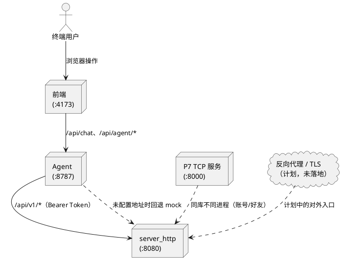
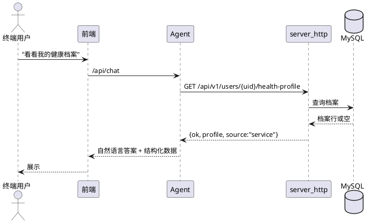
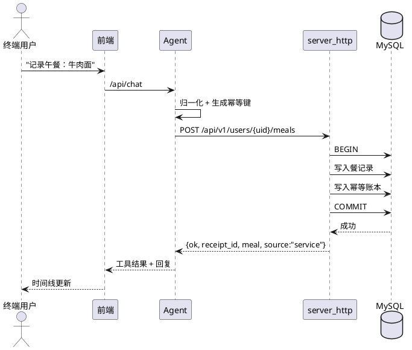
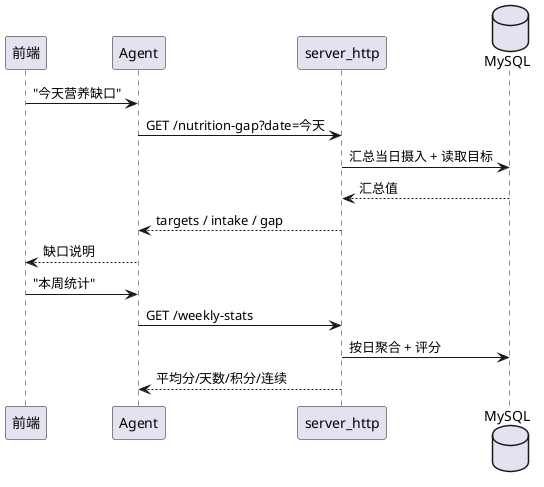
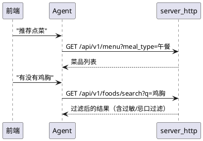
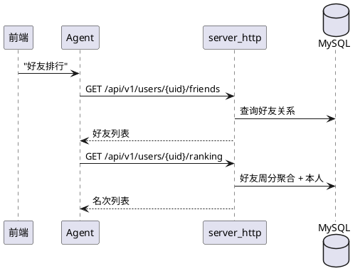
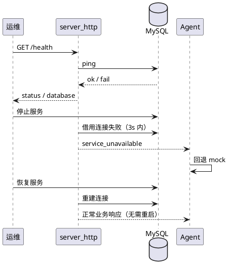
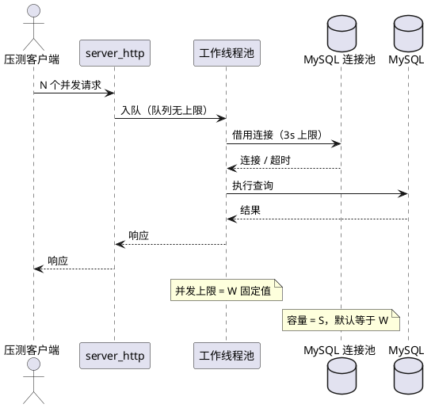
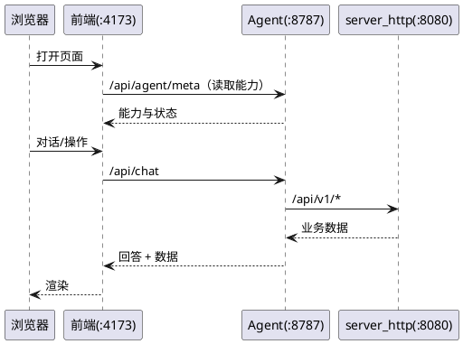
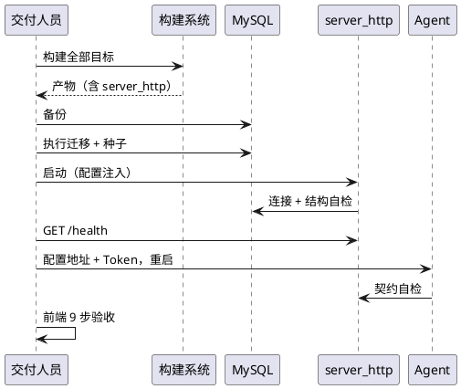

# P8 HTTP 业务后端 · 可跑通性与容量验收需求规格

> 检查对象：远程分支 `origin/feat/backend-p8`（HEAD `ab248f3`，base `b5887a2`）
> 检查基线：`origin/main`（`fc34b0f`）
> 检查方式：隔离 worktree 只读核查（未切换 main、未修改任何代码、未合并 PR）
> 声明：本文档只描述"要满足什么"与"如何证明"，不描述实现方案；实现由设计阶段负责。

---

# 1. 组件定位

## 1.1 核心职责

本组件负责受理 Agent 的饮食健康业务请求并落库，实现"前端 → Agent → C++ → MySQL"的业务闭环。

## 1.2 核心输入

1. **Agent 的 HTTP 业务请求**（来源：`agent/data/service_client.py`，共 10 个业务端点 + 1 个健康检查）。
   - 输入对象：用户标识 `user_id`、健康档案字段、餐记录载荷（餐次/文本/食材/营养值/日期）、幂等键、检索条件（关键词/餐型/条数/性质）、排行范围。
2. **运维触发**：进程启动（环境变量配置）、SIGTERM 关闭信号、健康检查探测请求。
3. **数据库返回**：查询结果集与错误码（作为内部输入，非外部契约）。

## 1.3 核心输出

1. **业务响应**（返回 Agent）：统一 JSON 信封，含 `ok`、业务数据、`source` 来源标记。
2. **错误响应**（返回 Agent）：`unauthorized`、`forbidden`、`invalid_params`、`user_not_found`、`idempotency_conflict`、`service_unavailable`、`internal_error`。
3. **健康检查响应**：服务存活状态 + 数据库可用性。
4. **数据库写入**：餐记录、幂等账本、健康档案（经服务端校验后写入）。
5. **运行日志**：请求处理、认证失败、数据库异常、池耗尽。
6. **前端侧输出**（经 Agent 转发）：对话答案、时间线、营养缺口、周统计、菜单、排行榜。

## 1.4 职责边界

**本组件不负责：**

1. **用户注册/登录/会话**——由 P7 TCP 服务（`:8000`）承担；HTTP 侧只做 Bearer Token 校验与单用户白名单。
2. **大模型推理、RAG 检索、技能市场逻辑**——由 Agent 承担。
3. **前端渲染与静态资源托管**——由根目录前端与 Agent `:8787` 承担；现有 `chatroom-backend/web` 是 P7 遗留页面，不属于 P8 交付面。
4. **聊天与群组业务**——PR 已按评审要求删除（13 条 TCP 路由保留，聊天/群组路由不可达）。
5. **跨实例会话、分库分表、缓存层**——当前无此能力，也未被本次交付声称具备。
6. **生产凭据管理与证书签发**——属运维决策，当前无落地。

---

# 2. 领域术语

**server_http**
: 监听 `:8080` 的 P8 HTTP 业务进程，构建目标名 `server_http`，与 `:8000` 的 P7 TCP 进程共用 MySQL 但各自持连接池。

**ServiceClient**
: Agent 侧唯一的 C++ 服务访问入口，位于 `agent/data/service_client.py`；未配置地址时自动回退本地 mock。

**service / mock 来源标记**
: 响应中的 `source` 字段。`service` 表示数据来自真实 C++ 服务端；`mock` 表示本地演示数据。

**p4_demo 白名单**
: 当前唯一允许的用户模式，只放行固定演示用户 `u_demo`；其他用户标识一律 `forbidden`。

**幂等键（idempotency_key）**
: 客户端为"同一次业务操作"生成的稳定标识，用于保证重试不产生重复餐记录。

**W（工作线程数）**
: httplib 服务端并发处理线程数，取 `max(8, 核数-1)`，可被 `CHATROOM_HTTP_WORKERS` 覆盖。

**S（数据库连接池容量）**
: 服务端可同时持有的 MySQL 连接数，默认等于 `W`，可被 `CHATROOM_HTTP_DB_POOL` 覆盖。

**业务降级（mock 回退）**
: 服务端不可达/超时/连接级失败时，Agent 返回本地演示数据，用户仍能看到界面，但数据非真实。

**验收门（S1–S6）**
: P8 的分阶段验收：S1 骨架与迁移、S2 档案、S3 餐记录与幂等、S4 统计与菜品、S5 端到端、S6 前端验收与交付收尾。

**阻断项（BLK）**
: 已识别但未闭环的缺陷，禁止在验收中被标记为"通过"。

---

# 3. 角色与边界

## 3.1 核心角色

1. **终端用户**：通过前端发起饮食记录、查询档案与统计、查看菜单与好友排行。
2. **Agent 运行时**：作为服务端的唯一业务调用方，负责工具编排、参数校验与降级决策。
3. **运维/交付人员**：负责构建、迁移、配置、启动、监控与回滚。

## 3.2 外部系统

1. **前端（`:4173`）**：只经 Agent `:8787` 访问业务，不直连 C++ 服务。
2. **Agent 服务（`:8787`）**：对前端提供对话/状态接口，对 C++ 发起 `/api/v1/*` 请求。
3. **P7 TCP 服务（`:8000`）**：账号与好友关系的事实来源，P8 不改动。
4. **反向代理（计划中，未落地）**：TLS 终止与对外入口，当前无配置文件。
5. **MySQL**：业务数据持久化与幂等裁决（图中不展开）。

## 3.3 交互上下文



---

# 4. DFX 约束

> 说明：以下约束全部可量化、可验证。标注"待定"的项必须在验收前补测，不得以估算值替代。

## 4.1 性能

### 4.1.1 当前代码事实基线（静态核对结论）

| 项 | 事实 | 证据 |
|---|---|---|
| 工作线程 W | `max(8, 核数-1)`，可用 `CHATROOM_HTTP_WORKERS` 覆盖；**固定值，无动态扩容** | `server/http/main_http.cc` 第 33-40、248-250 行；`httplib::ThreadPool(workers)` 的 `max_n` 缺省为 0，等于固定 `workers` |
| 等待队列 | **无上限**（`max_queued_requests` 缺省 0），任务无限入队 | `web/httplib.h` 第 10435-10455 行 |
| 监听 backlog | **5**（未显式设置，取默认宏） | `web/httplib.h` 第 184-185、12099 行 |
| 读写超时 | 默认 5s/5s（未显式设置，依赖宏默认值） | `web/httplib.h` 第 45-54 行 |
| 请求体上限 | **100MB**（未收紧） | `web/httplib.h` 第 129-130 行 |
| 数据库池 S | 默认 `= W`，可配置 | `server/http/main_http.cc` 第 203-206 行 |
| 池借用超时 | 3s 有界等待，超时返回 `service_unavailable` | `server/http/DbConn.h`、`server/database/MySQLPool.cc` |
| 压测脚本 | **不存在任何压测/基准脚本**；唯一并发用例为 30 请求 | 全仓检索 `wrk/locust/ab -n/benchmark/throughput` 零命中 |

> **与设计文档的冲突（须以代码为准）**：`docs/p8/P8-08` §1.1 与 `docs/p8/P8-04` 第 40 行称"峰值 `4W` 动态扩容、空闲回收"，但 `main_http.cc` 显式替换了任务队列并只传一个参数，实际为**固定 W**。任何基于 `4W` 的容量结论均无效。

### 4.1.2 性能需求

**REQ-PERF-01（通用）**：系统必须提供单实例在真实数据集下的 P50/P95/P99 延迟与吞吐实测值，禁止以公式推导值作为验收结论。
- 验收判据：存在可复跑脚本与结果文件，包含并发梯度（如 1/8/32/128/512 并发）、每档 QPS、P50/P95/P99、错误率、CPU/内存/连接数。
- 证据要求：压测脚本入库 + 原始输出日志 + 硬件与 MySQL 版本记录 + `SHOW VARIABLES LIKE 'max_connections'` 实测值。
- **状态：【未验证】**（P8-08 §3 自述"≈800 QPS 为理论推导、非实测"；仓内无压测数据）

**REQ-PERF-02（事件驱动）**：当在途业务请求数超过 W 时，系统必须将等待时间纳入可测口径，且必须保证等待有界或明确拒绝。
- 验收判据：并发超过 W 时，响应时间随并发增长的曲线被记录；不得出现无限排队导致的延迟无界上升或内存持续增长。
- 证据要求：并发压测曲线 + 进程 RSS 采样 + 队列长度监控。
- **状态：【阻断】**（队列无上限、无并发压测；当前行为是"无限排队"，不满足"有界"）

**REQ-PERF-03（状态驱动）**：在数据库连接池耗尽状态下，系统必须对每个请求在 5s 内返回明确错误，且不得永久阻塞工作线程。
- 验收判据：池容量设为 1、制造锁等待时，全部请求在 5s 内返回；不出现 5xx/网络异常/挂死。
- 证据要求：`tests/p8/s5_pool_exhaust_test.py` 输出；日志中出现 `service_unavailable`。
- **状态：【已验证】**（`evidence/p8-s5/10-pool-exhaust.log`：9/9 PASS，拒绝项最慢 3.01s，整体 8.03s）

**REQ-PERF-04（百万级并发口径）**：系统必须按"注册用户数 / 日活 / 峰值并发 / 峰值 QPS"四个口径分别定义容量目标与验证方法，禁止用"百万"一词笼统承诺。
- 验收判据：给出四口径的目标值、单实例实测容量、所需实例数、所需连接数与 fd 预算，并用压测验证单实例容量。
- 证据要求：容量测算书 + 压测报告 + 扩容演练记录。
- **状态：【阻断】**（当前无任何口径定义；且单实例硬约束为：W 固定、S 默认 = W、backlog = 5、队列无界）

**REQ-PERF-05（反向约束）**：若目标为百万级 QPS，系统必须具备水平扩展能力（多实例 + 负载均衡 + 连接预算），且必须验证扩展后业务一致性。
- 验收判据：N 实例部署下，业务写入仍满足幂等与唯一性；实例故障时请求可被其他实例承接。
- 证据要求：多实例部署清单 + 故障注入记录 + 幂等跨实例验证。
- **状态：【阻断】**（无 Dockerfile / systemd 单元 / nginx 配置落地文件；无多实例验证）

**容量推演口径（用于评审，不作为验收结论）**：单实例并发上限约等于 W，吞吐约等于 W ÷ 平均延迟；所需实例数约等于目标 QPS ÷ 单实例 QPS。按 8 核（W=8）与 10ms 延迟估算，单实例约 800 QPS；若目标 100 万 QPS，则需约 1200 个实例，且需同步解决 backlog=5、fd 上限与数据库连接预算。该推演必须由 REQ-PERF-01/04 的实测替换后方可对外承诺。

## 4.2 可靠性

**REQ-REL-01（状态驱动）**：在 MySQL 停止运行期间，系统必须对所有业务请求返回统一业务错误体，且不得返回 5xx 或崩溃。
- 验收判据：停库后全部请求 200 + 业务错误；健康检查明确报告数据库不可用。
- 证据要求：`tests/p8/s5_db_down_test.py`；`evidence/p8-s5/11-db-down.log`。
- **状态：【已验证】**（8/9，其中 D7"起库自愈"首轮失败，原因已定位并在后续修复）

**REQ-REL-02（状态驱动）**：在 MySQL 恢复后，系统必须在不重启进程的前提下自动重建连接并恢复业务。
- 验收判据：恢复后首个业务请求成功；连接数不超过池容量且无泄漏。
- 证据要求：`evidence/p8-s5/13-db-down-after-fix.log`（10/10，恢复耗时 0.03s）、`15-pool-selfheal.log`（22/22，12/12 补建成功，容量 4 不越界）。
- **状态：【已验证】**

**REQ-REL-03（异常驱动）**：当服务端拒绝写入（如池耗尽、幂等冲突）时，Agent 必须向用户暴露失败，禁止返回"已记录"成功文案。
- 验收判据：注入拒绝场景后，Agent 工具结果为失败，用户可见错误提示。
- 证据要求：失败注入用例 + Agent 侧断言。
- **状态：【阻断】**（`agent/tools/diet_tools.py` 的 `_record_meal` 直接返回 `ok=True`，未校验服务端 `ok`；P8-18 §6 登记为 G-9，未修复）

**REQ-REL-04（状态驱动）**：在收到 SIGTERM 时，系统必须停止接收新连接并有界地完成在途请求。
- 验收判据：慢请求 + SIGTERM 后，进程在 5s 内退出，在途请求得到响应或明确中断。
- 证据要求：关闭行为测试记录（P8-08 §8 待实测项 M-2）。
- **状态：【未验证】**（无对应测试与日志）

**REQ-REL-05（异常驱动）**：当请求体超过业务上限时，系统必须拒绝并返回明确错误，禁止将完整报文读入内存。
- 验收判据：超大请求体不导致进程内存异常增长，返回 `invalid_params` 或明确拒绝。
- 证据要求：大报文用例 + RSS 采样。
- **状态：【未验证】**（当前上限为 100MB，未收紧，无测试）

## 4.3 安全性

**REQ-SEC-01（通用）**：系统必须对每个 `/api/v1/*` 请求在进入业务逻辑前完成 Bearer Token 校验，缺失或错误必须返回 `unauthorized`，且不得执行任何数据库查询。
- 验收判据：无 Token / 错误 Token / 格式错误均被拒绝；日志可佐证无 SQL 执行。
- 证据要求：`tests/p8/p8s1_http_test.py`；`evidence/p8-s1/07-http-tests.log`（33/33）。
- **状态：【已验证】**（`server/http/Router.cc` 认证先于 Controller；`Auth.cc` 常量时间比较、fail-closed）

**REQ-SEC-02（通用）**：系统必须只允许白名单内的用户标识访问业务接口，非白名单一律 `forbidden`，且 UID 形状非法时先返回 `invalid_params`。
- 验收判据：任意非 `u_demo` 用户 → `forbidden`；含非法字符或超长 → `invalid_params`。
- 证据要求：同 REQ-SEC-01 日志中的越权与非法 UID 用例。
- **状态：【已验证】**（`Auth::allowUid` 仅放行 `u_demo`）

**REQ-SEC-03（异常驱动）**：若 Token 泄露，持有者必须不能越权操作其他用户数据；该风险不得被标记为已解决。
- 验收判据：报告必须明确标注"Token 泄露可操作 `u_demo`，属演示模式固有风险"。
- 证据要求：`P8-10` §2.1 ATK-8 判定与 `KNOWN-ISSUES` 登记。
- **状态：【阻断】**（ATK-8 永久 REPRO，任何模式不得记 PASS；且 `KNOWN-ISSUES.md` 未见对应条目）

**REQ-SEC-04（通用）**：系统必须不在日志中输出 Token、密码、授权码等敏感信息。
- 验收判据：敏感扫描零命中（排除字符表误报）。
- 证据要求：敏感扫描脚本输出 + 复核记录。
- **状态：【未验证】**（P8 交付范围内无独立敏感扫描证据；P7 时期有 `code-security` 扫描）

**REQ-SEC-05（通用）**：对外链路必须支持 TLS 终止，且明文端口不得直接暴露公网。
- 验收判据：存在可执行的反向代理/证书配置，且经外部验证 TLS 生效。
- 证据要求：代理配置 + 证书 + 外部探测记录。
- **状态：【阻断】**（仅有文档草案，无 nginx 配置文件落地）

## 4.4 可维护性

**REQ-MNT-01（通用）**：系统必须提供健康检查接口，分别报告服务存活与数据库可用性，且数据库不可用不得阻塞启动。
- 验收判据：`GET /health` 返回 `status/service/database` 三字段；停库时 `database=unavailable`。
- 证据要求：`evidence/p8-s1/07-http-tests.log`、`evidence/p8-s5/11-db-down.log`。
- **状态：【已验证】**

**REQ-MNT-02（通用）**：系统必须在启动时校验迁移是否已执行，缺表或缺列时拒绝启动（fail-closed）。
- 验收判据：未迁移库启动失败并输出明确原因，不产生任何业务写入。
- 证据要求：`evidence/p8-s1/22-schema-guard.log`。
- **状态：【已验证】**

**REQ-MNT-03（通用）**：系统必须提供可观测的请求日志与错误分类日志，足以定位 `unauthorized`、`service_unavailable` 与 SQL 异常。
- 验收判据：日志字段一致、可按错误类型检索、不含敏感信息。
- 证据要求：日志样例 + 检索命令。
- **状态：【未验证】**（有 glog 输出，但无日志规范文档与检索验证）

## 4.5 兼容性

**REQ-COMP-01（通用）**：P8 交付必须不改变 P7 TCP 服务的既有行为，13 条路由与账号/好友功能必须回归通过。
- 验收判据：P7 回归脚本全绿；TCP 进程零改动。
- 证据要求：`tests/smoke_cropped.py` 等；`evidence/p7b-*.log`、`evidence/p8-s*/0*-*regression.log`。
- **状态：【已验证】**（P7b 104/104；P8 各阶段 P7 回归 33/82/56 全绿）

**REQ-COMP-02（通用）**：三端接口契约必须版本化并与实现保持一致，含端点、字段、错误码、端口与启动方式。
- 验收判据：`AGENT.md` 接口表与实际路由逐项一致；新增/缺失接口有明确标注。
- 证据要求：契约表 + 自动比对结果。
- **状态：【未验证】**（`AGENT.md` §11.3 列 10 个端点，但未记录 `server_http` 启动方式、`:8080` 端口、健康检查与错误码；`HANDOFF.md` 第 62 行误写"指向本服务 8000"）

**REQ-COMP-03（通用）**：PR 分支必须与最新 `main` 保持可合并状态，分叉期间新增的前端功能必须在合并前完成适配验证。
- 验收判据：分支基于最新 `main` 或已完成 rebase；合并演练无冲突；新增前端功能有对应后端能力或明确降级。
- 证据要求：`git merge-base` 结果 + 合并演练日志。
- **状态：【阻断】**（PR base `b5887a2`，`origin/main` 已前进 5 个提交至 `fc34b0f`，其中包含"菜单定价分组、餐记录编辑、消费层级同步、头像与聊天 UI 精修"）

---

# 5. 核心能力

## 5.1 健康档案读写

### 5.1.1 业务规则

1. **档案读取规则**：当 Agent 请求用户健康档案时，系统必须返回完整档案对象；用户无档案时返回默认档案，而不是错误。
   a. 验收条件：`GET /api/v1/users/{uid}/health-profile` → `200` 且含 `user_id`、身高、体重、年龄、性别、目标、活动量、饮水目标、睡眠、过敏、忌口、饮食风格、BMI、备注。
   b. 证据：`evidence/p8-s2/02-http-tests.log`（82/82）、`agent_contract`（27/27）。
   c. **状态：【已验证】**
2. **档案更新规则**：当 Agent 提交部分字段时，系统必须只更新给定字段，并保持其他字段不变；更新后必须可立即读回一致值。
   a. 验收条件：`PATCH` 后 `GET` 返回值与提交值逐字段一致，BMI 随身高体重重算。
   b. 证据：`evidence/p8-s5/02-e2e.log`（"更新后重新读取生效 weight=64.5"、"BMI 随体重重算"）。
   c. **状态：【已验证】**
3. **未知用户规则**：当写入未登记用户时，系统必须返回 `user_not_found`，禁止静默创建用户。
   a. 验收条件：未知 `uid` 的 `PATCH` → `user_not_found`。
   b. 证据：`tests/p8/p8s2_http_test.py`。
   c. **状态：【已验证】**
4. **禁止项**：禁止通过 HTTP 接口创建账号、修改密码、改变用户身份绑定。
   a. 验收条件：不存在注册/改密/绑定路由；请求返回 `not_found`。

### 5.1.2 交互流程



### 5.1.3 异常场景

1. **Token 缺失/错误**
   a. 触发条件：无 `Authorization` 头或值不匹配。
   b. 系统行为：认证层直接拒绝，不进入业务层。
   c. 用户感知：`unauthorized`，Agent 侧按连接级失败处理。
2. **UID 非法**
   a. 触发条件：UID 含 `/`、空格或超过 64 字符。
   b. 系统行为：`invalid_params`，不查询数据库。
   c. 用户感知：参数错误提示。
3. **数据库不可用**
   a. 触发条件：MySQL 停止或连接池耗尽。
   b. 系统行为：3s 内返回 `service_unavailable`。
   c. 用户感知：Agent 回退 mock 数据，界面标注非真实来源（若实现）。

## 5.2 餐记录与幂等

### 5.2.1 业务规则

1. **写入规则**：当 Agent 提交餐记录时，系统必须在同一事务内写入餐记录与幂等账本，二者必须同生共死。
   a. 验收条件：写入成功后可查询到记录；失败注入后不出现孤立记录。
   b. 证据：`evidence/p8-s5/02-e2e.log`、`04-db-verify.log`（12/12）。
   c. **状态：【已验证】**
2. **幂等重放规则**：当相同用户使用相同幂等键、相同业务内容重试时，系统必须返回首次结果，且数据库中只有一条记录。
   a. 验收条件：两次请求 `receipt_id` 相同，第二次 `idempotent=true`，库中计数为 1。
   b. 证据：`agent_contract_test.py`（"replay same receipt"）、`p8s3_http_test.py`（56/56）。
   c. **状态：【已验证】**
3. **幂等冲突规则**：当相同幂等键对应不同业务内容时，系统必须拒绝并返回 `idempotency_conflict`。
   a. 验收条件：同 key 不同文本 → `idempotency_conflict`，库中不新增记录。
   b. 证据：`P8-06` §4.2.1 用例矩阵第 2 行；L2.24。
   c. **状态：【已验证】**
4. **营养值权威规则**：当幂等键与业务内容相同、但营养估算值不同时，系统必须返回首次结果，首次营养值为权威。
   a. 验收条件：同 key 同文本、不同蛋白质 → 返回首次结果，库中 1 行。
   b. 证据：L2.25。
   c. **状态：【已验证】**
5. **不同操作规则**：当幂等键不同时，即使内容相同也必须记为两条独立记录。
   a. 验收条件：两次不同 key 的相同载荷 → 2 条记录。
   b. 证据：L2.26。
   c. **状态：【已验证】**
6. **默认值规则**：当日期为空时，系统必须按服务端本地时区补为当天；文本为空时必须由食材列表拼接。
   a. 验收条件：空 `date` 写入后 `meal.date` 等于当天。
   b. 证据：`agent_contract_test.py`（"empty date defaults today"）。
   c. **状态：【已验证】**
7. **禁止项**：禁止在没有幂等键的情况下写入餐记录。
   a. 验收条件：缺 `idempotency_key` → `invalid_params`。
   b. 证据：`MealService` 校验分支；`p8s3_http_test.py`。
   c. **状态：【已验证】**
8. **删改能力规则**：当用户需要编辑或删除餐记录时，系统必须提供对应能力，或明确声明该能力不在本次交付范围。
   a. 验收条件：存在 `PATCH`/`DELETE` 餐记录端点，或交付说明中明确"未实现"并给出降级方案。
   b. 证据：路由清单。
   c. **状态：【阻断】**（仅有 `POST`/`GET` 餐记录；P8-18 §6 登记 BLK-2）

### 5.2.2 交互流程



### 5.2.3 异常场景

1. **同键并发重试**
   a. 触发条件：两个请求同时使用同一幂等键。
   b. 系统行为：唯一性裁决串行化，后到者回滚自身写入并返回首次结果。
   c. 用户感知：两次均显示成功，实际只有一条记录。
2. **客户端超时但服务端已提交**
   a. 触发条件：Agent 5s 超时断开，事务仍在执行。
   b. 系统行为：不提供语句取消能力；事务按原逻辑提交或回滚。
   c. 用户感知：Agent 回退 mock，用户看到演示数据；重试不会重复写入。
3. **服务端拒绝但 Agent 未校验**
   a. 触发条件：池耗尽或幂等冲突。
   b. 系统行为：服务端返回明确错误体。
   c. 用户感知：**当前仍显示"已记录"成功文案**（G-9，阻断项）。

## 5.3 营养缺口与周统计

### 5.3.1 业务规则

1. **缺口计算规则**：当请求某日营养缺口时，系统必须返回目标值、摄入值与缺口，且缺口必须等于 `max(0, 目标 − 摄入)`。
   a. 验收条件：四项指标均满足等式；无记录时摄入全 0。
   b. 证据：`agent_contract_test.py`（"arithmetic consistent"）、`evidence/p8-s5/04-db-verify.log`。
   c. **状态：【已验证】**
2. **统计口径规则**：当请求周统计时，系统必须返回平均健康分、记录天数、三餐齐全天数、积分、连续天数，且与数据库独立复算一致。
   a. 验收条件：测试脚本独立复算结果与接口输出逐值相等。
   b. 证据：`verify_s5_db.py`（12/12 PASS，今日健康分 90）。
   c. **状态：【已验证】**
3. **跨日期规则**：当写入昨日记录时，该记录必须不计入今日营养缺口，且周统计中昨日餐数 +1、今日餐数不变。
   a. 验收条件：跨日期用例 T1 全部通过。
   b. 证据：`evidence/p8-s5/02-e2e.log`。
   c. **状态：【已验证】**

### 5.3.2 交互流程



### 5.3.3 异常场景

1. **无记录**：返回摄入全 0、缺口等于目标，不返回错误。
2. **档案缺目标值**：使用默认目标，不得返回空对象。
3. **跨时区**：日期必须按服务端本地时区解释，禁止 UTC 换算导致跨日错位。

## 5.4 菜品与菜单

### 5.4.1 业务规则

1. **菜单规则**：当请求菜单时，系统必须返回 16 道种子菜品，并支持按餐型过滤。
   a. 验收条件：无过滤时数量为 16；按餐型过滤时结果均属于该餐型。
   b. 证据：`evidence/p8-s4/02-http-tests.log`（20/20）、`p8s5/12-s4-http.log`。
   c. **状态：【已验证】**
2. **搜索规则**：当请求搜索时，系统必须按关键词分词匹配并过滤用户过敏与忌口项。
   a. 验收条件：档案设"花生"后，描述含花生的菜品不出现；命中数高的结果排前。
   b. 证据：L2.52/L2.53。
   c. **状态：【已验证】**
3. **只读规则**：菜品目录必须为只读，禁止通过业务接口新增/修改菜品。
   a. 验收条件：不存在菜品写入路由。

### 5.4.2 交互流程



### 5.4.3 异常场景

1. **空关键词**：返回默认推荐列表，不返回错误。
2. **无匹配**：返回空列表且 `count=0`，不返回 404。
3. **档案缺失**：按空过敏/忌口集合处理。

## 5.5 好友与排行榜

### 5.5.1 业务规则

1. **好友列表规则**：系统必须只返回与目标用户存在正常好友关系的用户，拉黑与待处理关系不得出现。
   a. 验收条件：双向拉黑、单向申请均不在列表。
   b. 证据：`p8s4_http_test.py`（17/17）、L2.42。
   c. **状态：【已验证】**
2. **排行规则**：排行榜必须包含本人，且只能包含好友；排序与名次必须连续。
   a. 验收条件：本人分数与周统计一致；非好友不出现在榜单。
   b. 证据：`evidence/p8-s5/02-e2e.log`（"排行榜自己分数与周统计今日分一致"）。
   c. **状态：【已验证】**
3. **禁止项**：禁止跨用户读取他人档案或餐记录。

### 5.5.2 交互流程



### 5.5.3 异常场景

1. **无好友**：返回只含本人的榜单。
2. **好友关系异常（拉黑/删除）**：自动排除，不报错。
3. **被查询用户不存在**：`user_not_found`。

## 5.6 健康检查、降级与自愈

### 5.6.1 业务规则

1. **健康检查规则**：`/health` 必须同时报告服务与数据库状态，且不得要求 Token。
   a. 验收条件：正常时 `database=ok`；停库时 `database=unavailable` 且服务仍在监听。
   b. 证据：`evidence/p8-s1/07-http-tests.log`、`p8-s5/11-db-down.log`。
   c. **状态：【已验证】**
2. **迁移守卫规则**：启动时必须校验目标表与关键列存在；缺失时拒绝启动。
   a. 验收条件：未迁移库启动 FATAL，且不产生写入。
   b. 证据：`evidence/p8-s1/22-schema-guard.log`。
   c. **状态：【已验证】**
3. **池自愈规则**：连接失效时必须丢弃并重建，且重建数量不得超过容量。
   a. 验收条件：停库并发后恢复，补建 12/12 成功，连接数 ≤ 4。
   b. 证据：`evidence/p8-s5/15-pool-selfheal.log`（22/22）。
   c. **状态：【已验证】**
4. **降级透明规则**：当服务端不可达时，Agent 必须标记 `source:"mock"`，前端必须能让用户识别数据来源。
   a. 验收条件：断开服务端后，响应 `source=mock`，界面存在可识别标注。
   b. 证据：`evidence/p8-s4/13-mock-fallback-scan.log` + 前端验收记录。
   c. **状态：【部分验证】**（后端/Agent 标记已验证；前端展示未验收）

### 5.6.2 交互流程



### 5.6.3 异常场景

1. **启动时数据库不可用**：进程必须启动失败并输出明确原因（fail-closed），不得带病运行。
2. **运行中数据库闪断**：请求在 3s 内失败，恢复后自动可用。
3. **连接泄漏**：恢复后连接数不得超过容量上限。

## 5.7 并发与容量治理

### 5.7.1 业务规则

1. **并发度声明规则**：交付必须声明单实例可承受的并发请求数、对应硬件与数据库配置，且必须有实测支撑。
   a. 验收条件：声明值与压测报告一致。
   b. 证据：压测报告（当前缺失）。
   c. **状态：【阻断】**
2. **过载保护规则**：当并发超过单实例容量时，系统必须限流或快速失败，禁止无限排队。
   a. 验收条件：超过容量后错误率上升但延迟有界，内存稳定。
   b. 证据：过载压测曲线 + RSS 采样。
   c. **状态：【未验证】**（队列无上限，无过载测试）
3. **连接预算规则**：部署前必须实测 MySQL `max_connections`，并按"TCP 池 + HTTP 池 + 运维预留"计算，禁止使用固定上限结论。
   a. 验收条件：部署检查单包含实测值与计算过程。
   b. 证据：`P8-17` §3 检查单 + 实测输出。
   c. **状态：【未验证】**（检查单存在，无执行记录）
4. **禁止项**：禁止在任何材料中把理论推导的 QPS 表述为"已验证"或"可支撑百万并发"。
   a. 验收条件：全文检索"已验证 QPS/百万并发"零命中。
   b. 证据：文档检索结果。

### 5.7.2 交互流程



### 5.7.3 异常场景

1. **并发远超 W**：请求排队，延迟随并发线性增长；内存随队列增长（未验证）。
2. **连接池耗尽**：等待 3s 后 `service_unavailable`，不挂死（已验证）。
3. **线程创建失败**（如 W 配置过大）：进程启动异常，未捕获异常将终止进程（未验证）。

## 5.8 三端适配与分发

### 5.8.1 业务规则

1. **Agent 适配规则**：Agent 必须通过统一配置项指向服务端，未配置时回退 mock，且所有业务工具必须显式返回来源标记。
   a. 验收条件：配置后 `mode=="service"`；10 个方法均可调用；`source` 字段正确。
   b. 证据：`agent/config.py`、`agent/data/service_client.py`、`agent_contract_test.py`（27/27、29/29、17/17）。
   c. **状态：【已验证】**
2. **前端路由规则**：前端必须只经 Agent `:8787` 访问业务，禁止直连 C++ `:8080`。
   a. 验收条件：前端所有业务请求的地址均为 Agent 地址；`agent-adapter.js` 默认 `127.0.0.1:8787`。
   b. 证据：`agent-adapter.js` 第 2 行、`AGENT.md` §7.1、`P8-01` §调用链。
   c. **状态：【已验证（静态）】**
3. **前端业务验收规则**：必须在真实浏览器中完成 9 步手动清单（档案、记录、去重、缺口、周统计、菜单、排行、服务模式、断服降级）。
   a. 验收条件：9 项逐项签字，含截图或录屏。
   b. 证据：S6 验收记录。
   c. **状态：【阻断】**（无 `evidence/p8-s6`，S6 未执行）
4. **契约文档规则**：新增或缺失的服务端接口、端口、错误码必须写入 `AGENT.md`。
   a. 验收条件：`AGENT.md` 含 P8 服务启动方式、`:8080`、`/health`、错误码表、餐记录删改缺口说明。
   b. 证据：文档 diff。
   c. **状态：【阻断】**（`AGENT.md` §11.3 仅列端点，未记录启动/端口/错误码；`HANDOFF.md` 第 62 行误写端口 8000）
5. **分发规则**：三端必须各自具备可复现的构建与启动方式，且版本与配置模板一致。
   a. 验收条件：服务端构建产物、配置模板、迁移/回滚脚本、进程管理单元均可获取并执行；Agent 依赖锁定；前端静态产物可部署。
   b. 证据：构建日志、部署清单、启动验证记录。
   c. **状态：【阻断】**（无 Dockerfile、无 systemd 单元文件、无 nginx 配置；`env.example.draft` 未合并入仓库根；`DELIVERY.md` 仍为 P7 版本）

### 5.8.2 交互流程



### 5.8.3 异常场景

1. **未配置服务端地址**：全部工具走 mock，界面需可识别。
2. **配置了地址但 Token 不一致**：全部请求 `unauthorized`，Agent 回退 mock；必须能从日志定位。
3. **服务端重启窗口**：请求失败后回退 mock，恢复后自动回到 service 模式。

## 5.9 交付与部署收尾

### 5.9.1 业务规则

1. **文档收尾规则**：P8 交付必须更新 `README`、`HANDOFF`、`KNOWN-ISSUES`、`DELIVERY`、`TEST-REPORT`，至少包含架构位置、启动方式、验收结论、已知缺陷。
   a. 验收条件：上述文档存在 P8 章节且结论与 evidence 一致。
   b. 证据：文档 diff。
   c. **状态：【阻断】**（检索零命中；`DELIVERY.md` 仍描述 P7/PR #1）
2. **迁移与回滚规则**：迁移必须幂等、可回滚，且回滚只删除本次新增对象。
   a. 验收条件：重复执行不报错；回滚后目标表消失且旧表零改动。
   b. 证据：`evidence/p8-s1/01-14*.log`、迁移脚本 `run_migration.sh`。
   c. **状态：【已验证（测试库）】**
3. **证据归档规则**：每个验收阶段必须有原始日志，失败现场必须保留。
   a. 验收条件：S1–S5 均有日志，命名规范，含失败首跑记录。
   b. 证据：`evidence/p8-s1..s5`。
   c. **状态：【已验证】**（S6 缺失）
4. **合并前检查规则**：PR 合并前必须完成与最新 `main` 的合并演练，且三端适配结论可复核。
   a. 验收条件：合并演练无冲突；新增前端功能有对应后端能力或明确降级。
   b. 证据：演练日志。
   c. **状态：【阻断】**（分叉 5 个提交，未演练）

### 5.9.2 交互流程



### 5.9.3 异常场景

1. **迁移未执行**：服务拒绝启动（已验证）。
2. **配置缺失 Token**：服务拒绝启动（已验证）。
3. **端口被占用**：启动失败并退出（已验证）。
4. **回滚中途失败**：必须保留备份与回滚日志，人工介入（未验证）。

---

# 6. 数据约束

> 本章只描述业务约束，不涉及表结构、字段类型、索引设计。

## 6.1 用户映射

1. **user_id**：必须在白名单内（当前仅 `u_demo`），长度 1–64，仅允许字母、数字、下划线、连字符。
2. **身份绑定**：HTTP 侧用户标识必须能映射到既有账号体系；当前通过演示白名单实现，未实现通用映射。

## 6.2 健康档案

1. **user_id**：必填，必须已存在。
2. **身高/体重**：正数，单位分别为厘米/千克；BMI 必须由二者重算，不接受外部传入值作为权威。
3. **年龄**：非负整数。
4. **性别/目标/活动量/饮食风格**：必须属于预定义枚举值。
5. **饮水目标**：正整数，单位毫升；前端字段 `waterTarget` 与内部 `water_target` 必须等价。
6. **睡眠**：数值小时；前端字段与内部字段必须可互相转换。
7. **过敏/忌口**：字符串集合，必须参与菜品搜索过滤。
8. **部分更新语义**：未提交字段保持不变。

## 6.3 餐记录

1. **幂等键**：必填，长度 1–64，仅允许字母、数字、下划线、点、冒号、连字符。
2. **业务身份**：由"日期 + 餐次 + 文本"共同决定；相同业务身份 + 相同幂等键视为同一次操作。
3. **日期**：为空时补当天；必须按服务端本地时区解释。
4. **餐次**：必须属于早餐/午餐/晚餐/加餐。
5. **文本**：最长 512 字符，超长必须截断并记录。
6. **食材列表**：序列化后最长 1024 字符；为空时必须由文本回填。
7. **营养值**：蛋白质/纤维/蔬菜/饮水均必须为非负数值，单位分别为克/克/克/毫升。
8. **收据号**：同一次业务操作的所有重试必须返回相同收据号。

## 6.4 幂等账本

1. **唯一性**：同一用户 + 同一幂等键在全生命周期内只能对应一条餐记录。
2. **一致性**：账本记录必须指向存在的餐记录；餐记录与账本必须在同一事务内提交。
3. **冲突语义**：同键不同内容必须拒绝，不得覆盖首次结果。
4. **跨重启有效**：重启后幂等裁决仍必须成立。

## 6.5 菜品目录

1. **名称**：必须唯一。
2. **餐型**：必须为非空集合，取值属早餐/午餐/晚餐/加餐。
3. **性质**：仅允许"推荐"或"放纵"。
4. **可用状态**：不可用菜品不得出现在菜单与搜索结果中。
5. **营养字段**：热量/蛋白质/纤维/蔬菜/饮水均为非负数。
6. **只读性**：业务接口不得修改菜品目录。

---

# 附录 A · 验收状态矩阵

## A.1 已验证事实（有代码或原始日志支撑）

| 项 | 证据 | 结论 |
|---|---|---|
| 10 个业务接口 + 健康检查契约 | `evidence/p8-s1/07-http-tests.log`（33/33）、`s2`（82/82） | 通过 |
| 餐记录幂等（重放/冲突/并发） | `s3/02-http-tests.log`（56/56）、`s5/02-e2e.log`（41/41） | 通过 |
| 营养缺口/周统计与数据库复算 | `s5/04-db-verify.log`（12/12，健康分 90） | 通过 |
| 异常与越权（38 项） | `s5/03-exception.log`（38/38） | 通过 |
| 重启持久性 | `s5/05-restart-write.log`（3/3）、`07-restart-verify.log`（7/7） | 通过 |
| 连接池耗尽限时兜底 | `s5/10-pool-exhaust.log`（9/9，最慢 3.01s） | 通过 |
| 数据库停机与自愈 | `s5/13-db-down-after-fix.log`（10/10，恢复 0.03s）、`15-pool-selfheal.log`（22/22） | 通过 |
| Agent 真实契约（禁用 mock） | `agent_contract_test.py`（27/27）、`agent_s3`（29/29）、`agent_s4`（17/17） | 通过 |
| P7 回归 | `p8-s2/04`（33/33）、`p8-s3/04`（82/82）、`p8-s4/08`（56/56） | 通过 |
| 构建 | `evidence/p8-s1/21-all-targets-build.log`（`Built target server_http`） | 通过 |
| 迁移幂等与守卫 | `s1/01-14*.log`、`22-schema-guard.log` | 通过 |
| 30 并发样本 | `s5/09-pool-test.log`（30/30，wall 0.12s，median 0.04s，worst 0.09s） | 通过（样本量不足） |

## A.2 未验证项（无证据或无法在本机复核）

| 项 | 原因 | 需要的证据 |
|---|---|---|
| 性能实测（QPS/P50/P99/过载曲线） | 全仓无压测脚本，`P8-08` 自述 QPS 为理论推导 | 压测脚本 + 原始输出 + 硬件/DB 配置 |
| 前端 9 步业务验收（S6） | 无 `evidence/p8-s6`，S6 未执行 | 浏览器录屏/截图 + 签字清单 |
| 本机复跑全部流程 | 当前环境为 Windows，测试依赖 WSL2/Linux + root MySQL socket + `/home/m/eat-p8-s1` 路径 | 按附录 C 在 Linux/WSL 复跑 |
| 优雅关闭（M-2） | 无对应测试 | SIGTERM + 慢请求观测日志 |
| 大报文/慢速攻击防护 | 请求体上限 100MB、无测试 | 攻击用例 + RSS 采样 |
| 敏感信息扫描 | P8 交付内无独立扫描 | 扫描脚本输出 |
| 生产迁移/回滚 | 仅在测试库执行 | 生产演练记录 |
| 多实例水平扩展 | 无部署文件、无演练 | N 实例 + 反代 + 故障注入 |
| 连接预算实测 | 检查单存在但无执行 | `SHOW VARIABLES` + 连接数采样 |
| Token 保管与轮换 | 责任方未定 | 决策记录 |

## A.3 阻断项（必须闭环后才能宣称"可交付/可承载"）

| 编号 | 阻断项 | 影响 | 证据位置 |
|---|---|---|---|
| BLK-A | **单用户白名单**：只允许 `u_demo` | "百万用户"无业务基础；多用户必须新增身份映射 | `Auth::allowUid` |
| BLK-B | **餐记录删改缺失**：仅 `POST`/`GET` | 最新 main 已加入"餐记录编辑"功能，合并后功能不闭环 | `main_http.cc` 路由、`P8-18` §6 BLK-2 |
| BLK-C | **Concurrency 无实测**：固定 W、队列无上限、backlog=5、无压测 | 无法证明任何并发目标，更无法证明百万级 | 代码事实 + 压测缺失 |
| BLK-D | **文档与代码冲突**：`P8-08`/`P8-04` 宣称动态 4W，实际固定 W | 容量结论失真 4 倍 | `main_http.cc` vs `P8-08` §1.1 |
| BLK-E | **G-9 未修复**：Agent 不校验服务端 `ok` | 写入失败时用户看到"已记录"，数据丢失且无感知 | `diet_tools.py` `_record_meal` |
| BLK-F | **ATK-8**：Token 泄露可操作 `u_demo` | 安全红线，未登记 KNOWN-ISSUES | `P8-10` §2.1 |
| BLK-G | **S6 未执行**：前端验收与文档收尾缺失 | 交付声明不完整，README/HANDOFF/KNOWN-ISSUES 无 P8 | 无 `evidence/p8-s6` |
| BLK-H | **部署未落地**：无容器/进程管理/反代文件，配置模板未合并 | 无法"分发"到任何环境 | 仓内检索零命中 |
| BLK-I | **PR 分叉**：base 落后 main 5 个提交（含前端新功能） | 合并冲突风险；三端适配结论需重验 | `git log b5887a2..origin/main` |
| BLK-J | **HANDOFF 端口错误**：写成"指向本服务 8000" | 接入方会连错端口 | `HANDOFF.md` 第 62 行 |

---

# 附录 B · 检查方法与范围

1. **同步与比对**：`git fetch --all`；`git merge-base origin/main origin/feat/backend-p8` = `b5887a2`；`git log --oneline b5887a2..origin/main` = 5 个提交；PR 侧 1 个提交 `ab248f3`。
2. **隔离核查**：`git worktree add ../p8-verify --detach origin/feat/backend-p8`，只读检查，未改动 main 与工作树。
3. **变更规模**：311 文件、+42186 行，全部位于 `chatroom-backend/`。
4. **代码核对点**：`main_http.cc`（线程池、端口、超时、路由）、`MySQLPool.cc/h`（借用/归还/自愈）、`Router.cc`/`Auth.cc`（认证与白名单）、`DbConn.h`（3s 限时）、`diet_tools.py`（ok 校验）、`service_client.py`（9 方法 + 状态）、`agent-adapter.js`（8787）。
5. **文档核对点**：`docs/p8/P8-01..P8-19`、`DELIVERY/TEST-REPORT/BUILD-REPORT/HANDOFF/KNOWN-ISSUES/README/CHANGELOG`、`AGENT.md`。
6. **证据核对点**：`evidence/p8-s1`（23 份）、`p8-s2`（5 份）、`p8-s3`（12 份）、`p8-s4`（18 份）、`p8-s5`（26 份）。
7. **未做的事**：未修改任何代码；未合并 PR；未编译（Windows 环境无 mysqlclient/Linux 工具链）；未启动服务；未连接数据库。

---

# 附录 C · 复跑指南（验收前置）

环境前提：Linux 或 WSL2、MySQL 本地实例、Python 3、可用的 `mysqlclient` 开发库与 `glog`。

```bash
# 1. 构建
cd chatroom-backend
cmake -S . -B build && cmake --build build -j

# 2. 迁移（测试库 chatroom_p8）
mysql -uroot chatroom_p8 < server/http/migrations/001_p8_business.sql
mysql -uroot chatroom_p8 < server/http/migrations/foods_seed.sql

# 3. 启动
CHATROOM_HTTP_TOKEN=local-test-token \
CHATROOM_HTTP_PORT=18080 \
CHATROOM_MYSQL_DB=chatroom_p8 \
CHATROOM_MYSQL_HOST=/run/mysqld/mysqld.sock \
./build/bin/server_http

# 4. 分阶段验收
cd tests/p8
P8_WORK_ROOT=<仓库根> P8_BACKEND_DIR=<chatroom-backend 路径> bash full_regress.sh
python3 s5_e2e_test.py
python3 s5_exception_test.py
python3 s5_pool_test.py          # 需以 CHATROOM_HTTP_DB_POOL=1 启动独立实例
python3 s5_pool_exhaust_test.py
python3 s5_pool_selfheal_test.py # 需 POOL=4、端口 18082
python3 s5_db_down_test.py       # 需 systemd 与 root 权限
```

注意：
- 脚本默认 `P8_WORK_ROOT=/home/m/eat-p8-s1`，必须覆盖为本机仓库根。
- `s5_pool_selfheal_test.py` 与 `s5_db_down_test.py` 会启停本机 MySQL，只应在隔离环境执行。
- 上述脚本**不含任何性能压测**，REQ-PERF-01 需另行补充。